# PR #36 — single-page backend booking review

[Draft PR #36](https://github.com/MonkeyDo-Site/MonkeyDoWebsiteNewCode/pull/36) · [Scope and agreed behavior](../../SINGLE_PAGE_STAFF_BOOKING.md)

Please refer to the screen number when commenting. This gallery has **10 screens**, each at **desktop 1440px** and **phone 390px**. All changes stay in the same draft PR until owner review is complete.

Current waivers are shown as a read-only list, with one explicit choice: everyone is covered, or include the waiver link in the confirmation email. Screen 10 shows the email-link option. There are no per-waiver selection checkboxes. Customer search, session/date, visible child/total/supervised capacity, supervised play, attendee/sock counts, expected payment method, owner capacity override and closing the whole session remain available. The estimate, custom admissions/complimentary controls, waiver details, secure card details and one final Confirm booking action are on the same page.

**Backend reservation timing:** valid customer/session/count selections reserve places for 30 minutes. Changes to those selections update that reservation. Waiver/payment edits, polling and leaving the tab open do not extend it. Expired places become available automatically. The owner can explicitly reserve them again, subject to capacity. Confirmation replaces the temporary reservation with a permanent booking; ordinary admission is collected at arrival. **The public customer flow is unchanged**: its existing 20-minute form timeout and reservation at successful confirmation remain.

**Review fixtures:** customer details, signatures and card fields are fictional. Hosted card fields and provider outcomes are simulated. These images do not establish the actual Banquest iframe layout or auto-advance behavior; that provider check remains deferred. No external payment, email or storage provider was contacted.

## Screen index

| Screen | State | Desktop | Phone |
|---|---|---|---|
| **01** | All booking controls, read-only current waivers and one confirmation button | [Desktop](STAFF-v2-01-standard-1440.png) | [Phone](STAFF-v2-01-standard-390.png) |
| **02** | Custom admissions price beneath the estimate; socks remain separate | [Desktop](STAFF-v2-02-custom-price-1440.png) | [Phone](STAFF-v2-02-custom-price-390.png) |
| **03** | Fully complimentary booking; no card or payment required | [Desktop](STAFF-v2-03-complimentary-1440.png) | [Phone](STAFF-v2-03-complimentary-390.png) |
| **04** | Record a named signed paper waiver on the booking page | [Desktop](STAFF-v2-04-paper-waiver-1440.png) | [Phone](STAFF-v2-04-paper-waiver-390.png) |
| **05** | Sign an electronic waiver without navigating away from the booking | [Desktop](STAFF-v2-05-electronic-waiver-1440.png) | [Phone](STAFF-v2-05-electronic-waiver-390.png) |
| **06** | Owner capacity reminder; previous reservation and entered counts retained | [Desktop](STAFF-v2-06-capacity-warning-1440.png) | [Phone](STAFF-v2-06-capacity-warning-390.png) |
| **07** | Card-entry error preserves the booking details and reserved places | [Desktop](STAFF-v2-07-card-error-1440.png) | [Phone](STAFF-v2-07-card-error-390.png) |
| **08** | Expired backend reservation with explicit renewal; entries preserved | [Desktop](STAFF-v2-08-expired-reservation-1440.png) | [Phone](STAFF-v2-08-expired-reservation-390.png) |
| **09** | Single final action opens the confirmed booking; admission remains due at arrival | [Desktop](STAFF-v2-09-confirmed-1440.png) | [Phone](STAFF-v2-09-confirmed-390.png) |
| **10** | Explicit option to include the waiver link in the confirmation email | [Desktop](STAFF-v2-10-waiver-link-email-1440.png) | [Phone](STAFF-v2-10-waiver-link-email-390.png) |

## 01 — All booking controls, read-only current waivers and one confirmation button

[Open desktop image](STAFF-v2-01-standard-1440.png) · [Open phone image](STAFF-v2-01-standard-390.png)

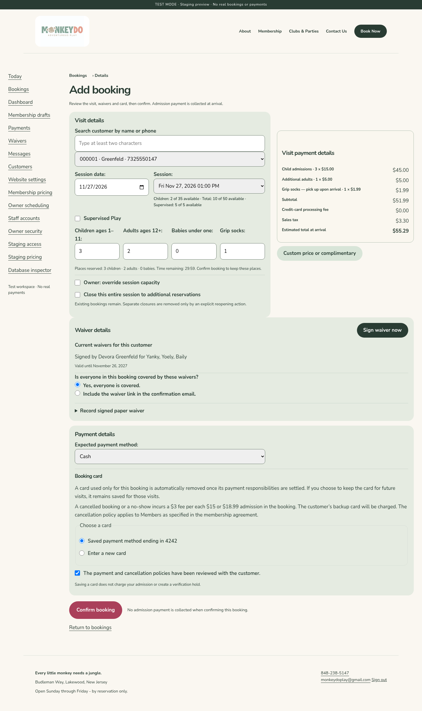

Phone image

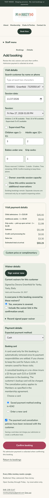

## 02 — Custom admissions price beneath the estimate; socks remain separate

[Open desktop image](STAFF-v2-02-custom-price-1440.png) · [Open phone image](STAFF-v2-02-custom-price-390.png)

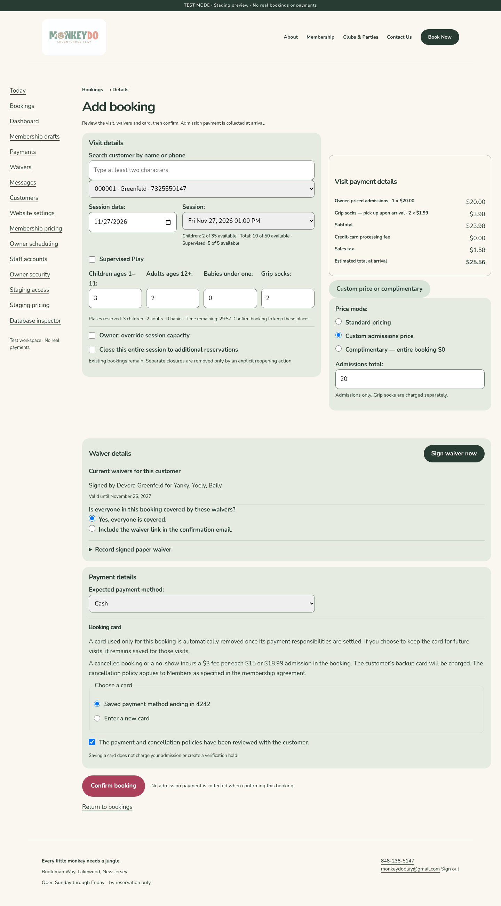

Phone image

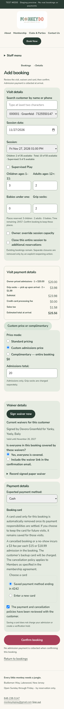

## 03 — Fully complimentary booking; no card or payment required

[Open desktop image](STAFF-v2-03-complimentary-1440.png) · [Open phone image](STAFF-v2-03-complimentary-390.png)

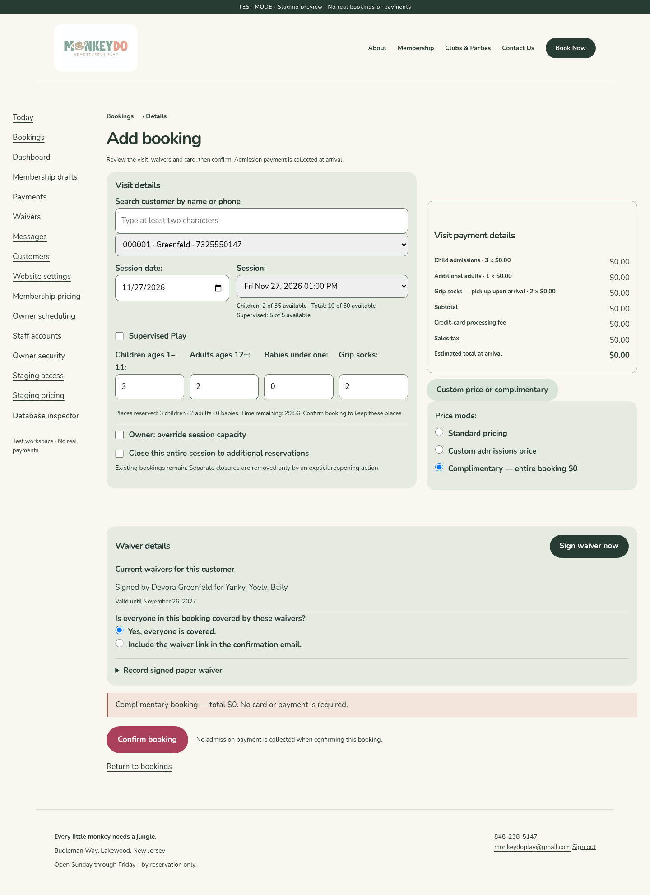

Phone image

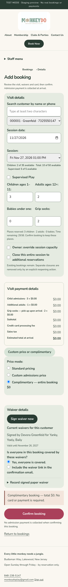

## 04 — Record a named signed paper waiver on the booking page

[Open desktop image](STAFF-v2-04-paper-waiver-1440.png) · [Open phone image](STAFF-v2-04-paper-waiver-390.png)

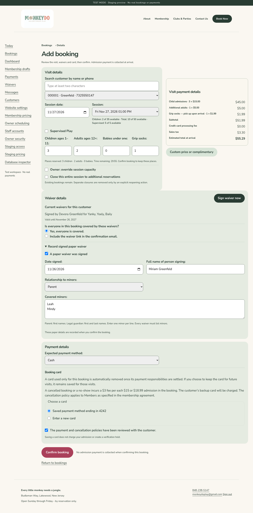

Phone image

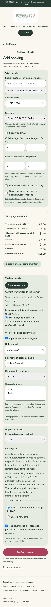

## 05 — Sign an electronic waiver without navigating away from the booking

[Open desktop image](STAFF-v2-05-electronic-waiver-1440.png) · [Open phone image](STAFF-v2-05-electronic-waiver-390.png)

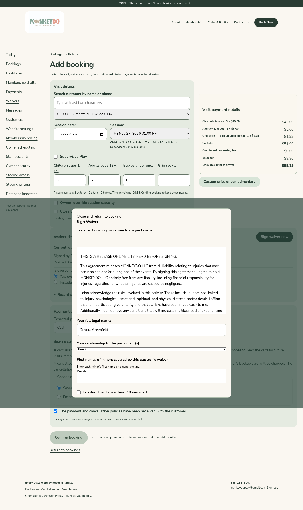

Phone image

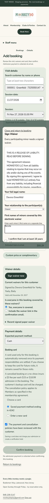

## 06 — Owner capacity reminder; previous reservation and entered counts retained

[Open desktop image](STAFF-v2-06-capacity-warning-1440.png) · [Open phone image](STAFF-v2-06-capacity-warning-390.png)

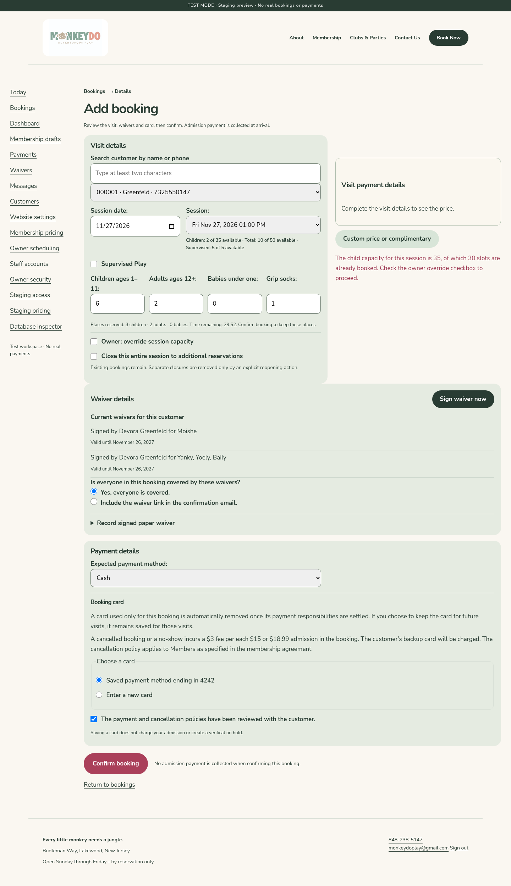

Phone image

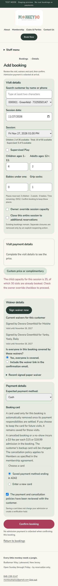

## 07 — Card-entry error preserves the booking details and reserved places

[Open desktop image](STAFF-v2-07-card-error-1440.png) · [Open phone image](STAFF-v2-07-card-error-390.png)

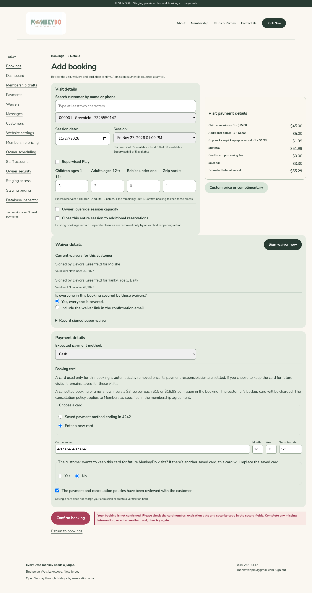

Phone image

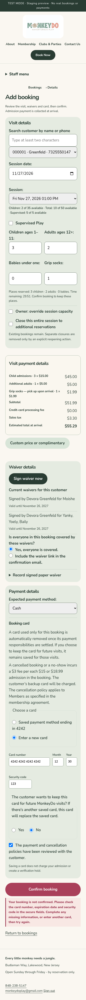

## 08 — Expired backend reservation with explicit renewal; entries preserved

[Open desktop image](STAFF-v2-08-expired-reservation-1440.png) · [Open phone image](STAFF-v2-08-expired-reservation-390.png)

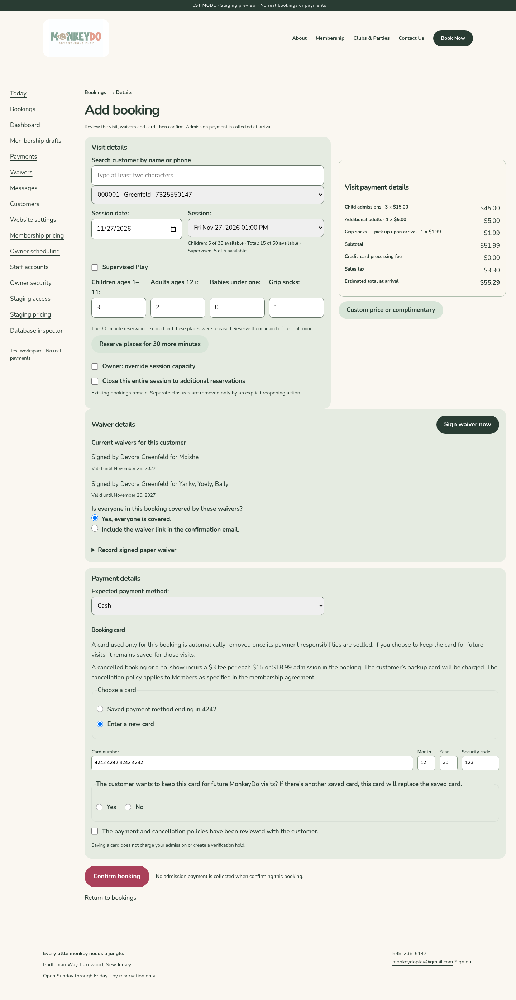

Phone image

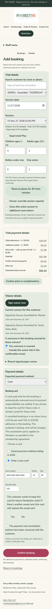

## 09 — Single final action opens the confirmed booking; admission remains due at arrival

[Open desktop image](STAFF-v2-09-confirmed-1440.png) · [Open phone image](STAFF-v2-09-confirmed-390.png)

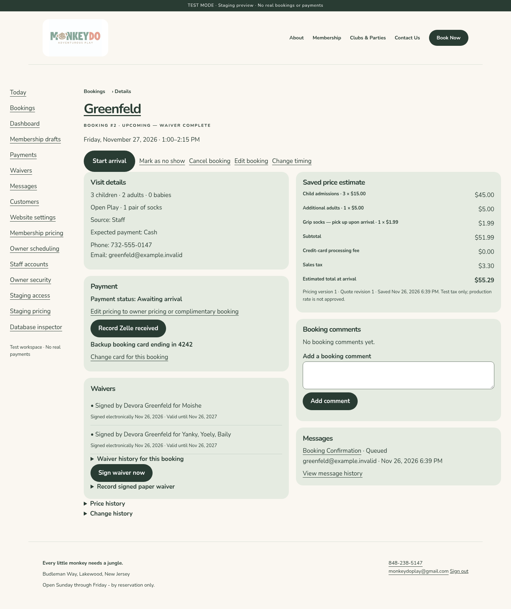

Phone image

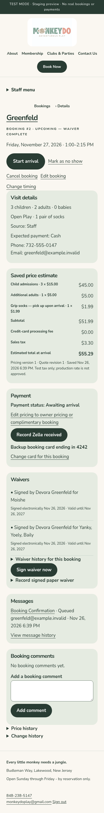

## 10 — Explicit option to include the waiver link in the confirmation email

[Open desktop image](STAFF-v2-10-waiver-link-email-1440.png) · [Open phone image](STAFF-v2-10-waiver-link-email-390.png)

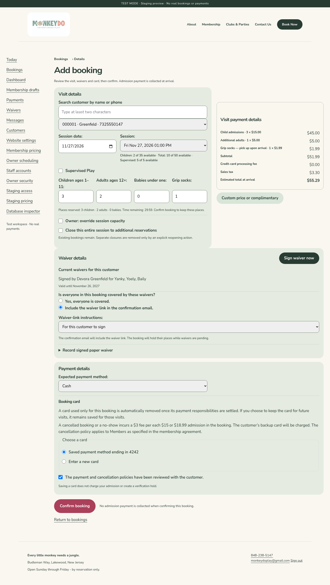

Phone image

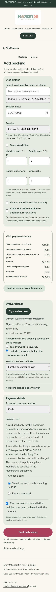

