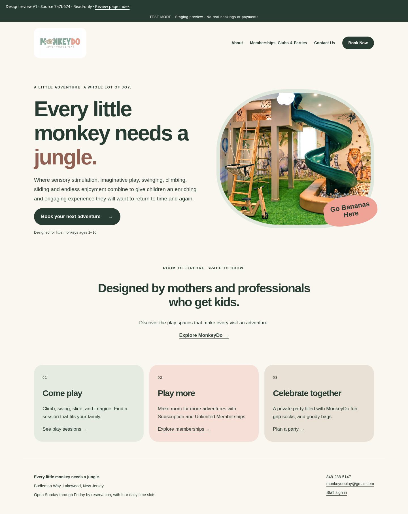

# MonkeyDo — Design review V1

**Start your design review here.** This version stays fixed while backend development continues separately.

Source: `7a7b674` (merged PR #15). Sample date: November 8, 2026, New York. All customer records are artificial.

Choose **Computer** or **Phone** beside a page below. Click an image to enlarge it. These are actual rendered layouts, captured at 1440px and 390px widths.

| Page / screen | Computer | Phone |
| --- | --- | --- |
| Home | [View](01-home-desktop.jpg) | [View](01-home-phone.jpg) |
| About | [View](02-about-desktop.jpg) | [View](02-about-phone.jpg) |
| Memberships, Clubs & Parties | [View](03-programs-desktop.jpg) | [View](03-programs-phone.jpg) |
| Book Now — schedule preview | [View](04-book-desktop.jpg) | [View](04-book-phone.jpg) |
| Contact Us | [View](05-contact-desktop.jpg) | [View](05-contact-phone.jpg) |
| Staff Today | [View](06-today-desktop.jpg) | [View](06-today-phone.jpg) |
| Customer list | [View](07-customers-desktop.jpg) | [View](07-customers-phone.jpg) |
| Customer detail | [View](08-customer-desktop.jpg) | [View](08-customer-phone.jpg) |
| Customer edit | [View](09-customer-edit-desktop.jpg) | [View](09-customer-edit-phone.jpg) |
| Booking list | [View](10-bookings-desktop.jpg) | [View](10-bookings-phone.jpg) |
| Booking detail — setup pending | [View](11-booking-desktop.jpg) | [View](11-booking-phone.jpg) |
| Membership draft list | [View](12-memberships-desktop.jpg) | [View](12-memberships-phone.jpg) |
| Membership draft detail | [View](13-membership-desktop.jpg) | [View](13-membership-phone.jpg) |
| New membership draft | [View](14-membership-new-desktop.jpg) | [View](14-membership-new-phone.jpg) |
| Owner dated calendar | [View](15-calendar-desktop.jpg) | [View](15-calendar-phone.jpg) |
| Owner weekly schedule | [View](16-weekly-desktop.jpg) | [View](16-weekly-phone.jpg) |

Show the Home page computer preview

## How to send comments

Send numbered comments in chat, in small batches. Include **V1**, the page, **phone or computer**, and the requested change. Screenshots or annotations are welcome.

Example: “V1, Home, phone: make the logo larger and reduce the space above the first photograph.”

Feedback is tracked in [DESIGN_FEEDBACK.md](../../DESIGN_FEEDBACK.md). A suggestion remains pending until reviewed; a completed change is marked ready for your review, and approval is recorded only when you give it. Approved business requirements remain on the build plan, including active memberships, waivers and payments.

## Optional: browse the frozen layouts on a computer

Download the repository ZIP **at this review commit** (not a changing main branch), extract it, then open `docs/design-review/v1/index.html` in your browser. Keep the extracted folder together so styles and original photos can load. No software installation or login is needed for this offline copy. Use the image links above for phone review.

The layouts have clickable page navigation. Forms, save buttons, phone/email actions and unfinished actions are disabled. This is a read-only design snapshot, not a functional staging site. The customer and membership screens show their current incomplete state, not the finished operational design.

## Hosted website status

The private hosted URL is awaiting secure access to the existing DigitalOcean server. No deployment, DNS change, paid service or Droplet resize has occurred. This gallery is available independently so design comments can begin now.
