# Active memberships — first functional samples

Draft [PR #37](https://github.com/MonkeyDo-Site/MonkeyDoWebsiteNewCode/pull/37). These are actual application pages with fictional review data, captured at 1440px desktop and 390px phone widths. All names, card references and payment outcomes are synthetic. No card was charged and no customer email was delivered.

These samples cover staff purchase with existing/new cards, the membership overview, member-aware staff booking/edit/arrival, individual-cohort renewals/additions, explicit installment payment resolution, verified private customer renewal, replacement-card entry, owner decisions for overdue reserved bookings, membership cancellation/refund tracking customer credit review/history, owner unused-credit corrections membership filtering/exports approved expiry/grace notices, inline booking renewal choices, requested renewal reminders initial purchases using existing credit, and cash/check membership purchase with arrival on one page, and a credit-funded membership with a separate visit-card balance and uncertain-result recovery. Public new-membership purchase, combined multi-cohort renewal checkout, card/paid-visit first-purchase conversion, credit returns/broader redemption and scheduled collection are still being implemented. The gallery will grow as those flows become functional; the current samples do not claim those parts are finished. Actual Banquest hosted fields are not verified here; sample 13 visibly labels its provider-field test double.

## 01 — Purchase membership on one page

Customer, membership places, term, payment choice, amount due today, remaining installment dates, accepted agreement and final purchase action stay together. Two Subscription places billed monthly: $35.98 + $1.08 card processing fee = **$37.06 today**. Membership and its fee are not taxable. Changes require reviewing the current terms again. Owner exceptions stay collapsed.

| Desktop | Phone |
| --- | --- |
|  |  |

## 02 — Active membership after confirmed payment

A successful simulated provider outcome records $37.06 received. The overview separates actual money from the next $37.06 installment. Membership dates, current month, saved card, included benefits and available/reserved/used counts are together; installment details and accepted history expand underneath. No automatic renewal beyond the purchased term.

| Desktop | Phone |
| --- | --- |
| [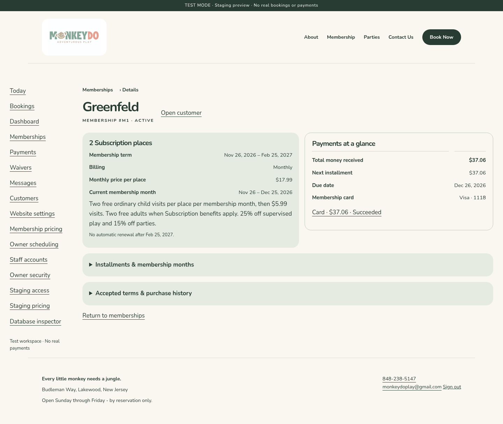](02-active-desktop.png) |  |

## 03 — First payment not yet confirmed

One Subscription place: **$18.53 due**. No received funds or active benefits are claimed while the card outcome is pending. The payment record opens from the overview. This sample has not been submitted to Banquest.

| Desktop | Phone |
| --- | --- |
|  |  |

## 04 — Member-aware booking on the existing combined page

Three children, two adults and one pair of socks; two Subscription places cover two children and both adults. One ordinary child admission remains: $15.00 + $1.99 socks + $0.51 card fee + $1.02 tax = **$18.52 at arrival**. Membership information sits above the existing attendee/price, waiver and card controls. Capacity counts, the 30-minute temporary reservation, session blocking, owner pricing and waiver-link choice remain visible. No member benefit is reserved by the unfinished draft itself.

The card setup shown here was simulated. Its configuration warning belongs to the isolated review environment and does not diagnose the deployed Banquest setup. No actual hosted card fields were verified.

| Desktop | Phone |
| --- | --- |
|  |  |

## 05 — Edit member booking

The estimate includes member admissions before saving. A count or timing change recalculates the applicable membership month/day and atomically transfers reservations when saved. Current capacity controls remain in place.

| Desktop | Phone |
| --- | --- |
| [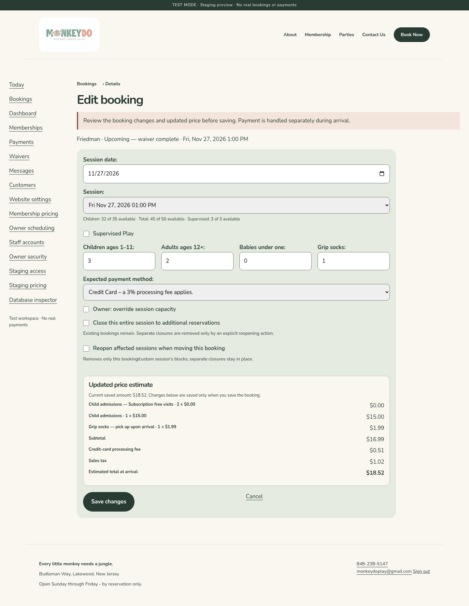](05-member-edit-desktop.png) | [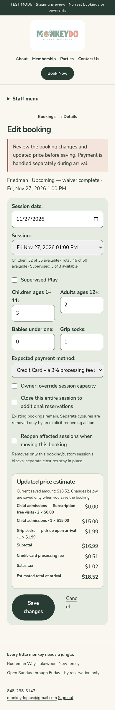](05-member-edit-phone.png) |

## 06 — Member arrival

The existing combined arrival page shows two free member admissions, one ordinary admission and socks. Waiver coverage and the selected payment action are reviewed before the single final confirmation. Only confirmation records usage and requests payment.

| Desktop | Phone |
| --- | --- |
|  |  |

## 07 — One fewer child arrives

Two member-covered children attend, along with two adults and one pair of socks. The revised total is **$5.14**: $1.99 socks + $3 cancellation fee + $0.15 card fee. The adjustment explains the original **$18.52**, the **$15 ordinary admission removed**, the fee/tax adjustments and the cancellation fee. No attendance or payment is recorded in these review captures.

| Desktop | Phone |
| --- | --- |
|  |  |

## 08 — Renew existing places

Two Subscription places change to Unlimited after their original term ends. The qualifying one-month renewal starts **February 26**, with **$82.38 due today** including the card fee. The original membership keeps its dates, price and history. The start date is fixed by the original expiry; a partial renewal also leaves the unrenewed places available for a later explicit purchase. Pending card outcomes count toward renewed places so another click cannot sell them twice.

| Desktop | Phone |
| --- | --- |
|  |  |

## 09 — Add places with their own term

One additional Unlimited place costs **$41.19 today**, with the two remaining installments visible. The new place has its own dates and payment schedule; the original two Subscription places keep theirs. The new three-month minimum and the accepted card authorization apply to this purchase. These captures stop before confirmation and do not request payment.

| Desktop | Phone |
| --- | --- |
|  |  |

## 10 — Resolve a declined installment with cash

Two Subscription places have a declined **$37.06** card installment. The same overview shows the actual first **$35.98 received**, the overdue installment and its payment history. Opening the controls keeps the amount and final action together. Choosing cash previews **$35.98**, removing the uncharged **$1.08** card fee for this installment. The owner/staff verifies receipt before recording it. Changing the membership card is alongside this control and requests no charge by itself.

| Desktop | Phone |
| --- | --- |
|  |  |

## 11 — Uncertain outcome blocks another collection

The first **$18.53** card outcome is unknown. Received funds remain **$0.00**, benefits stay pending and the previous payment record remains accessible. The payment controls explain that its outcome must be checked first. Another card charge or manual receipt is blocked even after changing the membership card. The collection button is visibly inactive.

| Desktop | Phone |
| --- | --- |
|  |  |

## 12 — Installment resolved, benefits active again

The cash-only fictional browser scenario was completed once. **$71.96 total money received** represents two actual **$35.98** recorded cash payments. The failed card attempt remains in history and adds no received funds. Benefits are active again with **four free child visits available** this membership month; the next installment remains **$37.06** on its accepted date. The persistent payment notice clears. No successful-installment customer email is queued.

| Desktop | Phone |
| --- | --- |
| [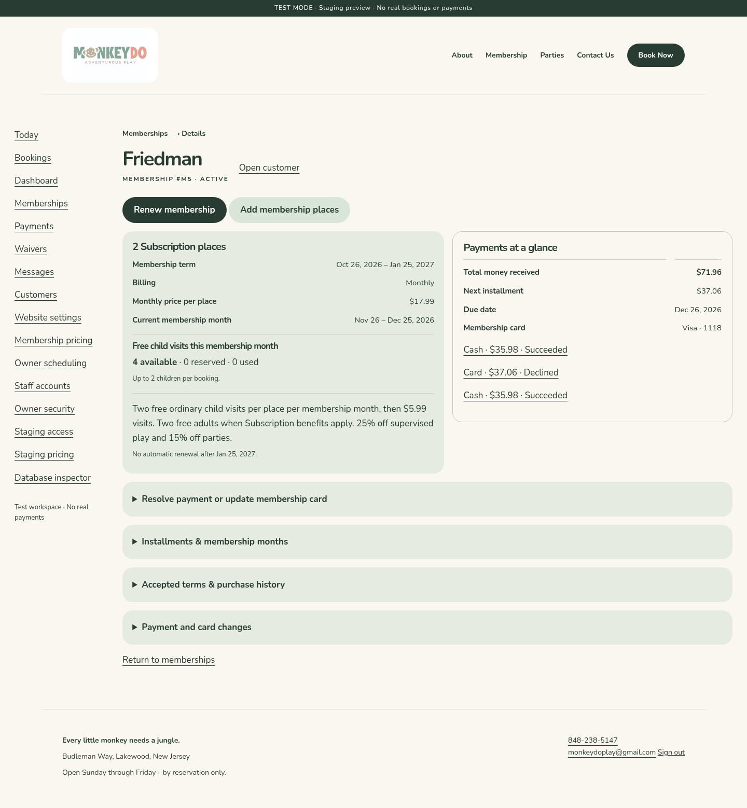](12-installment-paid-desktop.png) |  |

## 13 — New card on the combined membership purchase

Choose Enter a new card alongside the same membership, term and **$37.06 due today**. Staff records Yes/No for retaining it for unrelated future visits. **Confirm membership and charge card** securely saves the card first, then submits the explicit purchase once. Card storage and membership acceptance have their own evidence; no booking payment/cancellation consent is fabricated. The new source is restricted to this reviewed purchase unless future use was chosen.

**Provider limitation:** the pictured field area is explicitly labelled **synthetic browser test**. It verifies the surrounding page, nonce handoff and controls. It does not show or verify Banquest's real hosted-field rendering or processor behavior. The end-to-end scenario uses fake provider responses, creates one queued payment and leaves funds/benefits pending. A separate uncertain-save scenario reloads the page without another provider POST or membership purchase.

| Desktop | Phone |
| --- | --- |
|  |  |

## 14 — Verify a private renewal link

An owner/staff-created private link asks for phone number and last name before showing membership details. No staff login or public customer search is exposed. The link lasts 30 days; each verified browser session lasts 20 minutes. Link validity does not extend the seven-day renewal grace rule. The pictured details are fictional, and no private link is published in this gallery.

| Desktop | Phone |
| --- | --- |
|  |  |

## 15 — Customer renewal on one page

After verification, the customer reviews membership type, places, term, card, **$82.38 due today** and accepted terms together. Two Unlimited places start after the original Subscription term ends; the original dates and payment history stay intact. The final button explicitly requests the renewal and its card payment. The same form supports new secure-card entry; provider responses in this review are simulated.

| Desktop | Phone |
| --- | --- |
|  |  |

## 16 — Renewal submitted, payment pending

The fictional browser confirmation creates exactly one customer-accepted renewal and one queued initial payment. **$0.00 received** and the pending message accurately describe that state; no active benefit or completed charge is claimed. Checking status reads the existing result. A second verified browser returns this same renewal instead of collecting again. A separate uncertain new-card save survives reload without another provider exchange or purchase.

| Desktop | Phone |
| --- | --- |
|  |  |

## 17 — Replace a membership card on the overview

Staff can enter a replacement card alongside the existing payment details. The customer’s future-visit Yes/No choice is separate from authorization for the remaining accepted membership payments. **Save and use membership card** saves the source and updates its mandate once; it requests no payment or retry. The fictional confirmation preserves **$71.96 received**, the original installment dates and every earlier transaction’s card. Changing the billing details invalidates an older review.

The field area is visibly labelled **synthetic browser test**. A separate uncertain-save scenario verifies Check card setup and reload do not repeat the exchange or update the mandate. Real Banquest hosted-field rendering remains unverified.

| Desktop | Phone |
| --- | --- |
|  |  |

## 18 — Honor reserved benefits for one overdue booking

The owner reviews the existing counts, selects **Honor reserved membership benefits for this booking**, and records a readable reason on the same arrival page. Two child admissions remain covered and **$0.00 is due for this visit**. The membership installment is still unpaid; this is an exception for the reviewed booking/session, preserving normal quota and cancellation-fee rules. It does not grant benefits to other bookings or extend the membership term.

The fictional phone scenario confirms arrival with the first click after typing the reason, records two used benefits and creates no payment operation. Waivers and capacity checks remain in place. The earlier reservation history is retained.

| Desktop | Phone |
| --- | --- |
|  | [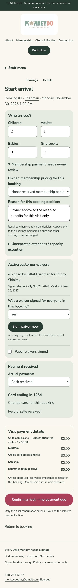](18-owner-honor-benefits-phone.png) |

## 19 — Choose ordinary prices before arrival

On Edit booking, the owner chooses ordinary admission prices and records a reason. Two children cost **$30.00 + $1.98 tax = $31.98**, with cash selected and no card fee. The adjustment explains the change from the saved **$0.00** member price. Ordinary pricing continues to recalculate when counts change. The existing visible capacity, session-blocking and navigation controls stay on the page.

The fictional phone scenario saves this edit and releases the reserved benefits. It collects no money and leaves membership dues unpaid. Save changes and Cancel stay together on the phone layout. These controls are limited to the owner and affected bookings.

| Desktop | Phone |
| --- | --- |
|  |  |

## 20 — Cancel membership on the existing overview

Two prepaid Subscription places originally cost **$215.88** for six months. The owner selects the end of the current membership month, **December 13**, and reviews a suggested **$71.96** unused-period refund. The owner controls the refund amount and explicitly chooses whether to send a cancellation email. Original funds, payment sources, dates and the final action stay together. Initial-commitment cancellation shows an additional owner approval only when needed.

The fictional phone scenario confirms cancellation once and records **refund due**, without claiming any return or requesting a card transaction. Opening or changing the review creates no cancellation. Earlier dues and existing bookings remain separate.

| Desktop | Phone |
| --- | --- |
| [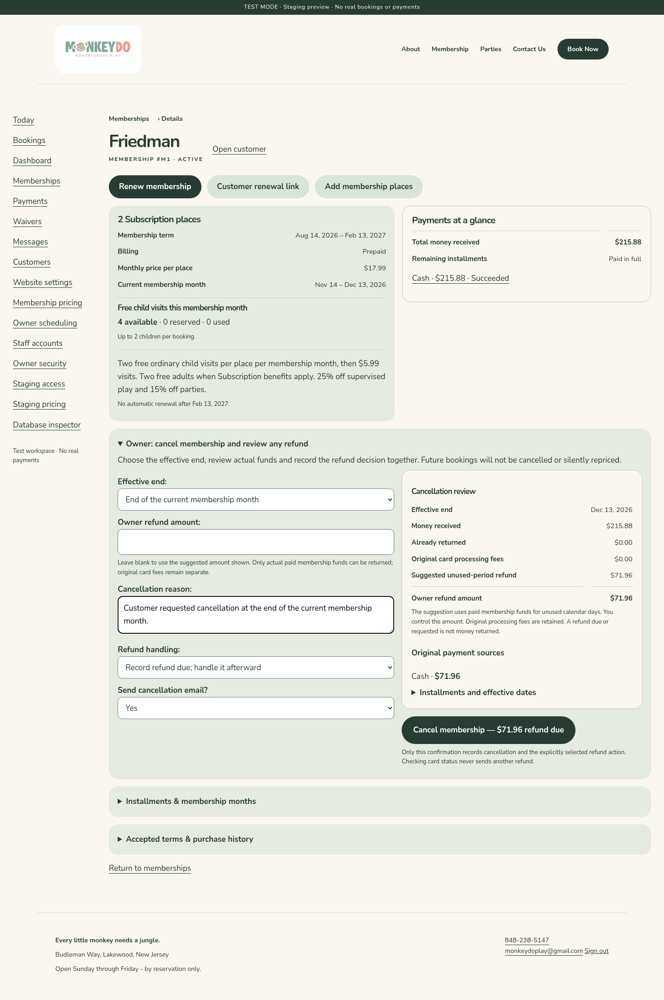](20-owner-cancellation-review-desktop.png) | [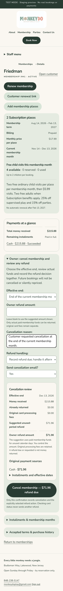](20-owner-cancellation-review-phone.png) |

## 21 — Refund due is separate from money actually returned

After cancellation is recorded, **$71.96 remains due and $0.00 has been returned**. The original receipt remains **$215.88**. Benefits remain available until the selected end when required dues are paid. The owner can record a completed cash return directly here, including a partial amount; the screen requires confirmation that the money was actually returned.

| Desktop | Phone |
| --- | --- |
| [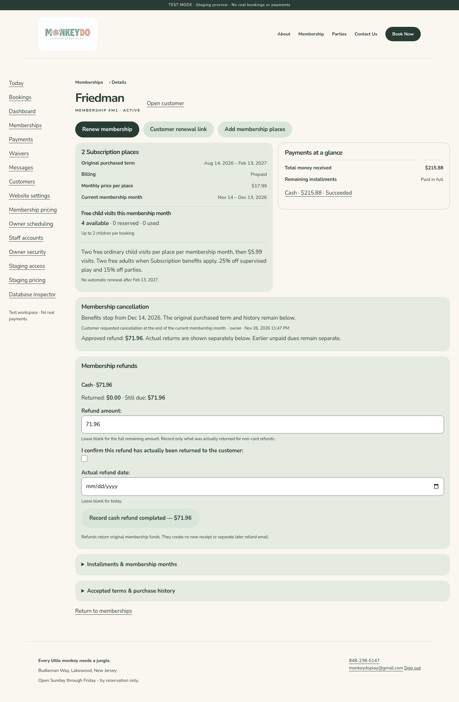](21-refund-due-desktop.png) |  |

## 22 — Partial refund, with actual totals

The fictional owner records **$20.00 actually returned in cash**. The overview shows **$215.88 originally received**, **$20.00 in recorded refunds**, and **$195.88 held after refunds**. The approved refund is still **$71.96**, so **$51.96 remains due**. The original purchase and payment evidence remain in history. Recording a return creates no new receipt and no separate later refund email.

| Desktop | Phone |
| --- | --- |
| [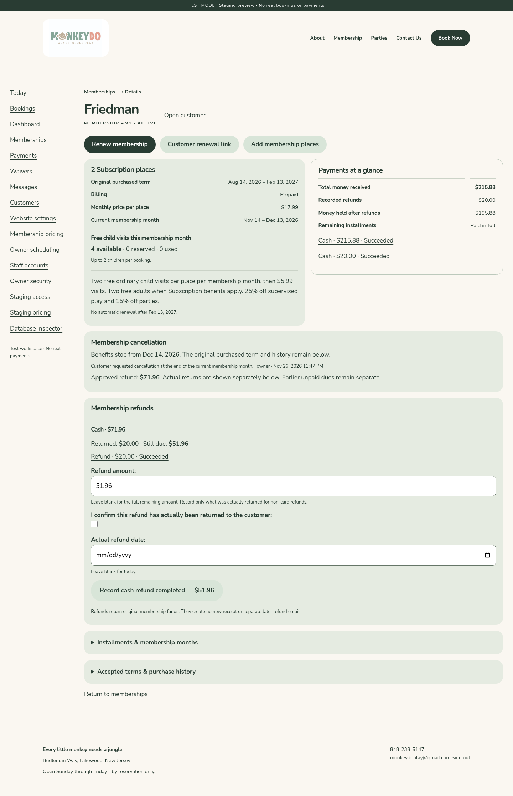](22-partial-refund-recorded-desktop.png) |  |

## 23 — Persistent owner Dashboard reminder

The **$51.96** remaining refund links back to the membership. A partial return keeps the reminder; confirmed completion clears it. Bookings whose reserved membership benefits end before their session have a separate review reminder. Cancellation neither cancels those bookings nor silently changes their saved prices.

| Desktop | Phone |
| --- | --- |
|  |  |

## 24 — Requested card refund is still pending

The owner explicitly requests a **$50.00** refund against the original Visa ending **4242**. The screen shows **$0.00 returned and $50.00 still due** until a successful provider outcome is recorded. The original card processing fee is excluded. A pending or uncertain refund blocks another attempt; no automatic retry is made.

This fictional review queues work only. No worker sent the refund to Banquest, and no external funds moved. Gateway behavior is developer-tested using simulated responses; real processor refund verification remains outstanding.

| Desktop | Phone |
| --- | --- |
|  |  |

## 25 — Record a card refund already completed in Banquest

Synthetic provider evidence reports a **$5.00** external return. The unstarted outgoing refund stops before any provider POST. The owner enters the completed refund reference and confirms it was already returned. **Verify and record completed Banquest refund — $5.00** reads and verifies the existing provider transaction; it sends no new refund. The reference must match the original payment, exact amount and successful refund outcome. Partial imports leave the rest due, and the same provider refund cannot be recorded twice.

These captures stop before verification, using a fictional reference. Developer tests exercise verified import with mock GET responses and assert no refund/void POST. Actual Banquest verification has not been performed. A whole-provider void that includes retained fees needs separate owner correction review; this action does not substitute a void for a net-only refund.

| Desktop | Phone |
| --- | --- |
| [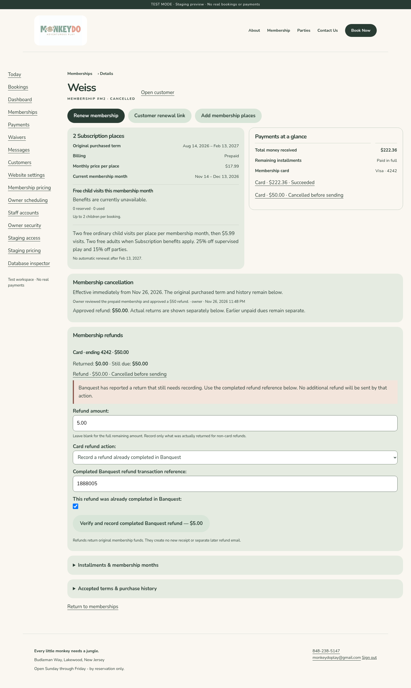](25-record-completed-card-refund-desktop.png) |  |

## 26 — Apply existing customer credit on the membership overview

An unused **$16.02** credit can cover part of a **$17.99** Subscription installment. The same page shows the amount to apply, **$1.97** of membership principal remaining, and **$0.06** in processing fee if that remainder is paid by card: **$2.03**. Changing the credit amount refreshes the review. Only **Apply customer credit — $16.02** spends it; this action collects no money and sends no card charge.

The fictional member already paid **$17.99 cash** for the first membership month. A separate fully paid same-day card visit was reconciled against that same-day purchase, creating credit from the replaced admission. This sample shows that unused credit in the later installment month. The combined purchase-and-conversion checkout and automatic installment producer are still being built; this is an explicit staff application of already recorded funds.

| Desktop | Phone |
| --- | --- |
|  |  |

## 27 — Credit applied, with the remaining balance still clear

After one fictional confirmation, **$16.02 customer credit applied** is separate from **$17.99 actual money received**. **$2.03 remains due** if paid by card. No second payment was recorded and no payment job was created by applying the credit. The membership remains overdue until its remaining balance is settled. Existing payment controls handle that remainder; the credit does not become another cash receipt.

Developer tests cover full and partial use, exact remaining fees, duplicate confirmations, stale reviews, uncertain payments, and simultaneous spending. Reported source returns hold unspent credit and pause affected funded benefits/collection for owner review, preserving receipts and saved booking prices. Applying credit stops an unstarted request for the old full charge; it cannot race a dispatch that has already started. Returning applied credit during membership cancellation remains a separate unfinished flow, so cancellation of such a term is currently blocked for credit-return review.

| Desktop | Phone |
| --- | --- |
| [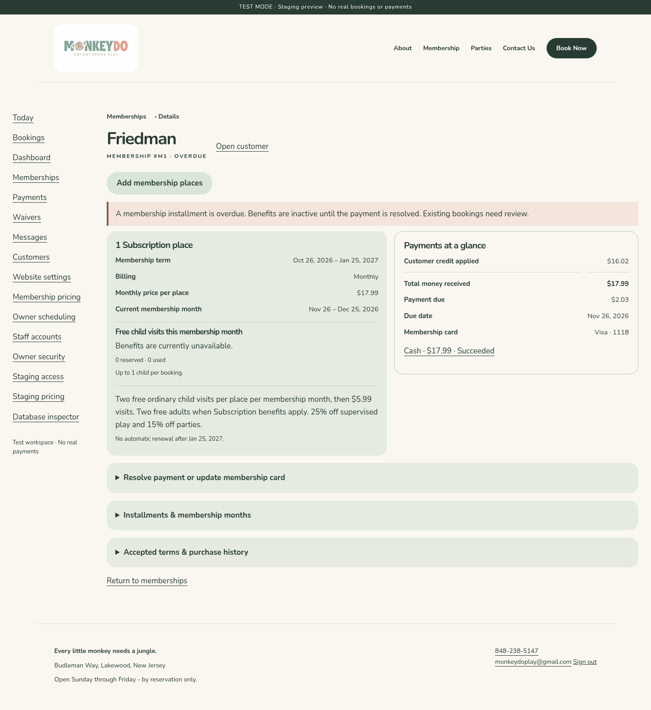](27-customer-credit-applied-desktop.png) |  |

## 28 — Original visit funds and the accountant's card example

The original card receipt is **$16.47**: $15 admission, $0.45 fee and $1.02 combined tax. Reconciliation reverses the replaced admission, its $0.99 tax and the $0.03 tax on the retained fee, making **$16.02 customer credit**. The original **$0.45 processing fee remains**. The booking shows the original receipt and transfer separately, the admission covered by membership, and the exact price adjustment. It records normal benefit usage and preserves original waivers, prices, receipt and tax components.

This source was prepared through the trusted reconciliation service using fictional confirmed funds. It demonstrates reconciliation against an already paid same-day membership. It does not show the still-unfinished combined first-purchase checkout or claim a real Banquest transaction/refund. Unpaid visits create no credit, and the same original funds cannot also be refunded.

| Desktop | Phone |
| --- | --- |
|  |  |

## 29 — Customer credit balance and recent history

The customer page keeps issued/applied credit history and links to the source booking and target membership. After the **$16.02** is used, **$0.00 is available**, with both entries retained. Credit is neither a physical gift-card balance nor new money received. Unspent credit carries beyond membership expiry; a persistent owner reminder identifies credit left from an ended term and clears when spent.

| Desktop | Phone |
| --- | --- |
|  | [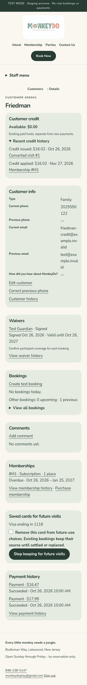](29-customer-credit-history-phone.png) |

## 30 — Owner correction with the resulting balance visible

On the existing customer page, expand **Owner: correct unused credit**. This fictional customer has **$16.02** available. Removing **$5.00** leaves **$11.02**. The amount, reason, before/after balances and one final action stay together. Review creates no correction; the owner must confirm. Staff cannot perform this action, and used or source-held credit cannot be removed.

| Desktop | Phone |
| --- | --- |
|  |  |

## 31 — Removed credit retained in the customer history

After confirmation, **$11.02** is available. The expandable history keeps the owner, time, amount and reason; the full customer history remains accessible. The original **$16.47** card receipt and **$16.02** credit issue remain unchanged. Removing unused credit neither returns money nor changes an already applied amount.

| Desktop | Phone |
| --- | --- |
|  |  |

## 32 — Restore only a specific earlier removal

The owner chooses the earlier **$5.00** removal and reviews restoring **$2.00**, leaving **$13.02** available. Restoration cannot exceed the amount still unrestored from that specific removal or create additional unsupported credit. If the original source later needs payment review, restored funds remain held; they do not become spendable. A second explicit confirmation records the restoration with its own reason and history.

Both fictional actions were completed in browser checks. No external payment, refund or email was sent.

| Desktop | Phone |
| --- | --- |
|  | [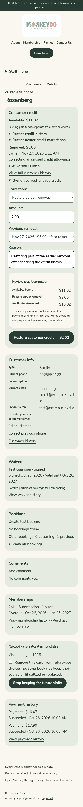](32-owner-credit-restoration-review-phone.png) |

## 33 — Membership search, status and expiry together

The membership list keeps all history available by default, with one compact filter area for customer/M-number search, type, actual payment status and expiry. Phone/email matching and labelled possible name matches reuse the existing staff search rules. Type/status/date changes apply immediately; text search uses Enter or Apply filters. Clear expiry preserves the other choices. Existing row-size and page navigation remain.

The fictional rows include active, future and overdue memberships. Status filtering uses actual receipts, adjusted obligations and applied credit, with source-held credit shown for review; a saved card or accepted purchase alone is not payment. Scheduled cancellation uses the effective last benefit day while preserving the original end date.

CSV downloads stay collapsed on the same page. Owners have access; staff need an explicitly assigned export permission, plus payment/booking viewing rights for the corresponding report. That export permission is not selected for new staff by default. The staff editor now also preserves normal membership sale/view/update permissions that were already available through the default staff group.

| Desktop | Phone |
| --- | --- |
| [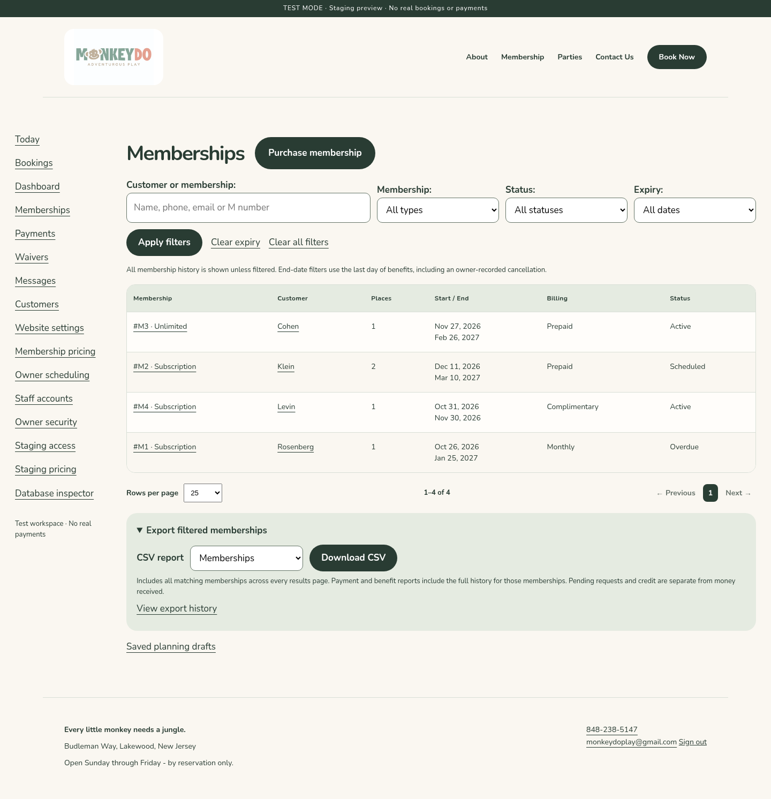](33-membership-list-and-exports-desktop.png) |  |

## 34 — Expiring memberships and a matching CSV

**Active + Next 5 days** narrows the list to the fictional complimentary membership ending **November 30**. The same filters apply to every exported row across all result pages. The downloaded [fictional sample CSV](34-expiring-memberships-sample.csv) contains that single membership; pagination does not limit the export.

The available operational reports are membership details, payment transactions and benefit history. Payment requests retain their outcome and requested amount separately from successfully recorded principal, fee and taxes, with distinct service, manual-receipt, completion and reported settlement dates. Credit applications create no incoming-money row. Benefit history includes each reserved/used/released event alongside its current state. Sensitive card-storage references, signed waivers and staff comments are excluded. These are operational CSVs; final accountant-report presentation remains separate.

| Desktop | Phone |
| --- | --- |
| [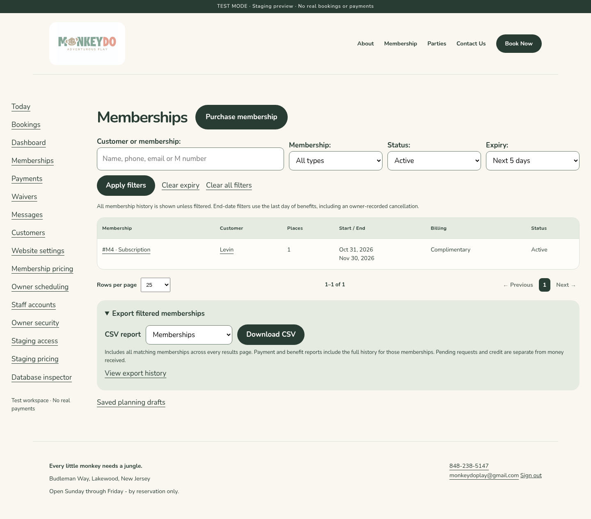](34-expiring-memberships-desktop.png) |  |

## 35 — Owner export history

Each prepared CSV records its report, exact row count, filters, staff member and New York time. The owner can page through all export history; ordinary staff cannot open this history even when permitted to export. CSV preparation is recorded before returning the download, and untrusted spreadsheet text is protected from formula interpretation. No additional owner password prompt is introduced.

Desktop and phone browser checks actually changed filters and downloaded/read the one-row fictional CSV. No membership, benefit reservation or payment was changed by filtering or exporting.

| Desktop | Phone |
| --- | --- |
|  | [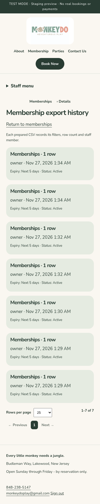](35-membership-export-history-phone.png) |

## 36 — Five days before expiry

The approved expiry wording uses the actual cohort's remaining unrenewed places and end date. The branded **Renew membership** button opens the protected renewal link. It creates no renewal or charge. The owner-removed lapse sentence stays out of this email; the underlying gap/eligibility rule remains.

This fictional snapshot is dated **November 25**, five days before the **November 30** end date. It was rendered from the queued immutable message; no email was sent. The original logo and previously reviewed email design are retained.

| Desktop | Phone |
| --- | --- |
|  |  |

## 37 — One day before the seven-day grace window ends

This fictional cohort ended **November 19**. Its approved notice is due **November 25**, saying the renewal window ends tomorrow, **November 26**. The renewed term starts on the actual renewal date. The link lasts 30 days, while a renewal after the seven-day window normally requires three months; link lifetime does not extend grace or restore benefits during the gap.

Desktop/phone browser checks opened this system-created link without a staff session, confirmed that it revealed no customer details before phone/name verification, and reached the one-month grace renewal selection after matching those details. No card was entered or payment requested.

| Desktop | Phone |
| --- | --- |
|  |  |

## 38 — Notice dates and actual history on the membership overview

The existing overview keeps an expandable **Renewal notices** section with the due dates and actual queued/sent/withdrawn history. Viewing it creates no message. Automated notices have scoped system evidence, with no fake staff attribution. Private verification and explicit customer acceptance still authorize any later purchase.

The bounded producer prepares only the approved due-day notices. It rechecks payment review, current contact, remaining places, cancellation and link validity before dispatch. A partial renewal/contact correction supersedes only an unsent snapshot; full renewal, cancellation or a stale notice day withdraws it. Sent, unknown or failed delivery is not automatically repeated. A known unrecorded original card return also suppresses notice sending. The two approved emails add no appointment reminders or customer failed-installment emails.

| Desktop | Phone |
| --- | --- |
| [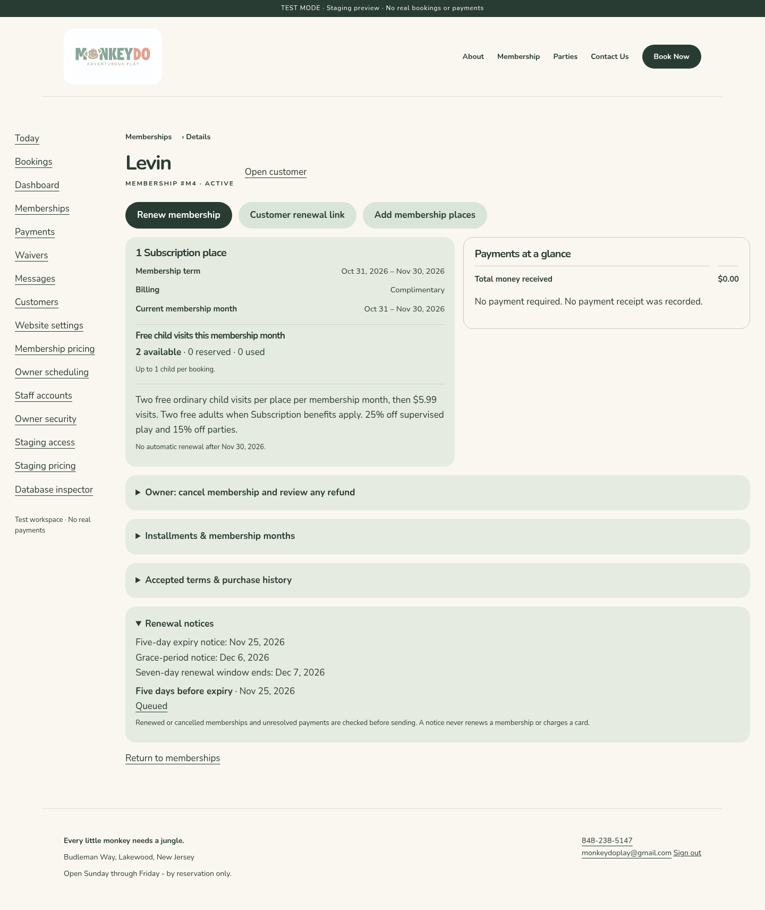](38-renewal-notice-history-desktop.png) |  |

## 39 — Membership payment needs reconciliation

A fictional prepaid membership has **$111.18 in recorded receipts** and a reported **$1 external card return** that has not yet been recorded as a completed refund. The overview shows **Review**, unavailable benefits and the original receipt together. Renewal and further collection wait for owner reconciliation; no zero-dollar collection or paid-in-full claim appears. Existing booking prices and benefit history stay intact.

A return reported after a later charge was queued also stops that charge before any financial provider request. Recording the actual return clears the reconciliation hold, but any resulting unpaid installment still needs resolution. These screenshots use local synthetic evidence; they do not verify a live Banquest return.

| Desktop | Phone |
| --- | --- |
|  | [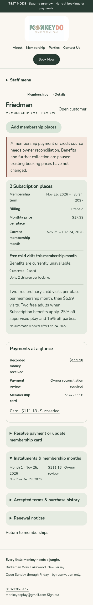](39-membership-funding-review-phone.png) |

## 40 — Owner booking with inline renewal choices

**Renew**, **Not now** and **Email me later** appear beside the customer's existing membership summary. The existing attendee estimate, visible capacity counts, 30-minute temporary reservation, closure/override controls, custom price, waivers, card and final booking button stay on the same page.

Renew opens the existing combined renewal form in another tab. Actual browser checks return to the original page with **2 children and 1 pair of socks preserved**, and the same hold expiry. Opening renewal or choosing a reminder confirms no booking and makes no membership purchase. The card-configuration warning belongs to this isolated review environment; it does not describe the deployed provider setup.

| Desktop | Phone |
| --- | --- |
|  |  |

## 41 — Customer booking near membership expiry

The same optional choices appear within five days of the cohort's expiry. **Not now** does not interrupt booking. That response is remembered across bookings; one further prompt may appear on a later booking at least 30 days after expiry. Displaying a prompt and choosing an action are separate immutable facts. Merely loading a page records neither; the visible prompt is acknowledged by a CSRF-protected request.

A customer who chooses Renew still verifies phone and name on the private renewal page before accessing its checkout. The booking profile proof does not authorize a financial action. The customer booking's existing 20-minute limit stays in place.

| Desktop | Phone |
| --- | --- |
|  |  |

## 42 — Expired membership and a requested reminder

This fictional membership ended **November 15**, and the review booking is on **November 25**. The page correctly shows a **new three-month minimum**. Email me later requests the next morning, **November 26 at 9 a.m. New York time**, and explains that the reminder does not preserve the shorter renewal minimum. No past expiry-relative reminder date is offered.

The actual phone interaction requests the reminder while leaving the entered counts and socks intact. No visit is confirmed. If an existing profile has no saved email yet, only the validated pending booking email can enable the choice, with an instruction to finish booking; delivery uses the actual saved contact, never an uncommitted address.

| Desktop | Phone |
| --- | --- |
| [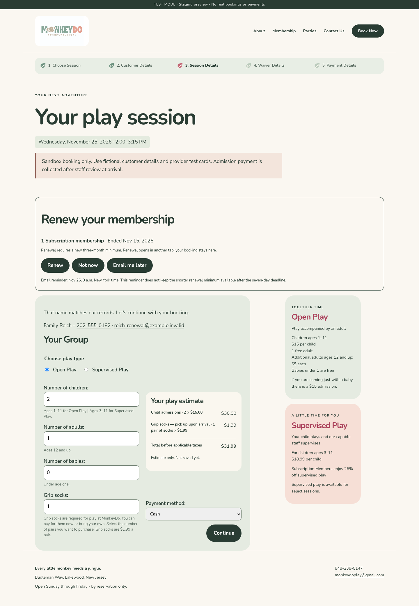](42-booking-expired-renewal-desktop.png) |  |

## 43 — Requested renewal email, prepared the following morning

This is the actual frozen email queued from sample 42's request at the following fictional morning, **November 26, 9 a.m. New York time**. It uses appropriate past/future wording and the current three-month minimum, with the protected **Renew membership** button. It was prepared locally and **not sent**.

The private link lasts 30 days from its creation and does not extend the seven-day renewal deadline. Remaining places, payments, cancellation, current contact and link validity are checked again before delivery. Obsolete messages are withdrawn; changed content has a new immutable snapshot. An unknown or failed delivery is not automatically repeated. An isolated reminder-preparation failure does not stop unrelated accepted jobs.

| Desktop | Phone |
| --- | --- |
|  |  |

## 44 — Apply existing credit during the initial purchase

The existing combined purchase form now shows available customer credit and a **Use available credit** action. This fictional three-month prepaid Subscription costs **$53.97**. Applying **$13.02** leaves **$40.95 cash due**, with no card fee. The price, credit, remaining payment, receipt confirmation and accepted terms stay on one page. This is use of existing backed credit; it is separate from the still-unfinished combined visit-conversion checkout.

Card-funded balances receive their own fee only on remaining principal. Application tests cover **$17.99 − $16.02 credit = $1.97**, plus **$0.06**, for a **$2.03** new card request. Later monthly installment prices/dates stay unchanged. A credit-funded first month still needs its accepted future card mandate; a fully credit-funded prepaid term needs no card or zero-dollar receipt.

| Desktop | Phone |
| --- | --- |
|  |  |

## 45 — Confirmed purchase keeps credit separate from new money

The actual local browser checkout confirms **$40.95 cash received** and applies **$13.02 existing credit**. The resulting membership is active and prepaid. Its overview shows those amounts separately, rather than claiming another $53.97 receipt. No card or external financial action was involved, and the confirmation email remains queued without delivery.

Changed credit sources, price/terms or card authorization require review before purchase. Concurrent owner credit correction cannot spend the same funds or deadlock a purchase; that is checked with actual PostgreSQL sessions. Unknown card outcomes still wait for reconciliation, and ordinary retries require explicit confirmation. Public private-renewal checkout does not accept unscoped credit input.

| Desktop | Phone |
| --- | --- |
|  |  |

## 46 — Buy a membership and complete arrival together

Three children and two adults arrive without paying admission first. The same page selects two Subscription places, three monthly installments and the accepted future card. Two child admissions and both adults become included. **$35.98 membership + $15.99 adjusted visit = $51.97 cash received today.** The final button records both purchases together; previewing creates no membership, receipt or benefit usage. Existing count, capacity, waiver, paper-waiver and payment controls remain. The credit-funded card variant is shown below; a positive first membership card charge and paid-visit conversion remain in progress.

| Desktop | Phone |
| --- | --- |
|  | [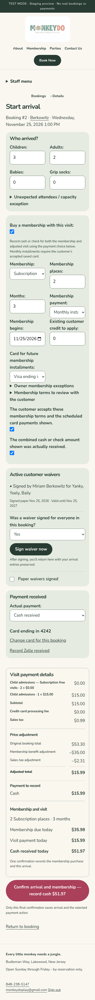](46-combined-membership-arrival-phone.png) |

## 47 — Completed visit links to its new membership

The visit shows its own **$15.99 received**, with the new membership linked immediately underneath. The combined confirmation records **$51.97 new money**, separated into $35.98 membership and $15.99 visit. Membership adult allowances are labelled as benefit adjustments, without claiming adults cancelled. Existing booking history and the earlier booking-confirmation record remain intact.

| Desktop | Phone |
| --- | --- |
|  | [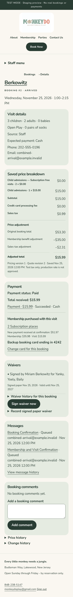](47-combined-membership-completed-phone.png) |

## 48 — One combined membership and visit email

The actual queued fictional confirmation presents the visit, membership, benefit usage, itemized amounts received and next scheduled installment together. There is no Book a visit button for an already booked visit. A normal membership-only email is suppressed only when the purchase has its completed combined arrival. This email remains unsent. Earlier Zelle and existing credit, when used, are shown separately from new money; confirmed coverage avoids an unnecessary waiver section.

| Desktop | Phone |
| --- | --- |
|  | [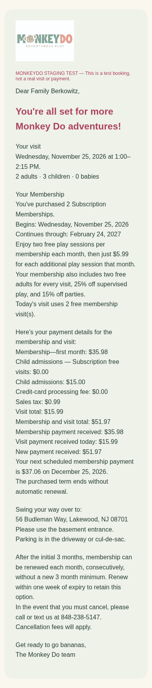](48-combined-membership-email-phone.png) |

## 49 — Existing credit pays membership; card pays the remaining visit

Two children and two adults attend. The first membership month is fully funded by **$17.99 of existing, ledger-backed customer credit**. One child admission remains: **$15.00 + $0.45 card fee + $1.02 tax = $16.47**. One final action purchases the membership and requests only that visit charge. The future monthly card mandate stays explicit. No cash-received acknowledgment or zero-dollar membership card charge is created. Positive first membership card charges in this combined flow remain in progress.

| Desktop | Phone |
| --- | --- |
|  |  |

## 50 — Uncertain visit-card result

The simulated response is uncertain: **$0.00 new money is confirmed**, with **$16.47 requiring review**. The membership's $17.99 credit stays separately recorded. No paid combined confirmation is queued, no replacement collection is allowed, and dispatch cannot repeat the same financial POST. The ordinary booking confirmation in history predates arrival; it is not a receipt.

| Desktop | Phone |
| --- | --- |
|  | [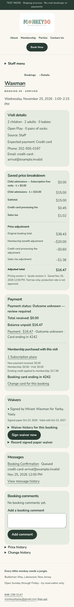](50-credit-card-uncertain-phone.png) |

## 51 — Reconciled payment, without another charge

A mocked provider GET confirms the original transaction. The visit now shows **$16.47 received** and links the membership purchased with credit. Applying $17.99 credit is never counted as new money. This is a local simulated provider result; no actual Banquest financial POST occurred. Superseded unsent message snapshots remain in history; only the current queued version can be sent.

| Desktop | Phone |
| --- | --- |
|  |  |

## 52 — Combined credit/card confirmation

The actual queued, unsent email separates the $17.99 applied credit, $0.00 newly received for membership and $16.47 newly received for the visit. It includes the actual next scheduled installment. Current payment/contact changes supersede an unattempted stale email; attempted or unknown delivery never automatically sends another confirmation.

| Desktop | Phone |
| --- | --- |
| [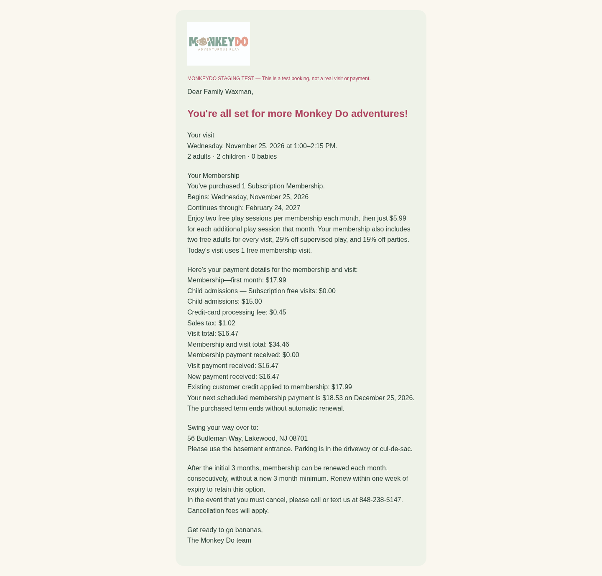](52-credit-card-combined-email-desktop.png) | [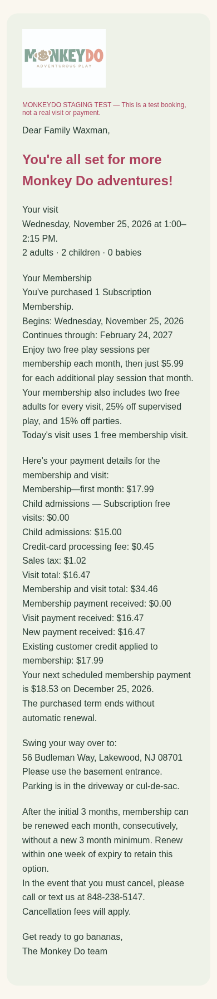](52-credit-card-combined-email-phone.png) |

## Checked so far

The browser checks confirm no horizontal overflow or JavaScript errors on all fifty-two desktop/phone pairs. The complete 1,094-test application suite passed, followed by 16 focused checks including the final complimentary-membership/card case. Thirty combined-arrival checks cover credit/card uncertainty, GET-only reconciliation, an explicit cash fallback with current fees/tax, unsent email refresh and no repeated attempted delivery, two forced PostgreSQL races, and exact money, atomic rollback, one confirmation, existing Zelle, stale reviews, future mandates, waiver checks, immutable/runtime SQL guards and repeat submissions. Earlier coverage includes membership filtering/exports, staff permissions, owner credit corrections, the customer-credit foundation, split-source allocation, source-return holds and six credit-related PostgreSQL races. All ten final reporting checks pass after stable ordering and readable export-history labels were added. Fourteen initial-credit checks cover exact card/cash arithmetic, full funding, future mandates/starts, replay, source holds, stale terms/card authority, native/CSRF/public-forgery boundaries and a forced purchase-versus-correction PostgreSQL race. Thirty-three booking-prompt/requested-reminder checks cover real private checkout, source/browser ownership, elapsed hold preservation, CSRF, native recovery, DST, private system authority, current contact/payment/renewal facts, producer isolation and two PostgreSQL races. Nine funding checks cover direct and credit sources, queued dispatch, recorded-return recovery, contradictory declines, staff/runtime permissions and truthful overview/messages. Sixteen notice checks include two PostgreSQL races, New York midnight/DST boundaries, contact reversals, verified system links, stale suppression, runtime immutable grants and no repeated unknown delivery. Native no-JavaScript re-review protects changed amounts. Functional browser scenarios complete a prepaid cash purchase, resolve a declined installment with one cash receipt, perform one new-card purchase and submit one verified customer renewal with simulated provider responses. Changing purchase counts requires accepting the current terms again; unchanged number-field blur no longer discards a completed review. Reloading uncertain card storage repeats no exchange and creates no purchase. Application tests cover immutable purchases/terms, exact-cent non-taxable payments, fixed-term calendar dates, stale quotes, duplicate submissions, uncertain outcomes, owner exceptions, permissions and actual runtime database grants. Two PostgreSQL concurrency tests exercise competing renewal links and repeated submissions from independently verified sessions. The [owner testing guide in progress](../../ACTIVE_MEMBERSHIP_OWNER_TESTING.md) distinguishes current functional checks from the remaining scope.

The first review is about layout and clarity. Implementation and regression testing continue independently while the owner reviews. The final owner testing guide and release package follow completion and explicit release approval.
