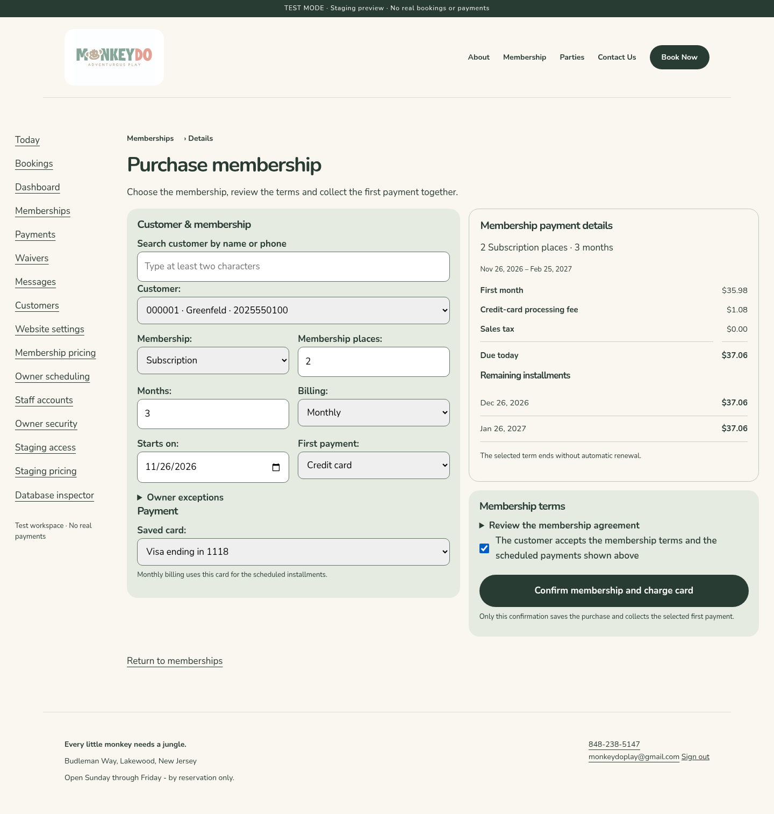
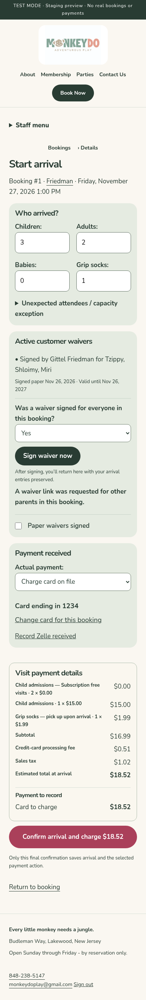
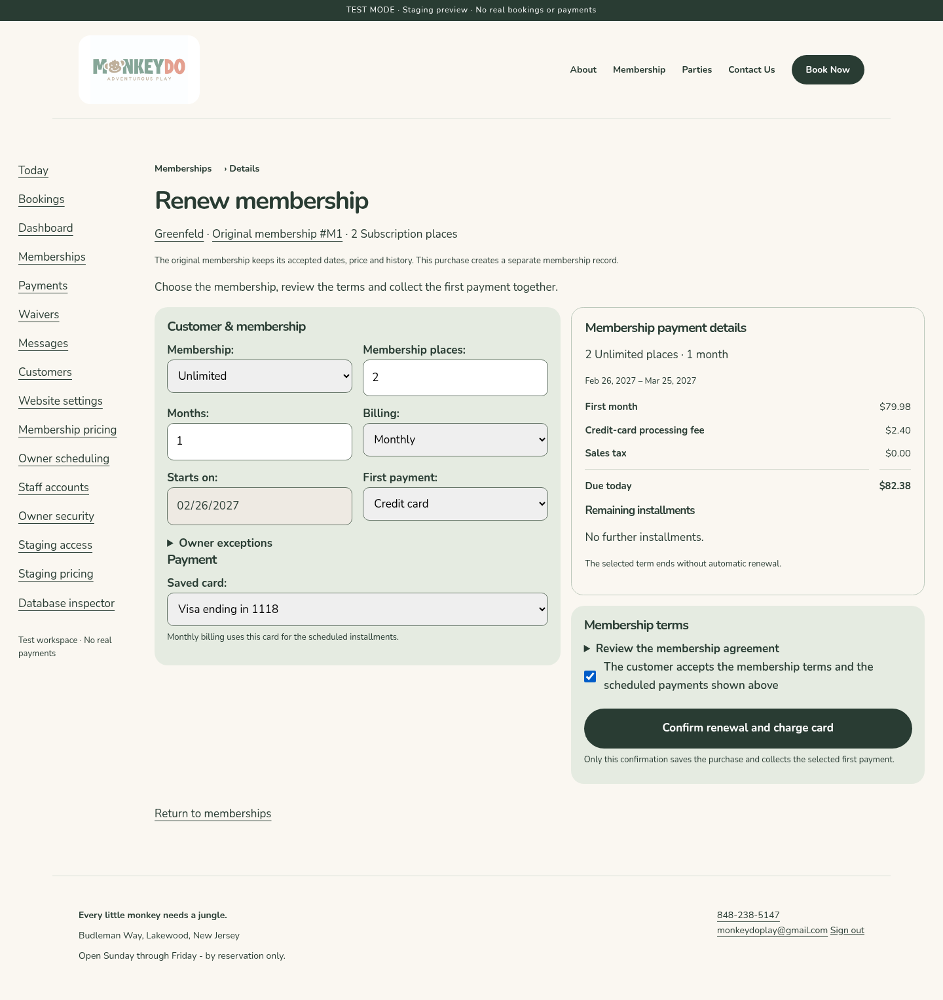

# Active memberships — first functional samples

Draft [PR #37](https://github.com/MonkeyDo-Site/MonkeyDoWebsiteNewCode/pull/37). These are actual application pages with fictional review data, captured at 1440px desktop and 390px phone widths. All names, card references and payment outcomes are synthetic. No card was charged and no customer email was delivered.

These samples cover staff purchase, the membership overview, member-aware staff booking/edit/arrival and individual-cohort renewals/additions. Public purchase, combined multi-cohort renewal checkout, conversion/credit and scheduled collection are still being implemented. The gallery will grow as those flows become functional; the current samples do not claim those parts are finished. Actual Banquest hosted fields are not shown or verified here.

## 01 — Purchase membership on one page

Customer, membership places, term, payment choice, amount due today, remaining installment dates, accepted agreement and final purchase action stay together. Two Subscription places billed monthly: $35.98 + $1.08 card processing fee = **$37.06 today**. Membership and its fee are not taxable. Changes require reviewing the current terms again. Owner exceptions stay collapsed.

| Desktop | Phone |
| --- | --- |
|  |  |

## 02 — Active membership after confirmed payment

A successful simulated provider outcome records $37.06 received. The overview separates actual money from the next $37.06 installment. Membership dates, current month, saved card, included benefits and available/reserved/used counts are together; installment details and accepted history expand underneath. No automatic renewal beyond the purchased term.

| Desktop | Phone |
| --- | --- |
|  |  |

## 03 — First payment not yet confirmed

One Subscription place: **$18.53 due**. No received funds or active benefits are claimed while the card outcome is pending. The payment record opens from the overview. This sample has not been submitted to Banquest.

| Desktop | Phone |
| --- | --- |
|  |  |

## 04 — Member-aware booking on the existing combined page

Three children, two adults and one pair of socks; two Subscription places cover two children and both adults. One ordinary child admission remains: $15.00 + $1.99 socks + $0.51 card fee + $1.02 tax = **$18.52 at arrival**. Membership information sits above the existing attendee/price, waiver and card controls. Capacity counts, the 30-minute temporary reservation, session blocking, owner pricing and waiver-link choice remain visible. No member benefit is reserved by the unfinished draft itself.

The card setup shown here was simulated. Its configuration warning belongs to the isolated review environment and does not diagnose the deployed Banquest setup. No actual hosted card fields were verified.

| Desktop | Phone |
| --- | --- |
|  |  |

## 05 — Edit member booking

The estimate includes member admissions before saving. A count or timing change recalculates the applicable membership month/day and atomically transfers reservations when saved. Current capacity controls remain in place.

| Desktop | Phone |
| --- | --- |
|  |  |

## 06 — Member arrival

The existing combined arrival page shows two free member admissions, one ordinary admission and socks. Waiver coverage and the selected payment action are reviewed before the single final confirmation. Only confirmation records usage and requests payment.

| Desktop | Phone |
| --- | --- |
|  |  |

## 07 — One fewer child arrives

Two member-covered children attend, along with two adults and one pair of socks. The revised total is **$5.14**: $1.99 socks + $3 cancellation fee + $0.15 card fee. The adjustment explains the original **$18.52**, the **$15 ordinary admission removed**, the fee/tax adjustments and the cancellation fee. No attendance or payment is recorded in these review captures.

| Desktop | Phone |
| --- | --- |
|  |  |

## 08 — Renew existing places

Two Subscription places change to Unlimited after their original term ends. The qualifying one-month renewal starts **February 26**, with **$82.38 due today** including the card fee. The original membership keeps its dates, price and history. The start date is fixed by the original expiry; a partial renewal also leaves the unrenewed places available for a later explicit purchase. Pending card outcomes count toward renewed places so another click cannot sell them twice.

| Desktop | Phone |
| --- | --- |
|  |  |

## 09 — Add places with their own term

One additional Unlimited place costs **$41.19 today**, with the two remaining installments visible. The new place has its own dates and payment schedule; the original two Subscription places keep theirs. The new three-month minimum and the accepted card authorization apply to this purchase. These captures stop before confirmation and do not request payment.

| Desktop | Phone |
| --- | --- |
|  |  |

## Checked so far

The browser checks confirm no horizontal overflow or JavaScript errors on all nine desktop/phone pairs. The complete application suite passes 816 tests, including 56 related renewal/payment/setup tests. A separate functional browser scenario completes a prepaid cash purchase on the same form, requires new acceptance after changing places and shows the recorded receipt on the active overview. Application tests cover immutable purchases/terms, exact-cent non-taxable payments, fixed-term calendar dates, stale quotes, duplicate submissions, uncertain outcomes, owner exceptions, permissions and actual runtime database grants.

The first review is about layout and clarity. Implementation and regression testing continue independently while the owner reviews. The final owner testing guide and release package follow completion and explicit release approval.
