# Active memberships — review gallery

Draft [PR #37](https://github.com/MonkeyDo-Site/MonkeyDoWebsiteNewCode/pull/37). These are actual application pages with fictional review data, captured at 1440px desktop and 390px phone widths. All names, card references and payment outcomes are synthetic. No card was charged and no customer email was delivered.

Purchases, booking benefits, payment resolution and customer credit use the existing combined screens. Membership features and scheduled collection remain **off by default**, and PR #37 remains a draft while the remaining scope is implemented. Actual Banquest hosted fields and processor outcomes remain unverified; provider areas in samples 13 and 68 are explicitly labelled placeholders.

| Review area | Samples |
| --- | --- |
| Purchases, additions, renewals and cards | 01–03, 08–17, 67–72 |
| Bookings, arrival and owner exceptions | 04–07, 18–19, 40–42 |
| Cancellation and actual refunds | 20–25 |
| Customer credit and original funding | 26–32, 39, 44–45 |
| Search, exports and notices | 33–38, 43 |
| Membership purchase with arrival and recovery | 46–66 |
| Scheduled installment review | 73–74 |
| Physical gift card and an owner-comped visit | 75–76 |
| Customer review and reservation of a released Unlimited benefit | 77–78 |
| Split visit payments and a separate membership receipt | 79–80 |
| Separate membership Zelle during arrival | 81–82 |
| Customer credit on arrival and the private receipt | 83–85 |
| Credit with a partial cancellation fee | 86–87 |
| Split the membership first payment | [88–89](#88--split-the-membership-payment-on-the-same-purchase-page) |
| Received membership split during arrival | [90–91](#90--received-membership-split-and-visit-on-one-page) |
| Apply recorded booking Zelle to membership | [92–93](#92--assign-recorded-zelle-between-membership-and-visit) |
| Membership card remainder during arrival | [94–96](#94--split-membership-receipts-and-card-with-arrival) |
| Received visit funds while membership card is pending | [97–99](#97--received-visit-funds-with-a-pending-membership-card) |
| Record an unused visit-fund return and review the remaining payment | [100–102](#100--record-an-actual-unused-visit-fund-return) |
| Gift-card goods payment with a separate cancellation fee | [103–104](#103--gift-card-covers-goods-and-the-card-covers-the-cancellation-fee) |
| Stop a funded arrival while keeping the booking and membership | [105–106](#105--stop-an-arrival-and-keep-the-booking-and-membership) |
| Return unused visit funds while membership payment is unresolved | [107–108](#107--unused-visit-funds-with-an-unconfirmed-membership-payment) |
| **New: stop arrival after a recorded membership cancellation** | **[109–110](#109--stop-only-the-arrival-after-membership-cancellation)** |

Each sample includes desktop and phone images. See the [owner testing guide](../../ACTIVE_MEMBERSHIP_OWNER_TESTING.md) for expected actions and the explicit unfinished scope. Samples 100–102 add actual original-tender returns and reallocation after confirmed membership funding. Samples 105–106 add an explicit owner stop after known membership funding and recorded return of unused new visit funds. The original booking and membership stay in place. Samples 107–108 add owner-paused actual visit-fund returns while the original membership payment is unresolved. Samples 109–110 close an arrival after a recorded membership cancellation without changing its refund. Multi-cohort checkout, already-paid first-purchase conversion, broader credit returns/redemption and remaining owner corrections are still being implemented.

## 01 — Purchase membership on one page

Customer, membership places, term, payment choice, amount due today, remaining installment dates, accepted agreement and final purchase action stay together. Two Subscription places billed monthly: $35.98 + $1.08 card processing fee = **$37.06 today**. Membership and its fee are not taxable. Changes require reviewing the current terms again. Owner exceptions stay collapsed.

| Desktop | Phone |
| --- | --- |
|  | [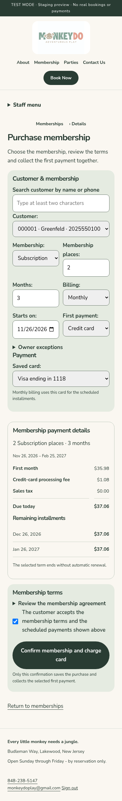](01-purchase-phone.png) |

## 02 — Active membership after confirmed payment

A successful simulated provider outcome records $37.06 received. The overview separates actual money from the next $37.06 installment. Membership dates, current month, saved card, included benefits and available/reserved/used counts are together; installment details and accepted history expand underneath. No automatic renewal beyond the purchased term.

| Desktop | Phone |
| --- | --- |
|  | [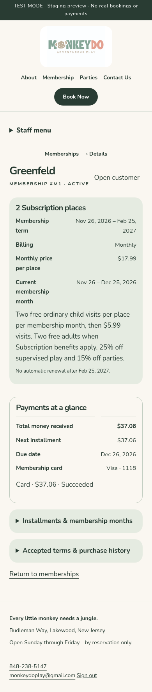](02-active-phone.png) |

## 03 — First payment not yet confirmed

One Subscription place: **$18.53 due**. No received funds or active benefits are claimed while the card outcome is pending. The payment record opens from the overview. This sample has not been submitted to Banquest.

| Desktop | Phone |
| --- | --- |
|  |  |

## 04 — Member-aware booking on the existing combined page

Three children, two adults and one pair of socks; two Subscription places cover two children and both adults. One ordinary child admission remains: $15.00 + $1.99 socks + $0.51 card fee + $1.02 tax = **$18.52 at arrival**. Membership information sits above the existing attendee/price, waiver and card controls. Capacity counts, the 30-minute temporary reservation, session blocking, owner pricing and waiver-link choice remain visible. No member benefit is reserved by the unfinished draft itself.

The card setup shown here was simulated. Its configuration warning belongs to the isolated review environment and does not diagnose the deployed Banquest setup. No actual hosted card fields were verified.

| Desktop | Phone |
| --- | --- |
| [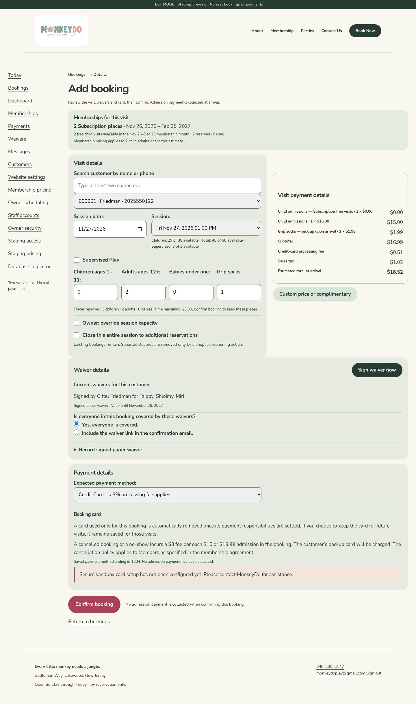](04-member-booking-desktop.png) |  |

## 05 — Edit member booking

The estimate includes member admissions before saving. A count or timing change recalculates the applicable membership month/day and atomically transfers reservations when saved. Current capacity controls remain in place.

| Desktop | Phone |
| --- | --- |
|  |  |

## 06 — Member arrival

The existing combined arrival page shows two free member admissions, one ordinary admission and socks. Waiver coverage and the selected payment action are reviewed before the single final confirmation. Only confirmation records usage and requests payment.

| Desktop | Phone |
| --- | --- |
|  |  |

## 07 — One fewer child arrives

Two member-covered children attend, along with two adults and one pair of socks. The revised total is **$5.14**: $1.99 socks + $3 cancellation fee + $0.15 card fee. The adjustment explains the original **$18.52**, the **$15 ordinary admission removed**, the fee/tax adjustments and the cancellation fee. No attendance or payment is recorded in these review captures.

| Desktop | Phone |
| --- | --- |
| [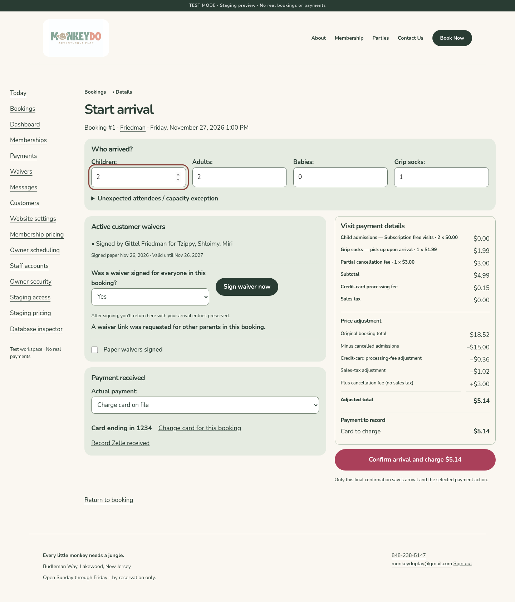](07-member-reduced-arrival-desktop.png) |  |

## 08 — Renew existing places

Two Subscription places change to Unlimited after their original term ends. The qualifying one-month renewal starts **February 26**, with **$82.38 due today** including the card fee. The original membership keeps its dates, price and history. The start date is fixed by the original expiry; a partial renewal also leaves the unrenewed places available for a later explicit purchase. Pending card outcomes count toward renewed places so another click cannot sell them twice.

| Desktop | Phone |
| --- | --- |
|  | [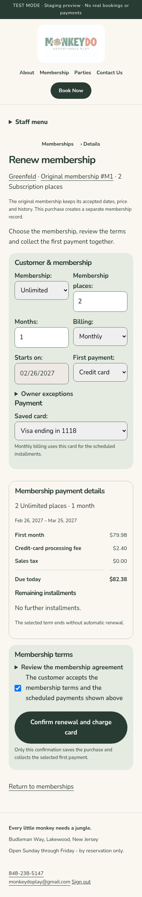](08-renewal-phone.png) |

## 09 — Add places with their own term

One additional Unlimited place costs **$41.19 today**, with the two remaining installments visible. The new place has its own dates and payment schedule; the original two Subscription places keep theirs. The new three-month minimum and the accepted card authorization apply to this purchase. These captures stop before confirmation and do not request payment.

| Desktop | Phone |
| --- | --- |
| [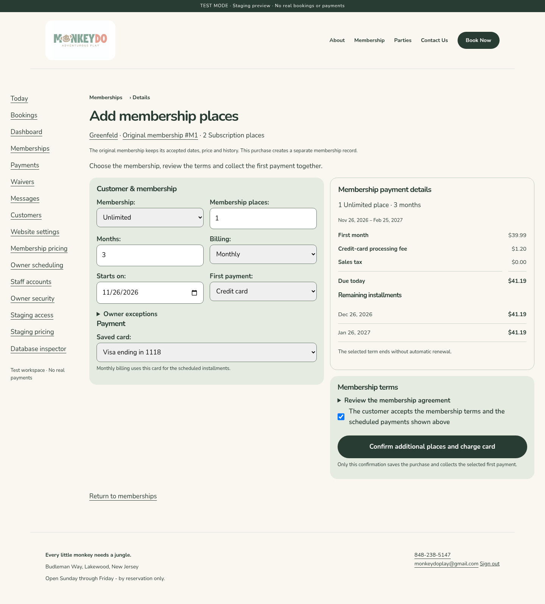](09-addition-desktop.png) |  |

## 10 — Resolve a declined installment with cash

Two Subscription places have a declined **$37.06** card installment. The same overview shows the actual first **$35.98 received**, the overdue installment and its payment history. Opening the controls keeps the amount and final action together. Choosing cash previews **$35.98**, removing the uncharged **$1.08** card fee for this installment. The owner/staff verifies receipt before recording it. Changing the membership card is alongside this control and requests no charge by itself.

| Desktop | Phone |
| --- | --- |
| [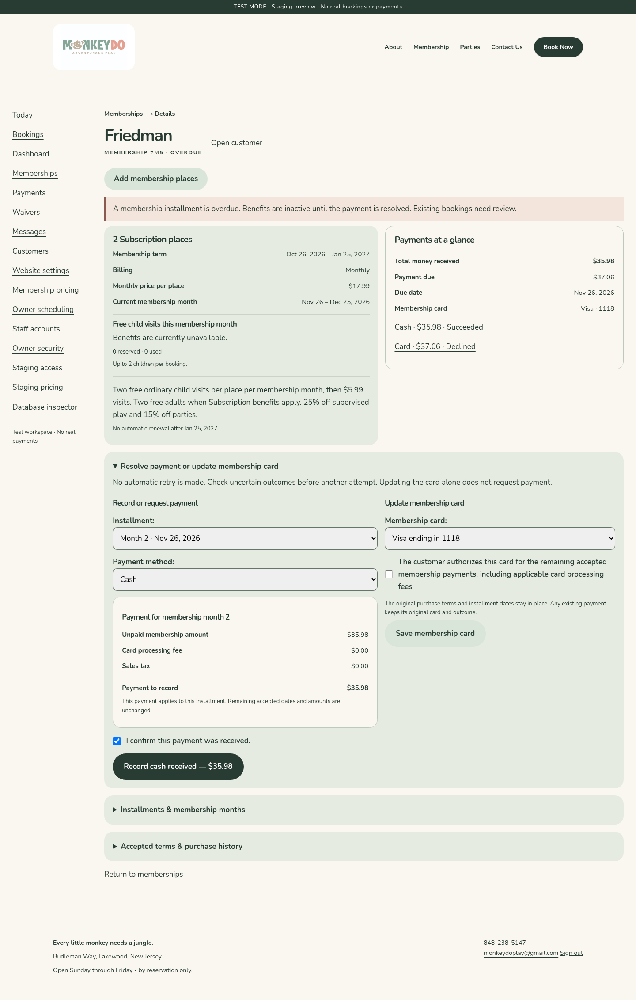](10-installment-cash-desktop.png) | [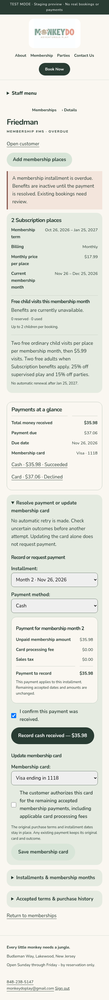](10-installment-cash-phone.png) |

## 11 — Uncertain outcome blocks another collection

The first **$18.53** card outcome is unknown. Received funds remain **$0.00**, benefits stay pending and the previous payment record remains accessible. The payment controls explain that its outcome must be checked first. Another card charge or manual receipt is blocked even after changing the membership card. The collection button is visibly inactive.

| Desktop | Phone |
| --- | --- |
|  | [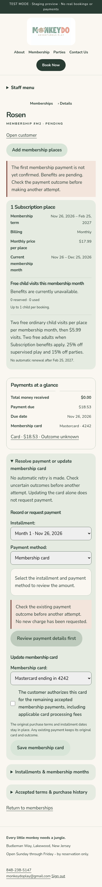](11-uncertain-payment-phone.png) |

## 12 — Installment resolved, benefits active again

The cash-only fictional browser scenario was completed once. **$71.96 total money received** represents two actual **$35.98** recorded cash payments. The failed card attempt remains in history and adds no received funds. Benefits are active again with **four free child visits available** this membership month; the next installment remains **$37.06** on its accepted date. The persistent payment notice clears. No successful-installment customer email is queued.

| Desktop | Phone |
| --- | --- |
|  |  |

## 13 — New card on the combined membership purchase

Choose Enter a new card alongside the same membership, term and **$37.06 due today**. Staff records Yes/No for retaining it for unrelated future visits. **Confirm membership and charge card** securely saves the card first, then submits the explicit purchase once. Card storage and membership acceptance have their own evidence; no booking payment/cancellation consent is fabricated. The new source is restricted to this reviewed purchase unless future use was chosen.

**Provider limitation:** the pictured field area is explicitly labelled **synthetic browser test**. It verifies the surrounding page, nonce handoff and controls. It does not show or verify Banquest's real hosted-field rendering or processor behavior. The end-to-end scenario uses fake provider responses, creates one queued payment and leaves funds/benefits pending. A separate uncertain-save scenario reloads the page without another provider POST or membership purchase.

| Desktop | Phone |
| --- | --- |
|  |  |

## 14 — Verify a private renewal link

An owner/staff-created private link asks for phone number and last name before showing membership details. No staff login or public customer search is exposed. The link lasts 30 days; each verified browser session lasts 20 minutes. Link validity does not extend the seven-day renewal grace rule. The pictured details are fictional, and no private link is published in this gallery.

| Desktop | Phone |
| --- | --- |
| [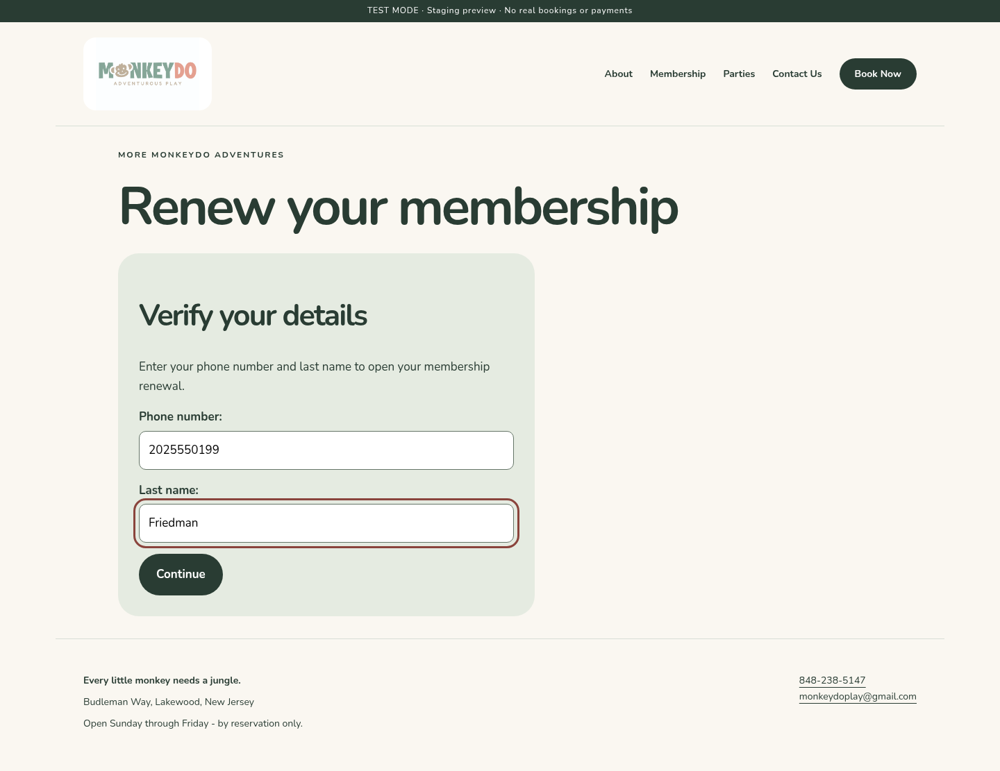](14-renewal-verification-desktop.png) |  |

## 15 — Customer renewal on one page

After verification, the customer reviews membership type, places, term, card, **$82.38 due today** and accepted terms together. Two Unlimited places start after the original Subscription term ends; the original dates and payment history stay intact. The final button explicitly requests the renewal and its card payment. The same form supports new secure-card entry; provider responses in this review are simulated.

| Desktop | Phone |
| --- | --- |
|  | [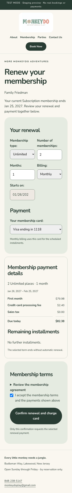](15-customer-renewal-phone.png) |

## 16 — Renewal submitted, payment pending

The fictional browser confirmation creates exactly one customer-accepted renewal and one queued initial payment. **$0.00 received** and the pending message accurately describe that state; no active benefit or completed charge is claimed. Checking status reads the existing result. A second verified browser returns this same renewal instead of collecting again. A separate uncertain new-card save survives reload without another provider exchange or purchase.

| Desktop | Phone |
| --- | --- |
|  |  |

## 17 — Replace a membership card on the overview

Staff can enter a replacement card alongside the existing payment details. The customer’s future-visit Yes/No choice is separate from authorization for the remaining accepted membership payments. **Save and use membership card** saves the source and updates its mandate once; it requests no payment or retry. The fictional confirmation preserves **$71.96 received**, the original installment dates and every earlier transaction’s card. Changing the billing details invalidates an older review.

The field area is visibly labelled **synthetic browser test**. A separate uncertain-save scenario verifies Check card setup and reload do not repeat the exchange or update the mandate. Real Banquest hosted-field rendering remains unverified.

| Desktop | Phone |
| --- | --- |
| [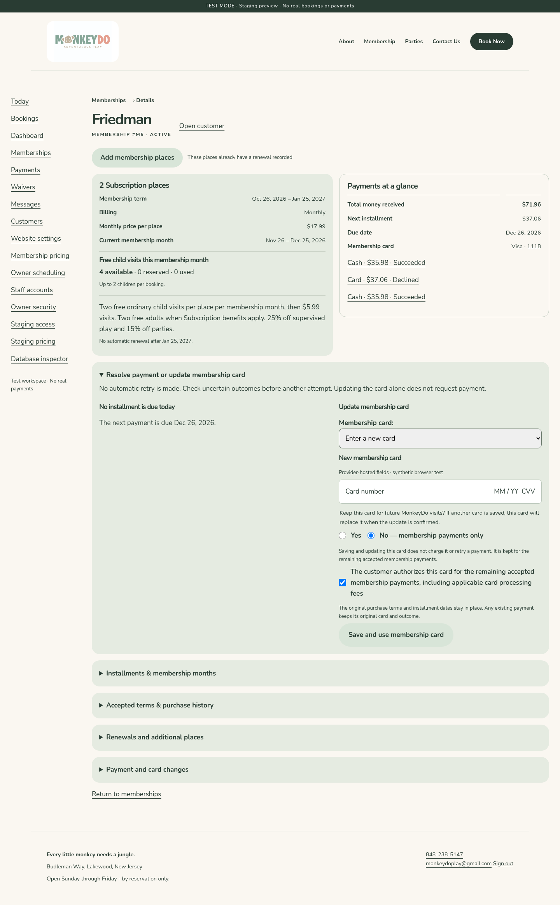](17-replacement-membership-card-desktop.png) |  |

## 18 — Honor reserved benefits for one overdue booking

The owner reviews the existing counts, selects **Honor reserved membership benefits for this booking**, and records a readable reason on the same arrival page. Two child admissions remain covered and **$0.00 is due for this visit**. The membership installment is still unpaid; this is an exception for the reviewed booking/session, preserving normal quota and cancellation-fee rules. It does not grant benefits to other bookings or extend the membership term.

The fictional phone scenario confirms arrival with the first click after typing the reason, records two used benefits and creates no payment operation. Waivers and capacity checks remain in place. The earlier reservation history is retained.

| Desktop | Phone |
| --- | --- |
| [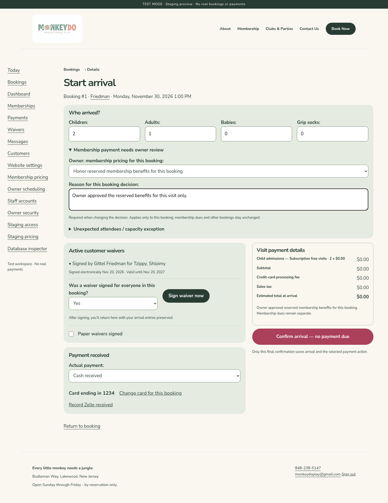](18-owner-honor-benefits-desktop.png) |  |

## 19 — Choose ordinary prices before arrival

On Edit booking, the owner chooses ordinary admission prices and records a reason. Two children cost **$30.00 + $1.98 tax = $31.98**, with cash selected and no card fee. The adjustment explains the change from the saved **$0.00** member price. Ordinary pricing continues to recalculate when counts change. The existing visible capacity, session-blocking and navigation controls stay on the page.

The fictional phone scenario saves this edit and releases the reserved benefits. It collects no money and leaves membership dues unpaid. Save changes and Cancel stay together on the phone layout. These controls are limited to the owner and affected bookings.

| Desktop | Phone |
| --- | --- |
| [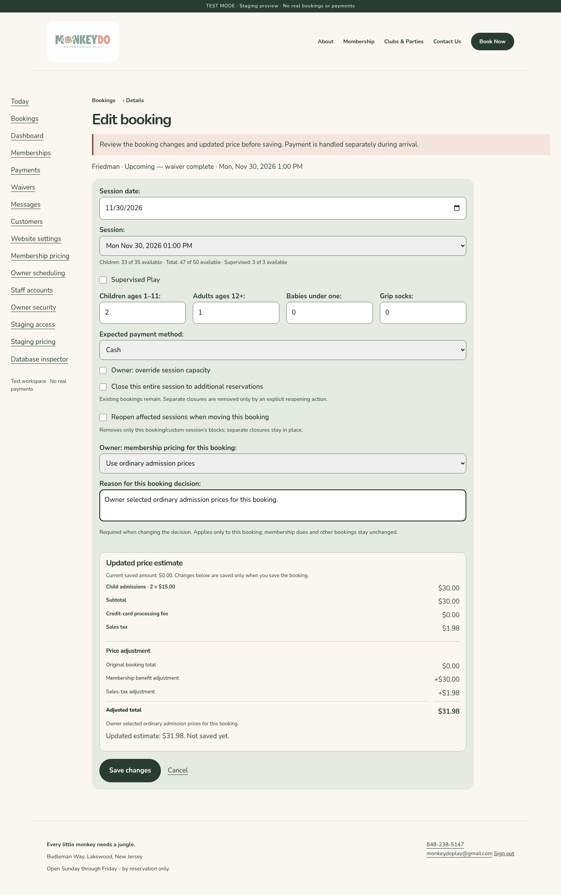](19-owner-ordinary-pricing-desktop.png) | [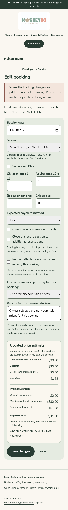](19-owner-ordinary-pricing-phone.png) |

## 20 — Cancel membership on the existing overview

Two prepaid Subscription places originally cost **$215.88** for six months. The owner selects the end of the current membership month, **December 13**, and reviews a suggested **$71.96** unused-period refund. The owner controls the refund amount and explicitly chooses whether to send a cancellation email. Original funds, payment sources, dates and the final action stay together. Initial-commitment cancellation shows an additional owner approval only when needed.

The fictional phone scenario confirms cancellation once and records **refund due**, without claiming any return or requesting a card transaction. Opening or changing the review creates no cancellation. Earlier dues and existing bookings remain separate.

| Desktop | Phone |
| --- | --- |
|  |  |

## 21 — Refund due is separate from money actually returned

After cancellation is recorded, **$71.96 remains due and $0.00 has been returned**. The original receipt remains **$215.88**. Benefits remain available until the selected end when required dues are paid. The owner can record a completed cash return directly here, including a partial amount; the screen requires confirmation that the money was actually returned.

| Desktop | Phone |
| --- | --- |
|  |  |

## 22 — Partial refund, with actual totals

The fictional owner records **$20.00 actually returned in cash**. The overview shows **$215.88 originally received**, **$20.00 in recorded refunds**, and **$195.88 held after refunds**. The approved refund is still **$71.96**, so **$51.96 remains due**. The original purchase and payment evidence remain in history. Recording a return creates no new receipt and no separate later refund email.

| Desktop | Phone |
| --- | --- |
|  |  |

## 23 — Persistent owner Dashboard reminder

The **$51.96** remaining refund links back to the membership. A partial return keeps the reminder; confirmed completion clears it. Bookings whose reserved membership benefits end before their session have a separate review reminder. Cancellation neither cancels those bookings nor silently changes their saved prices.

| Desktop | Phone |
| --- | --- |
|  | [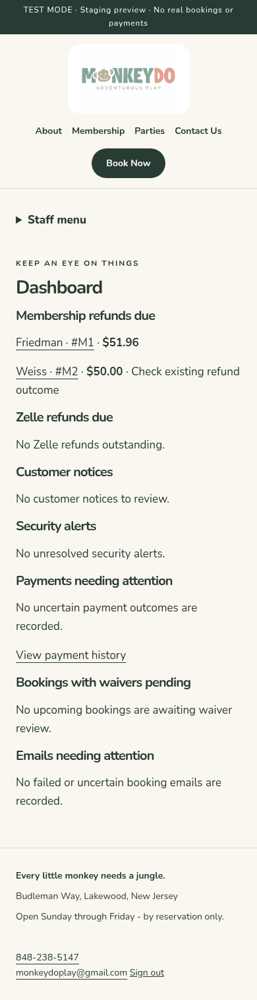](23-refund-dashboard-phone.png) |

## 24 — Requested card refund is still pending

The owner explicitly requests a **$50.00** refund against the original Visa ending **4242**. The screen shows **$0.00 returned and $50.00 still due** until a successful provider outcome is recorded. The original card processing fee is excluded. A pending or uncertain refund blocks another attempt; no automatic retry is made.

This fictional review queues work only. No worker sent the refund to Banquest, and no external funds moved. Gateway behavior is developer-tested using simulated responses; real processor refund verification remains outstanding.

| Desktop | Phone |
| --- | --- |
|  | [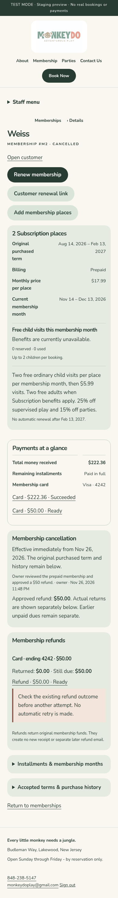](24-card-refund-pending-phone.png) |

## 25 — Record a card refund already completed in Banquest

Synthetic provider evidence reports a **$5.00** external return. The unstarted outgoing refund stops before any provider POST. The owner enters the completed refund reference and confirms it was already returned. **Verify and record completed Banquest refund — $5.00** reads and verifies the existing provider transaction; it sends no new refund. The reference must match the original payment, exact amount and successful refund outcome. Partial imports leave the rest due, and the same provider refund cannot be recorded twice.

These captures stop before verification, using a fictional reference. Developer tests exercise verified import with mock GET responses and assert no refund/void POST. Actual Banquest verification has not been performed. A whole-provider void that includes retained fees needs separate owner correction review; this action does not substitute a void for a net-only refund.

| Desktop | Phone |
| --- | --- |
|  |  |

## 26 — Apply existing customer credit on the membership overview

An unused **$16.02** credit can cover part of a **$17.99** Subscription installment. The same page shows the amount to apply, **$1.97** of membership principal remaining, and **$0.06** in processing fee if that remainder is paid by card: **$2.03**. Changing the credit amount refreshes the review. Only **Apply customer credit — $16.02** spends it; this action collects no money and sends no card charge.

The fictional member already paid **$17.99 cash** for the first membership month. A separate fully paid same-day card visit was reconciled against that same-day purchase, creating credit from the replaced admission. This sample shows that unused credit in the later installment month. The combined purchase-and-conversion checkout and automatic installment producer are still being built; this is an explicit staff application of already recorded funds.

| Desktop | Phone |
| --- | --- |
| [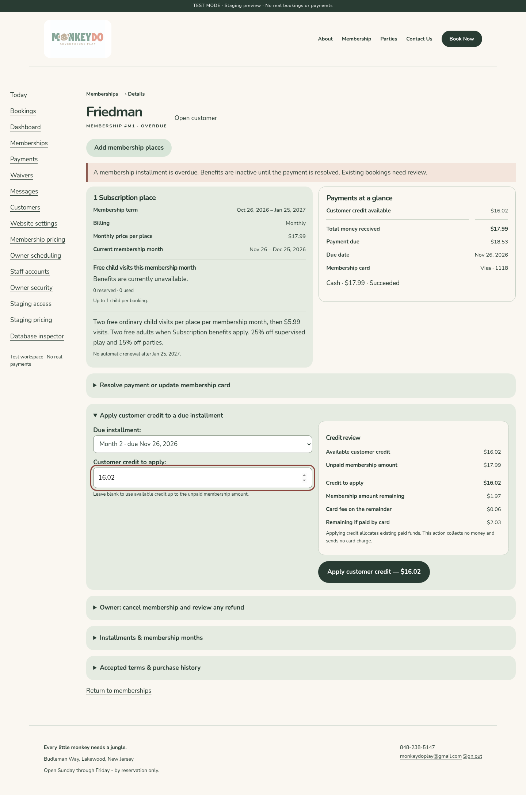](26-customer-credit-review-desktop.png) |  |

## 27 — Credit applied, with the remaining balance still clear

After one fictional confirmation, **$16.02 customer credit applied** is separate from **$17.99 actual money received**. **$2.03 remains due** if paid by card. No second payment was recorded and no payment job was created by applying the credit. The membership remains overdue until its remaining balance is settled. Existing payment controls handle that remainder; the credit does not become another cash receipt.

Developer tests cover full and partial use, exact remaining fees, duplicate confirmations, stale reviews, uncertain payments, and simultaneous spending. Reported source returns hold unspent credit and pause affected funded benefits/collection for owner review, preserving receipts and saved booking prices. Applying credit stops an unstarted request for the old full charge; it cannot race a dispatch that has already started. Returning applied credit during membership cancellation remains a separate unfinished flow, so cancellation of such a term is currently blocked for credit-return review.

| Desktop | Phone |
| --- | --- |
|  |  |

## 28 — Original visit funds and the accountant's card example

The original card receipt is **$16.47**: $15 admission, $0.45 fee and $1.02 combined tax. Reconciliation reverses the replaced admission, its $0.99 tax and the $0.03 tax on the retained fee, making **$16.02 customer credit**. The original **$0.45 processing fee remains**. The booking shows the original receipt and transfer separately, the admission covered by membership, and the exact price adjustment. It records normal benefit usage and preserves original waivers, prices, receipt and tax components.

This source was prepared through the trusted reconciliation service using fictional confirmed funds. It demonstrates reconciliation against an already paid same-day membership. It does not show the still-unfinished combined first-purchase checkout or claim a real Banquest transaction/refund. Unpaid visits create no credit, and the same original funds cannot also be refunded.

| Desktop | Phone |
| --- | --- |
| [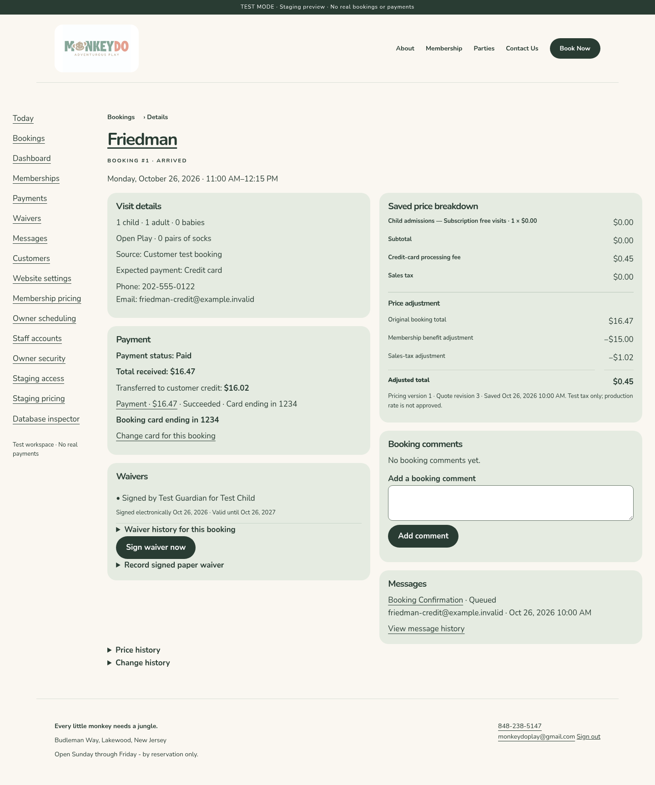](28-converted-visit-funds-desktop.png) | [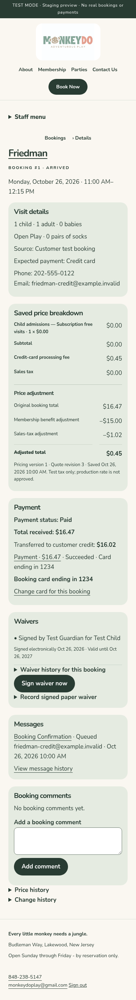](28-converted-visit-funds-phone.png) |

## 29 — Customer credit balance and recent history

The customer page keeps issued/applied credit history and links to the source booking and target membership. After the **$16.02** is used, **$0.00 is available**, with both entries retained. Credit is neither a physical gift-card balance nor new money received. Unspent credit carries beyond membership expiry; a persistent owner reminder identifies credit left from an ended term and clears when spent.

| Desktop | Phone |
| --- | --- |
|  |  |

## 30 — Owner correction with the resulting balance visible

On the existing customer page, expand **Owner: correct unused credit**. This fictional customer has **$16.02** available. Removing **$5.00** leaves **$11.02**. The amount, reason, before/after balances and one final action stay together. Review creates no correction; the owner must confirm. Staff cannot perform this action, and used or source-held credit cannot be removed.

| Desktop | Phone |
| --- | --- |
| [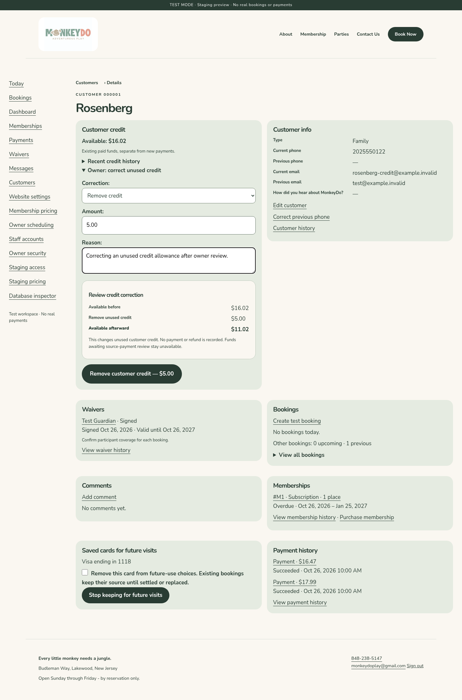](30-owner-credit-removal-review-desktop.png) | [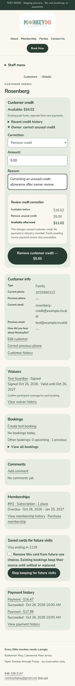](30-owner-credit-removal-review-phone.png) |

## 31 — Removed credit retained in the customer history

After confirmation, **$11.02** is available. The expandable history keeps the owner, time, amount and reason; the full customer history remains accessible. The original **$16.47** card receipt and **$16.02** credit issue remain unchanged. Removing unused credit neither returns money nor changes an already applied amount.

| Desktop | Phone |
| --- | --- |
|  |  |

## 32 — Restore only a specific earlier removal

The owner chooses the earlier **$5.00** removal and reviews restoring **$2.00**, leaving **$13.02** available. Restoration cannot exceed the amount still unrestored from that specific removal or create additional unsupported credit. If the original source later needs payment review, restored funds remain held; they do not become spendable. A second explicit confirmation records the restoration with its own reason and history.

Both fictional actions were completed in browser checks. No external payment, refund or email was sent.

| Desktop | Phone |
| --- | --- |
|  |  |

## 33 — Membership search, status and expiry together

The membership list keeps all history available by default, with one compact filter area for customer/M-number search, type, actual payment status and expiry. Phone/email matching and labelled possible name matches reuse the existing staff search rules. Type/status/date changes apply immediately; text search uses Enter or Apply filters. Clear expiry preserves the other choices. Existing row-size and page navigation remain.

The fictional rows include active, future and overdue memberships. Status filtering uses actual receipts, adjusted obligations and applied credit, with source-held credit shown for review; a saved card or accepted purchase alone is not payment. Scheduled cancellation uses the effective last benefit day while preserving the original end date.

CSV downloads stay collapsed on the same page. Owners have access; staff need an explicitly assigned export permission, plus payment/booking viewing rights for the corresponding report. That export permission is not selected for new staff by default. The staff editor now also preserves normal membership sale/view/update permissions that were already available through the default staff group.

| Desktop | Phone |
| --- | --- |
|  | [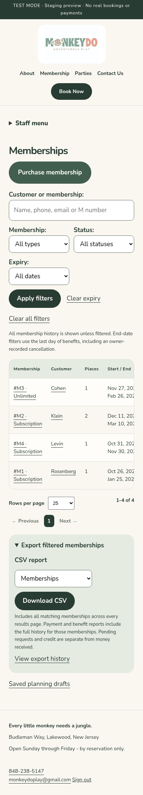](33-membership-list-and-exports-phone.png) |

## 34 — Expiring memberships and a matching CSV

**Active + Next 5 days** narrows the list to the fictional complimentary membership ending **November 30**. The same filters apply to every exported row across all result pages. The downloaded [fictional sample CSV](34-expiring-memberships-sample.csv) contains that single membership; pagination does not limit the export.

The available operational reports are membership details, payment transactions and benefit history. Payment requests retain their outcome and requested amount separately from successfully recorded principal, fee and taxes, with distinct service, manual-receipt, completion and reported settlement dates. Credit applications create no incoming-money row. Benefit history includes each reserved/used/released event alongside its current state. Sensitive card-storage references, signed waivers and staff comments are excluded. These are operational CSVs; final accountant-report presentation remains separate.

| Desktop | Phone |
| --- | --- |
|  |  |

## 35 — Owner export history

Each prepared CSV records its report, exact row count, filters, staff member and New York time. The owner can page through all export history; ordinary staff cannot open this history even when permitted to export. CSV preparation is recorded before returning the download, and untrusted spreadsheet text is protected from formula interpretation. No additional owner password prompt is introduced.

Desktop and phone browser checks actually changed filters and downloaded/read the one-row fictional CSV. No membership, benefit reservation or payment was changed by filtering or exporting.

| Desktop | Phone |
| --- | --- |
| [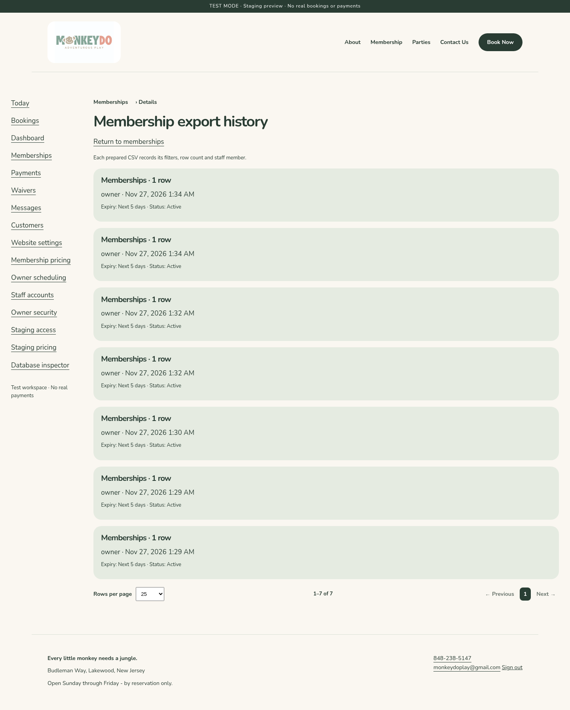](35-membership-export-history-desktop.png) |  |

## 36 — Five days before expiry

The approved expiry wording uses the actual cohort's remaining unrenewed places and end date. The branded **Renew membership** button opens the protected renewal link. It creates no renewal or charge. The owner-removed lapse sentence stays out of this email; the underlying gap/eligibility rule remains.

This fictional snapshot is dated **November 25**, five days before the **November 30** end date. It was rendered from the queued immutable message; no email was sent. The original logo and previously reviewed email design are retained.

| Desktop | Phone |
| --- | --- |
|  |  |

## 37 — One day before the seven-day grace window ends

This fictional cohort ended **November 19**. Its approved notice is due **November 25**, saying the renewal window ends tomorrow, **November 26**. The renewed term starts on the actual renewal date. The link lasts 30 days, while a renewal after the seven-day window normally requires three months; link lifetime does not extend grace or restore benefits during the gap.

Desktop/phone browser checks opened this system-created link without a staff session, confirmed that it revealed no customer details before phone/name verification, and reached the one-month grace renewal selection after matching those details. No card was entered or payment requested.

| Desktop | Phone |
| --- | --- |
| [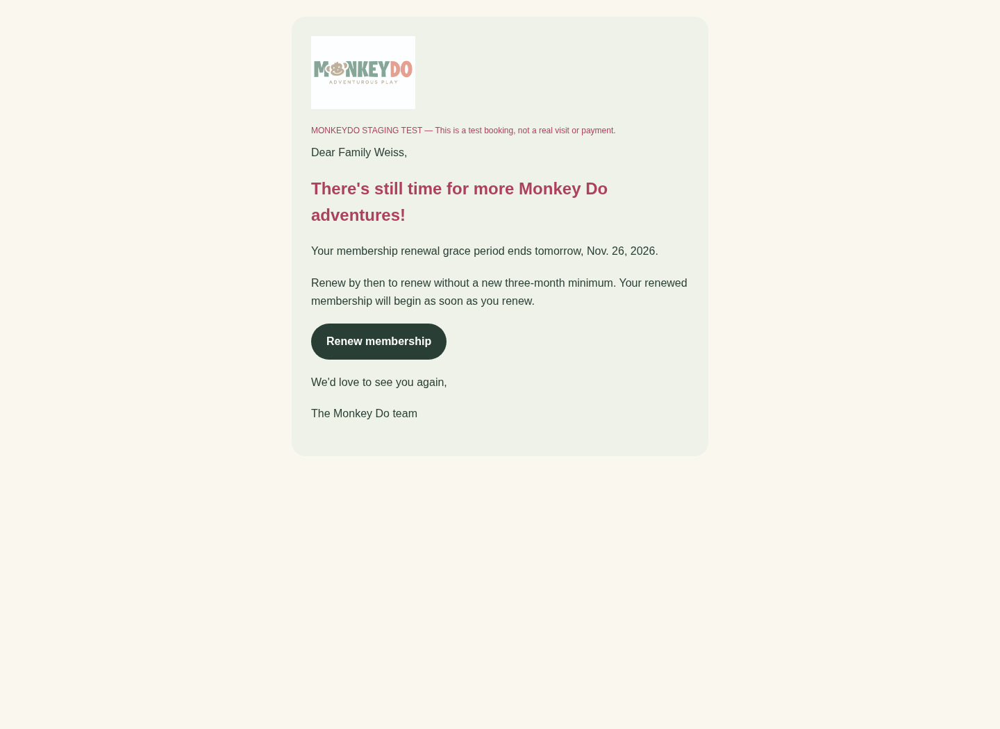](37-grace-email-desktop.png) |  |

## 38 — Notice dates and actual history on the membership overview

The existing overview keeps an expandable **Renewal notices** section with the due dates and actual queued/sent/withdrawn history. Viewing it creates no message. Automated notices have scoped system evidence, with no fake staff attribution. Private verification and explicit customer acceptance still authorize any later purchase.

The bounded producer prepares only the approved due-day notices. It rechecks payment review, current contact, remaining places, cancellation and link validity before dispatch. A partial renewal/contact correction supersedes only an unsent snapshot; full renewal, cancellation or a stale notice day withdraws it. Sent, unknown or failed delivery is not automatically repeated. A known unrecorded original card return also suppresses notice sending. The two approved emails add no appointment reminders or customer failed-installment emails.

| Desktop | Phone |
| --- | --- |
|  |  |

## 39 — Membership payment needs reconciliation

A fictional prepaid membership has **$111.18 in recorded receipts** and a reported **$1 external card return** that has not yet been recorded as a completed refund. The overview shows **Review**, unavailable benefits and the original receipt together. Renewal and further collection wait for owner reconciliation; no zero-dollar collection or paid-in-full claim appears. Existing booking prices and benefit history stay intact.

A return reported after a later charge was queued also stops that charge before any financial provider request. Recording the actual return clears the reconciliation hold, but any resulting unpaid installment still needs resolution. These screenshots use local synthetic evidence; they do not verify a live Banquest return.

| Desktop | Phone |
| --- | --- |
| [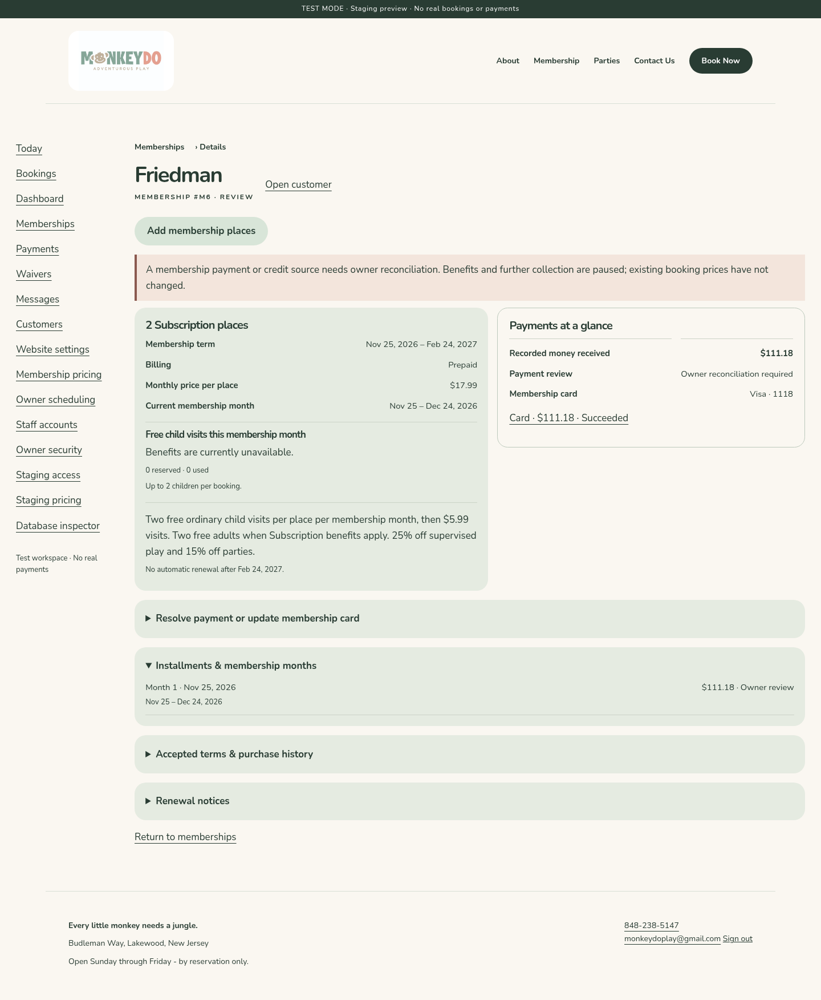](39-membership-funding-review-desktop.png) |  |

## 40 — Owner booking with inline renewal choices

**Renew**, **Not now** and **Email me later** appear beside the customer's existing membership summary. The existing attendee estimate, visible capacity counts, 30-minute temporary reservation, closure/override controls, custom price, waivers, card and final booking button stay on the same page.

Renew opens the existing combined renewal form in another tab. Actual browser checks return to the original page with **2 children and 1 pair of socks preserved**, and the same hold expiry. Opening renewal or choosing a reminder confirms no booking and makes no membership purchase. The card-configuration warning belongs to this isolated review environment; it does not describe the deployed provider setup.

| Desktop | Phone |
| --- | --- |
| [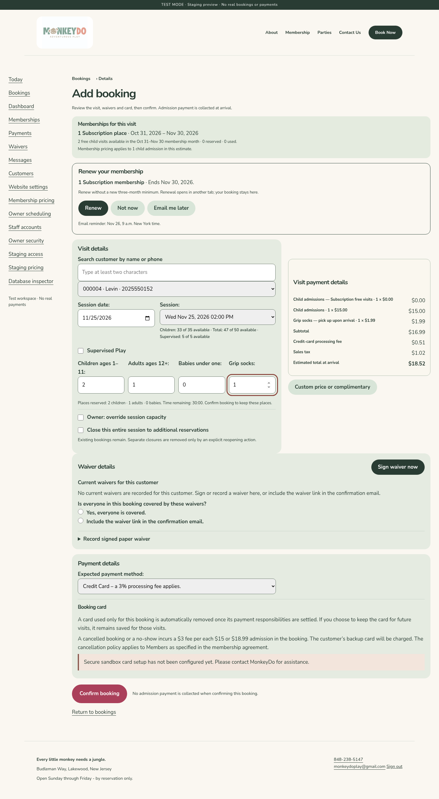](40-booking-renewal-owner-desktop.png) |  |

## 41 — Customer booking near membership expiry

The same optional choices appear within five days of the cohort's expiry. **Not now** does not interrupt booking. That response is remembered across bookings; one further prompt may appear on a later booking at least 30 days after expiry. Displaying a prompt and choosing an action are separate immutable facts. Merely loading a page records neither; the visible prompt is acknowledged by a CSRF-protected request.

A customer who chooses Renew still verifies phone and name on the private renewal page before accessing its checkout. The booking profile proof does not authorize a financial action. The customer booking's existing 20-minute limit stays in place.

| Desktop | Phone |
| --- | --- |
| [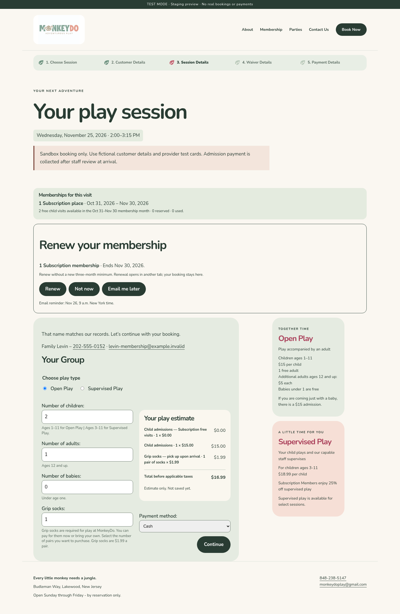](41-booking-renewal-customer-desktop.png) | [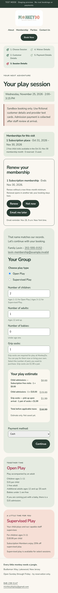](41-booking-renewal-customer-phone.png) |

## 42 — Expired membership and a requested reminder

This fictional membership ended **November 15**, and the review booking is on **November 25**. The page correctly shows a **new three-month minimum**. Email me later requests the next morning, **November 26 at 9 a.m. New York time**, and explains that the reminder does not preserve the shorter renewal minimum. No past expiry-relative reminder date is offered.

The actual phone interaction requests the reminder while leaving the entered counts and socks intact. No visit is confirmed. If an existing profile has no saved email yet, only the validated pending booking email can enable the choice, with an instruction to finish booking; delivery uses the actual saved contact, never an uncommitted address.

| Desktop | Phone |
| --- | --- |
|  |  |

## 43 — Requested renewal email, prepared the following morning

This is the actual frozen email queued from sample 42's request at the following fictional morning, **November 26, 9 a.m. New York time**. It uses appropriate past/future wording and the current three-month minimum, with the protected **Renew membership** button. It was prepared locally and **not sent**.

The private link lasts 30 days from its creation and does not extend the seven-day renewal deadline. Remaining places, payments, cancellation, current contact and link validity are checked again before delivery. Obsolete messages are withdrawn; changed content has a new immutable snapshot. An unknown or failed delivery is not automatically repeated. An isolated reminder-preparation failure does not stop unrelated accepted jobs.

| Desktop | Phone |
| --- | --- |
| [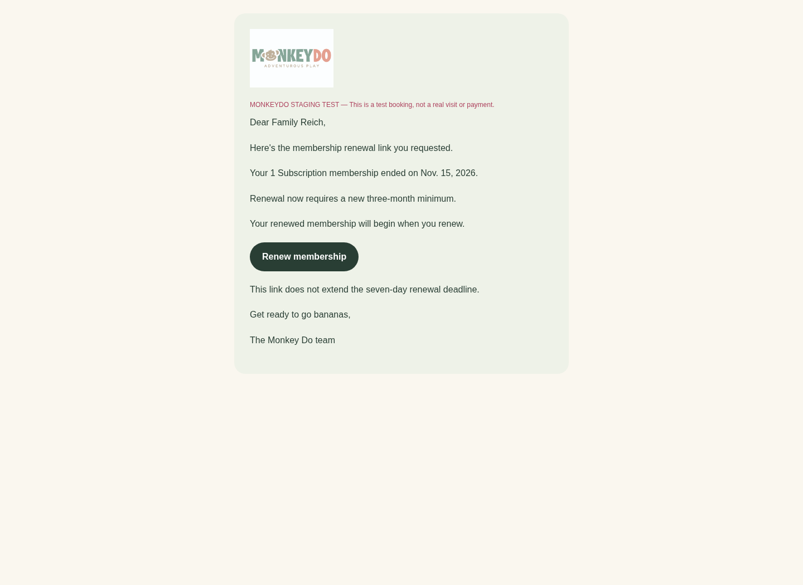](43-requested-renewal-email-desktop.png) | [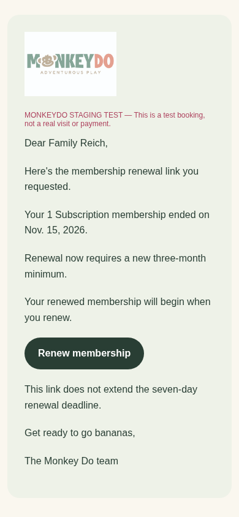](43-requested-renewal-email-phone.png) |

## 44 — Apply existing credit during the initial purchase

The existing combined purchase form now shows available customer credit and a **Use available credit** action. This fictional three-month prepaid Subscription costs **$53.97**. Applying **$13.02** leaves **$40.95 cash due**, with no card fee. The price, credit, remaining payment, receipt confirmation and accepted terms stay on one page. This is use of existing backed credit; it is separate from the still-unfinished combined visit-conversion checkout.

Card-funded balances receive their own fee only on remaining principal. Application tests cover **$17.99 − $16.02 credit = $1.97**, plus **$0.06**, for a **$2.03** new card request. Later monthly installment prices/dates stay unchanged. A credit-funded first month still needs its accepted future card mandate; a fully credit-funded prepaid term needs no card or zero-dollar receipt.

| Desktop | Phone |
| --- | --- |
|  | [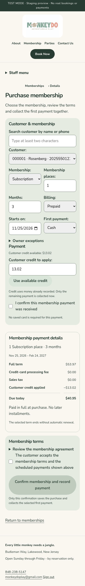](44-initial-credit-purchase-phone.png) |

## 45 — Confirmed purchase keeps credit separate from new money

The actual local browser checkout confirms **$40.95 cash received** and applies **$13.02 existing credit**. The resulting membership is active and prepaid. Its overview shows those amounts separately, rather than claiming another $53.97 receipt. No card or external financial action was involved, and the confirmation email remains queued without delivery.

Changed credit sources, price/terms or card authorization require review before purchase. Concurrent owner credit correction cannot spend the same funds or deadlock a purchase; that is checked with actual PostgreSQL sessions. Unknown card outcomes still wait for reconciliation, and ordinary retries require explicit confirmation. Public private-renewal checkout does not accept unscoped credit input.

| Desktop | Phone |
| --- | --- |
| [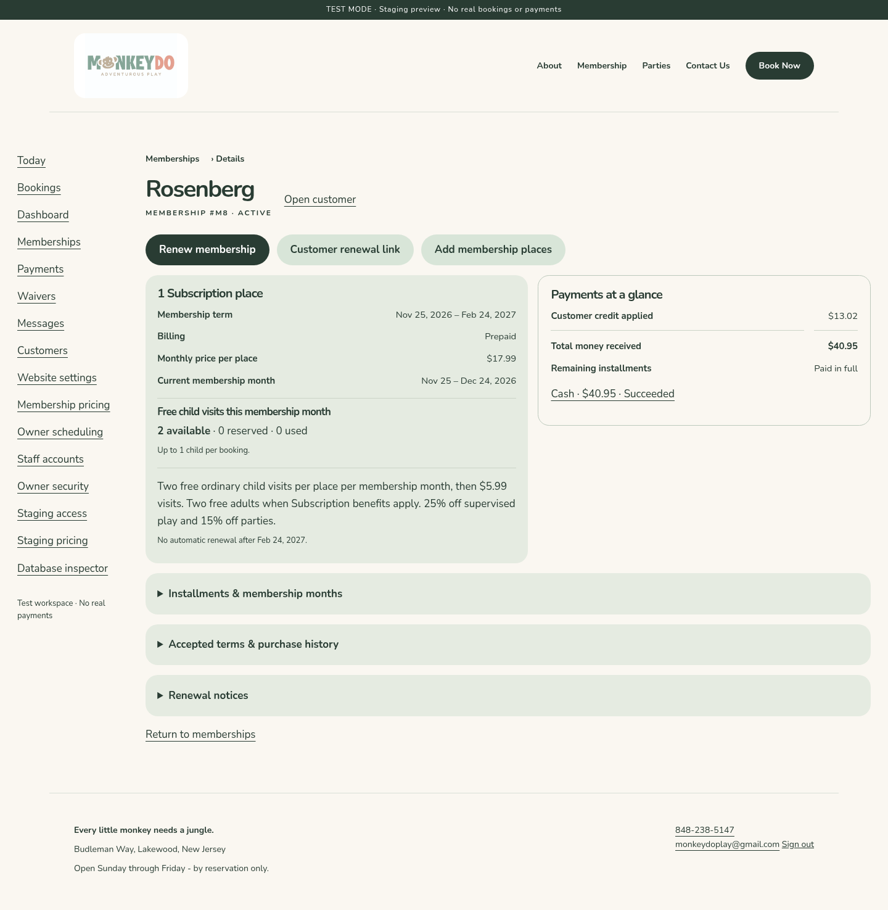](45-initial-credit-paid-desktop.png) | [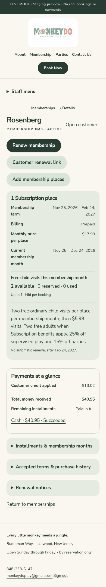](45-initial-credit-paid-phone.png) |

## 46 — Buy a membership and complete arrival together

Three children and two adults arrive without paying admission first. The same page selects two Subscription places, three monthly installments and the accepted future card. Two child admissions and both adults become included. **$35.98 membership + $15.99 adjusted visit = $51.97 cash received today.** The final button records both purchases together; previewing creates no membership, receipt or benefit usage. Existing count, capacity, waiver, paper-waiver and payment controls remain. The credit-funded and positive-first-payment card variants are shown below. Paid-visit first-purchase conversion remains in progress.

| Desktop | Phone |
| --- | --- |
| [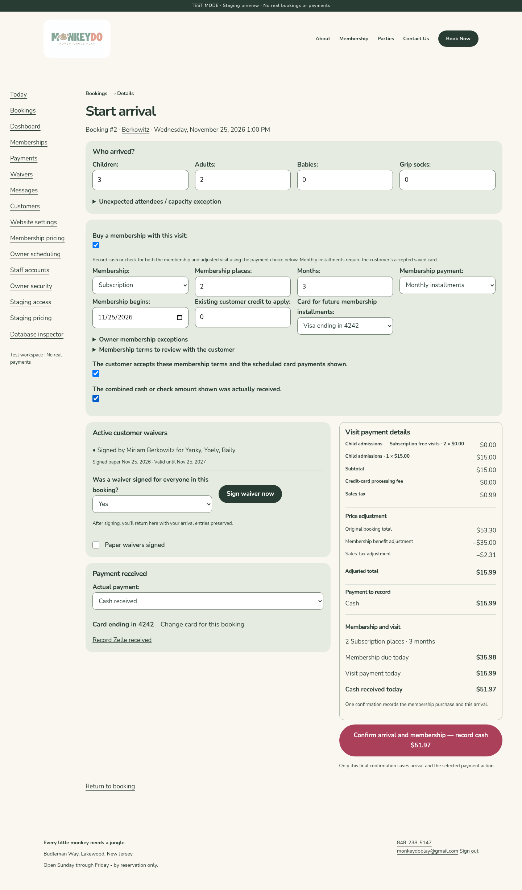](46-combined-membership-arrival-desktop.png) |  |

## 47 — Completed visit links to its new membership

The visit shows its own **$15.99 received**, with the new membership linked immediately underneath. The combined confirmation records **$51.97 new money**, separated into $35.98 membership and $15.99 visit. Membership adult allowances are labelled as benefit adjustments, without claiming adults cancelled. Existing booking history and the earlier booking-confirmation record remain intact.

| Desktop | Phone |
| --- | --- |
| [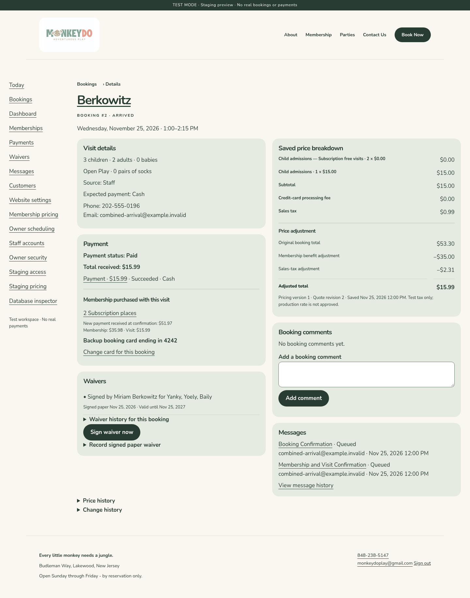](47-combined-membership-completed-desktop.png) |  |

## 48 — One combined membership and visit email

The actual queued fictional confirmation presents the visit, membership, benefit usage, itemized amounts received and next scheduled installment together. There is no Book a visit button for an already booked visit. A normal membership-only email is suppressed only for an accepted combined purchase with its protected pending intent or completed arrival; the combined paid email waits for confirmed funds. This email remains unsent. Earlier Zelle and existing credit, when used, are shown separately from new money; confirmed coverage avoids an unnecessary waiver section.

| Desktop | Phone |
| --- | --- |
|  |  |

## 49 — Existing credit pays membership; card pays the remaining visit

Two children and two adults attend. The first membership month is fully funded by **$17.99 of existing, ledger-backed customer credit**. One child admission remains: **$15.00 + $0.45 card fee + $1.02 tax = $16.47**. One final action purchases the membership and requests only that visit charge. The future monthly card mandate stays explicit. No cash-received acknowledgment or zero-dollar membership card charge is created. A positive first membership card payment is now shown in samples 53–56.

| Desktop | Phone |
| --- | --- |
|  |  |

## 50 — Uncertain visit-card result

The simulated response is uncertain: **$0.00 new money is confirmed**, with **$16.47 requiring review**. The membership's $17.99 credit stays separately recorded. No paid combined confirmation is queued, no replacement collection is allowed, and dispatch cannot repeat the same financial POST. The ordinary booking confirmation in history predates arrival; it is not a receipt.

| Desktop | Phone |
| --- | --- |
| [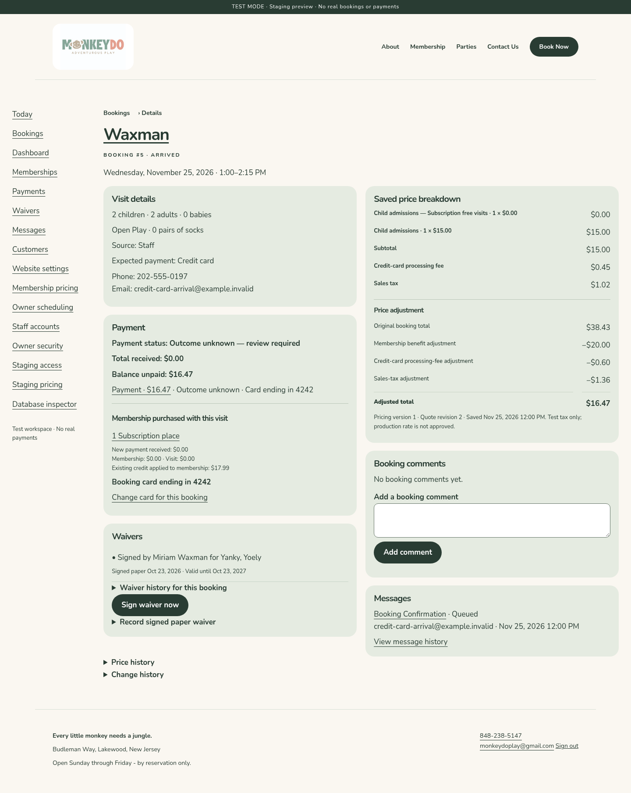](50-credit-card-uncertain-desktop.png) |  |

## 51 — Reconciled payment, without another charge

A mocked provider GET confirms the original transaction. The visit now shows **$16.47 received** and links the membership purchased with credit. Applying $17.99 credit is never counted as new money. This is a local simulated provider result; no actual Banquest financial POST occurred. Superseded unsent message snapshots remain in history; only the current queued version can be sent.

| Desktop | Phone |
| --- | --- |
| [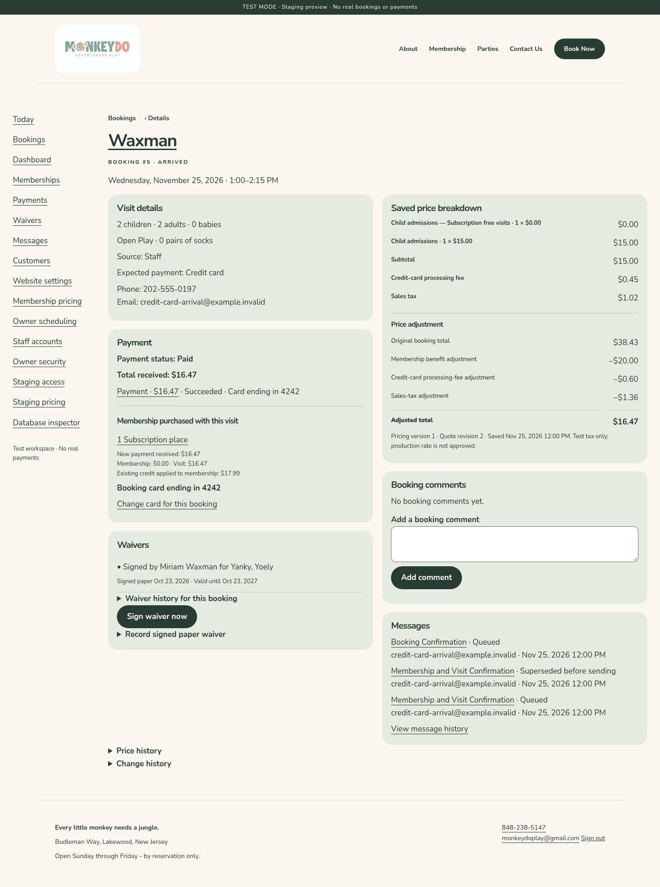](51-credit-card-confirmed-desktop.png) |  |

## 52 — Combined credit/card confirmation

The actual queued, unsent email separates the $17.99 applied credit, $0.00 newly received for membership and $16.47 newly received for the visit. It includes the actual next scheduled installment. Current payment/contact changes supersede an unattempted stale email; attempted or unknown delivery never automatically sends another confirmation.

| Desktop | Phone |
| --- | --- |
|  |  |

## 53 — Review both card payments on the existing arrival page

Three children and two adults attend with two new Subscription places. The first membership month is **$35.98 + $1.08 card fee = $37.06**. The remaining visit is **$15.00 + $0.45 fee + $1.02 tax = $16.47**. The page identifies both cards and the **$53.53 total** before its one final action. Only the membership payment is initially requested; no unpaid membership benefits are used.

| Desktop | Phone |
| --- | --- |
|  |  |

## 54 — Uncertain first payment preserves the reviewed visit

The same arrival URL shows the saved review, **$0.00 membership payment received**, **$37.06 balance**, and that the visit charge has not been requested. Checking status is read-only and cannot retry a card or extend the reservation. The original booking retains its places; extra attendees have a fixed 30-minute reservation. A paid membership and current, unchanged visit are required before continuation. Expired or changed details stop for owner review. Once membership funding is confirmed, the fresh owner review in samples 57–60 can complete the current visit.

| Desktop | Phone |
| --- | --- |
|  | [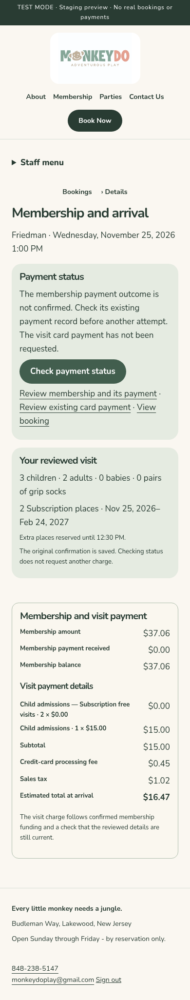](54-membership-first-uncertain-phone.png) |

## 55 — Confirmed funding completes the dependent visit once

GET-only simulated reconciliation confirms the original **$37.06** membership receipt. A separate worker transaction rechecks the accepted visit, capacity, waivers, actor, prices and payment source before requesting its **$16.47** charge. After both fictional approvals, the booking shows **$53.53 new payment received**, split into membership and visit. Replaying acceptance or overlapping completion cannot create another purchase, benefit use or visit charge. A first decline can instead be repaired by an explicit verified payment; the original purchase is retained.

| Desktop | Phone |
| --- | --- |
|  |  |

## 56 — One confirmation includes both actual card fees

The actual queued fictional email separates **$35.98 membership principal**, visit items, **$1.53 combined processing fees**, **$1.02 sales tax**, and **$53.53 received**. Its future monthly schedule remains distinct. No paid confirmation was prepared during uncertainty or before the dependent visit payment succeeded. This email remains unsent; all provider results were simulated locally.

| Desktop | Phone |
| --- | --- |
| [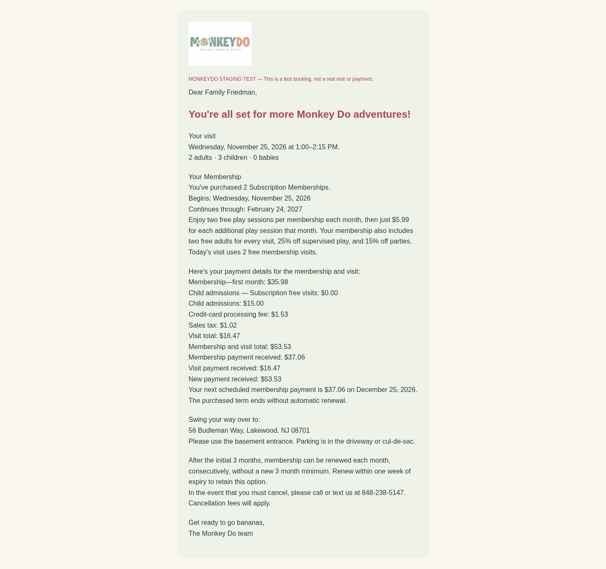](56-membership-first-combined-email-desktop.png) |  |

## 57 — Expired reservation keeps the actual membership receipt

The first membership payment is confirmed, but the original extra-attendee reservation has expired after 30 minutes. The status shows **$37.06 received**, **$0.00 membership balance**, and no visit charge. The owner can choose **Review current arrival**. Opening or checking the status does not renew the reservation, request a payment or buy another membership.

| Desktop | Phone |
| --- | --- |
|  | [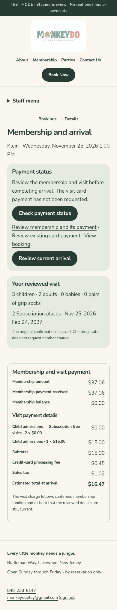](57-expired-arrival-review-phone.png) |

## 58 — Current owner review on the existing arrival page

Starting this explicit owner action pauses the earlier automatic continuation. The same combined arrival page shows the paid membership and dates, current attendee counts, reason, active/paper waivers, price adjustments and payment choice. Two children now attend: both membership admissions are included, and the existing **$3.00 partial cancellation fee + $0.09 card fee = $3.09** remains clearly itemized. The final button approves only this remaining visit payment. Card/waiver returns retain this private draft; the owner rechecks current capacity and coverage.

| Desktop | Phone |
| --- | --- |
|  |  |

## 59 — Re-reviewed arrival retains both payment records

After the synthetic visit approval, the booking shows the revised two-child visit, **$3.09 visit payment**, and **$40.15 combined new money**, including the original **$37.06 membership receipt**. There is still one membership purchase. The new immutable owner approval identifies its current actor, reason, checkout and request; the original accepted intent, actor, terms and receipt remain intact. Change history shows who approved the re-review and why. Competing owners and an old waiting worker cannot create a second visit payment.

| Desktop | Phone |
| --- | --- |
|  | [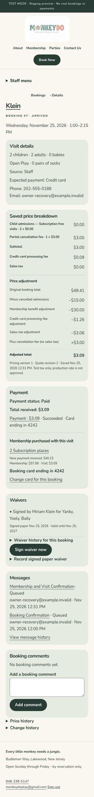](59-owner-reviewed-arrival-completed-phone.png) |

## 60 — Accurate confirmation after owner recovery

The actual unsent confirmation reflects the current two-child visit, unchanged purchased membership, **$3.00 cancellation fee**, **$1.17 total processing fees**, **$0.00 visit tax**, and **$40.15 received**. The earlier $37.06 is counted once. No paid email was prepared before the visit result was confirmed. All records/provider outcomes in this example are fictional; nothing was charged or delivered externally.

| Desktop | Phone |
| --- | --- |
|  | [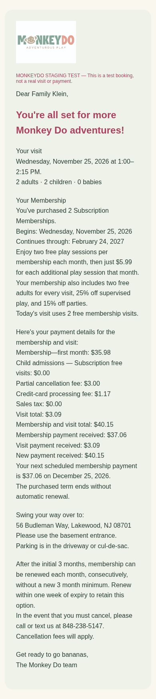](60-owner-reviewed-combined-email-phone.png) |

## 61 — Enter a new membership card on the arrival page

The membership card selector now offers **Enter a new card** alongside available saved cards. The same page retains counts, waivers, the adjusted visit price and final confirmation. Staff records the customer's explicit future-visit Yes/No choice. **No — membership payments only** keeps this card for the accepted membership obligations without replacing the customer's future-visit preference. The hosted inputs here are **visibly labelled provider test doubles**; this screenshot does not verify Banquest's actual field layout.

| Desktop | Phone |
| --- | --- |
| [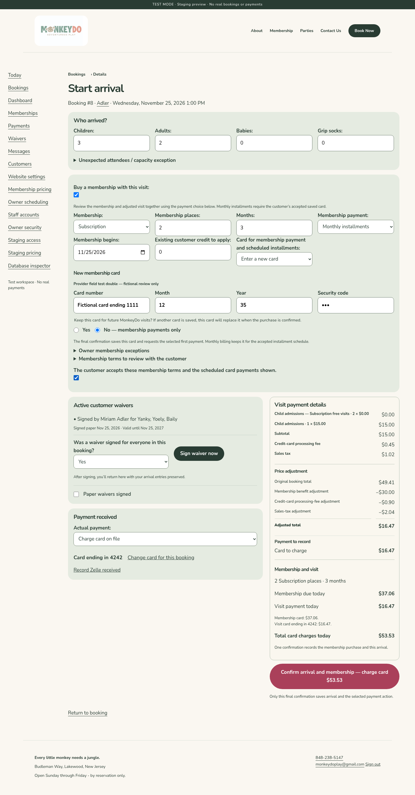](61-arrival-new-membership-card-desktop.png) |  |

## 62 — Uncertain card storage preserves the entered visit

One synthetic card-storage exchange has an uncertain outcome. Reload and **Check card setup** inspect its existing record without another exchange, purchase or payment request. Counts, membership selection, accepted terms and the explicit future-use choice remain on the private arrival draft. The final action stays unavailable while the required card outcome is unresolved.

| Desktop | Phone |
| --- | --- |
| [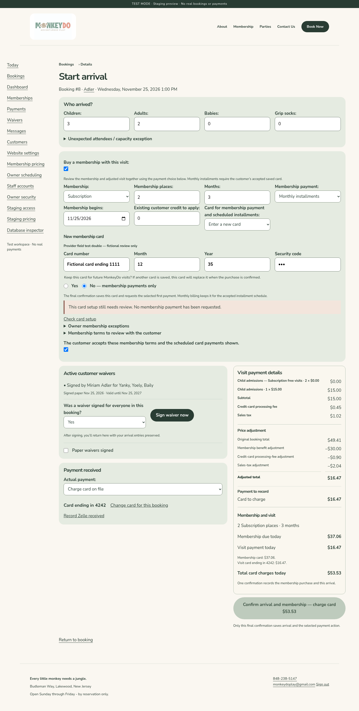](62-arrival-card-storage-uncertain-desktop.png) |  |

## 63 — Saved card ready, with both payment sources identified

GET-only simulated reconciliation identifies the saved card. No membership has yet been purchased and no payment requested. The reviewed page identifies **membership card ending in 1111: $37.06** and the separately authorized **visit card ending in 4242: $16.47**. Only a new explicit final confirmation can proceed. Changing membership terms requires fresh current card authority, using provider reads of the known source rather than exchanging its nonce again. A separate browser exercise changes capacity during that authorization and verifies that no purchase or payment is created; the owner must review the changed visit.

| Desktop | Phone |
| --- | --- |
| [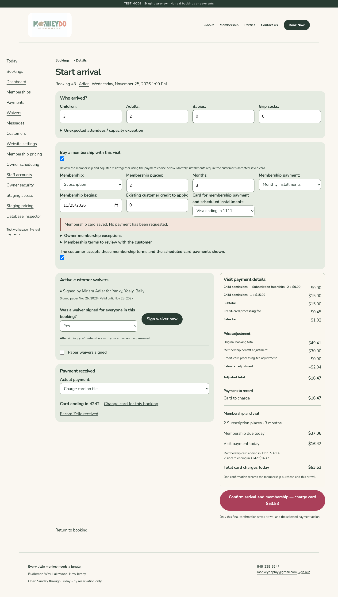](63-arrival-new-card-ready-desktop.png) |  |

## 64 — One purchase, distinct membership and visit receipts

After the explicit final action, the existing staged payment flow requests the membership payment first. Its synthetic success permits the separate visit charge after current facts are checked. The completed booking records **$37.06 membership + $16.47 visit = $53.53 received**, with one membership purchase and one card-storage exchange. The membership keeps card 1111 for its accepted schedule; the visit keeps its original card 4242. The accurate combined confirmation remains queued and unsent. No external card was charged.

| Desktop | Phone |
| --- | --- |
|  | [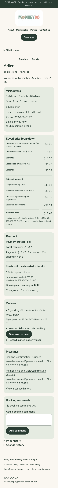](64-new-card-arrival-completed-phone.png) |

## 65 — Known card saved, but its review expired

The original 20-minute card review has ended. The same arrival page retains the counts, selected card and current total while clearing the terms acceptance. A status check reads the existing outcome; it creates no authorization or payment and does not extend the old expiry. The customer must accept the current terms again before the final action can authorize this same known source. Unknown storage remains blocked, and the original browser/customer/actor scope remains required.

| Desktop | Phone |
| --- | --- |
|  |  |

## 66 — Fresh approval, with payment still pending

The explicit fresh review checks the existing card through **one simulated metadata GET**, without a new nonce or storage exchange. The original authorization still expires at **12:20 p.m.**; a distinct current authorization expires at **12:41 p.m.** The confirmed purchase now requests its first **$37.06** payment, with **$0.00 received**. The visit payment remains unrequested until actual membership funding is confirmed. Polling never renews authority, an already recorded purchase cannot obtain another initial checkout authorization, and a changed or missing private scope requires a new reviewed checkout.

| Desktop | Phone |
| --- | --- |
| [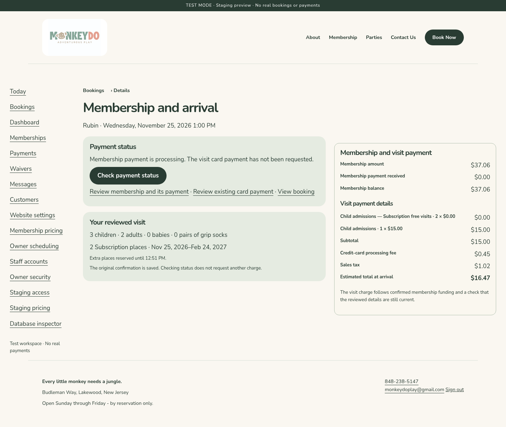](66-fresh-card-review-payment-pending-desktop.png) |  |

## 67 — Customer membership purchase on one page

After the existing phone/name/email verification, the customer reviews membership type, count, term, monthly/prepaid billing, chosen start, card, current price, installment dates and agreement together. This returning fictional family selects two Subscription memberships: **$37.06 today**, with two later scheduled installments. The final action obtains exact card authorization and records one purchase/payment request; it creates no visit or admission hold.

| Desktop | Phone |
| --- | --- |
|  |  |

## 68 — Brand-new customer and new membership card

The same page supports a newly created, verified customer. With no saved card, new-card entry is selected automatically. One Unlimited membership prepaid for three months shows **$119.97 + $3.60 fee = $123.57**. The phone date field spans the form width. The provider area explicitly displays a placeholder: **these screenshots do not verify Banquest's hosted fields or a real card exchange**. Application-level new-customer storage/purchase is separately tested with local gateway doubles.

| Desktop | Phone |
| --- | --- |
| [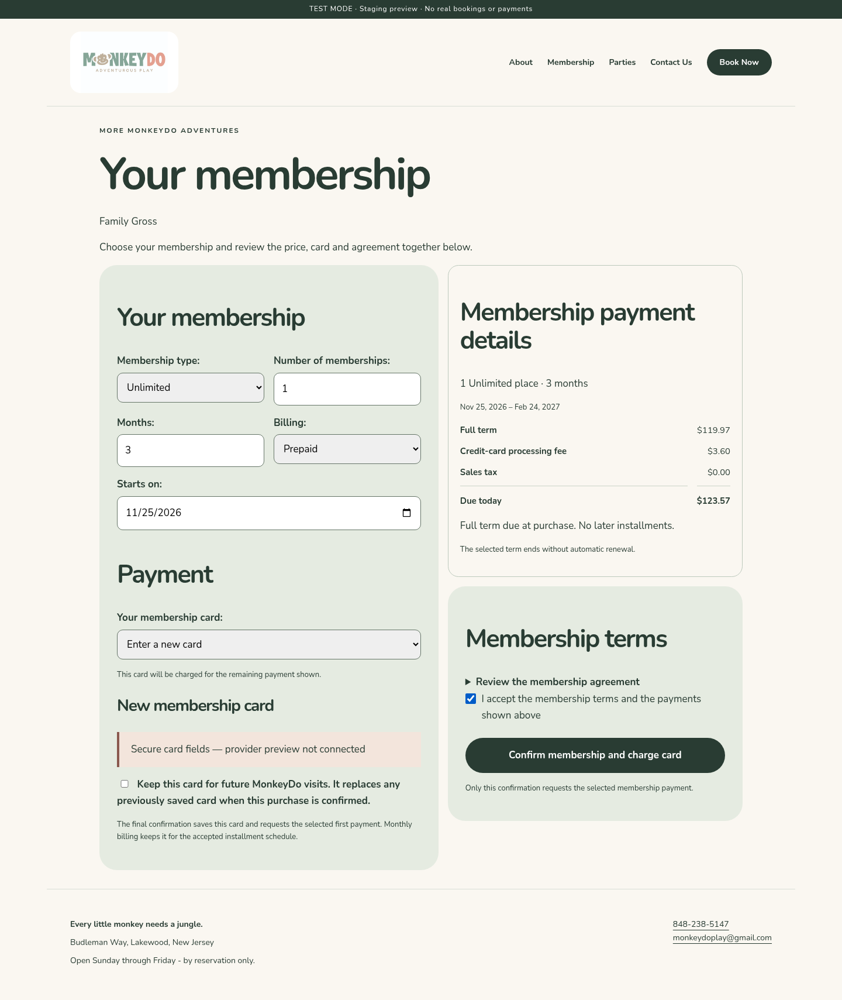](68-new-customer-membership-checkout-desktop.png) |  |

## 69 — Initial payment outcome still needs checking

A simulated uncertain first payment keeps the membership unconfirmed and displays **$0.00 received**. Checking the page does not create another purchase or repeat a charge. The customer is directed to check status or contact MonkeyDo before another attempt; an accepted purchase or uncertain card save cannot be discarded through Start again.

| Desktop | Phone |
| --- | --- |
| [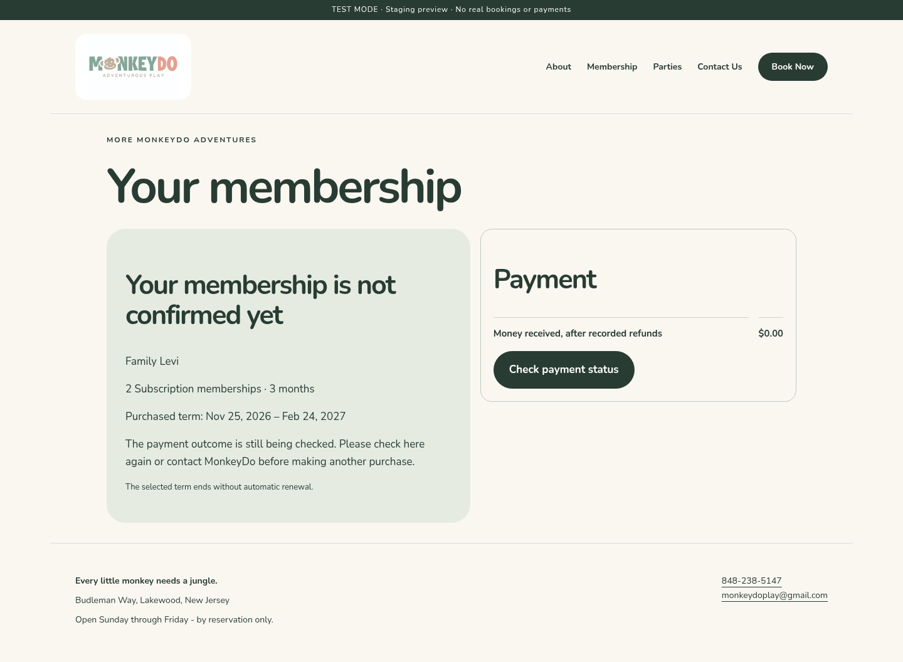](69-public-membership-payment-uncertain-desktop.png) |  |

## 70 — Confirmed membership receipt

A later simulated successful result records **$37.06 once**, confirms the membership and queues one branded confirmation email. The receipt shows the purchased term, actual received amount and Book a visit action. No visit is created by the membership purchase. The outcome and all funds here are fictional; no Banquest charge or email delivery occurred.

| Desktop | Phone |
| --- | --- |
|  |  |

## 71 — Reopen a receipt after checkout verification expires

After the original twenty-minute checkout expires, the same private browser can verify the purchasing customer using **one form: phone plus last name or email**. The receipt remains hidden until those details match the original purchase customer. Existing spelling, previous-phone and conflicting-profile confirmation steps remain available when needed. This verification cannot create a customer, purchase or payment.

| Desktop | Phone |
| --- | --- |
|  |  |

## 72 — Existing receipt reopened without another payment

Fresh verification opens the original receipt, visibly labelled **No new payment was requested**. The fictional $37.06 receipt, accepted purchase, card authorization and original financial deadline are unchanged. Receipt access is separate from payment permission; it cannot save another card, retry a charge or extend the expired checkout. This browser exercise made no provider calls and delivered no email. Lost original private purchase context still requires assistance.

| Desktop | Phone |
| --- | --- |
|  |  |

## 73 — Owner review before an installment request

A fictional unattempted preparation is blocked for owner review. Family, membership, month and due date remain together, with a direct link to the membership and the current **$37.06 card estimate**. **Resume this installment** is available only for a current, eligible, unattempted preparation. It does not bypass an existing declined or uncertain charge. This is a simulated local queue interruption; no installment request was created while viewing the page.

| Desktop | Phone |
| --- | --- |
|  |  |

## 74 — Missed scheduled date uses explicit payment controls

On the following fictional day, the same preparation cannot resume as a catch-up charge. The owner can open the membership's existing payment controls and close the technical task. The page explicitly states that closing it **does not record payment**; the unpaid installment remains due. Both samples are actual GET-only application captures with no new financial record or provider call.

| Desktop | Phone |
| --- | --- |
|  |  |

## 75 — One verified gift card for membership and arrival

The same arrival page shows **$35.98 membership + $15.99 visit = $51.97** paid with a physically presented gift card. One verification covers the combined amount; there is no duplicate cash-received checkbox. Monthly installments still require the separately accepted saved card, while prepaid gift-card purchases need no future card. Changing the amount or including/removing the membership clears the gift verification before another confirmation.

These actual desktop/phone captures use a disposable fictional test database. The browser exercise previewed without creating a purchase, then confirmed once and verified two constituent gift-card receipts with no provider calls. This records a staff-verified tender; it does not claim a gift-card balance service or permit gift cards for cancellation/no-show fees.

| Desktop | Phone |
| --- | --- |
|  |  |

## 76 — Paid membership during an owner-comped visit

The visit remains **$0.00**, and two monthly Subscription places cost **$35.98 cash today**. The existing payment selector offers membership tenders only while Buy a membership with this visit is selected. Removing that purchase restores Owner-comped booking — no payment; adding it again requires fresh acceptance. The phone billing and saved-card fields span the form so their selected text and last four digits remain readable.

The actual disposable-database browser exercise confirms one membership receipt, no visit receipt, no benefit consumption and no provider calls. Separate service checks cover verified prepaid gift-card funding and a simulated $37.06 membership-card payment whose confirmed outcome completes the $0 arrival without a second charge. The original complimentary visit decision, waiver checks and original email remain intact.

| Desktop | Phone |
| --- | --- |
|  |  |

## 77 — Review an available benefit on the original booking receipt

One Unlimited place became available after another booking released it. This customer's original private receipt still shows its saved **$16.47** estimate and offers a reviewed **$0.00** booking price. The updated itemization and original-to-adjusted explanation expand on that page. One clear button confirms the new price; no new waiver, attendee or card form is needed. The booking keeps its already reserved capacity.

Viewing this screen writes no quote or benefit reservation. The original twenty-minute private booking verification is not extended. Another booking taking the benefit, changed verification, staff pricing decisions or started arrival/payment prevent the old review from completing. New customers can use a later funded membership even when their ordinary booking was created without membership metadata.

| Desktop | Phone |
| --- | --- |
|  |  |

## 78 — Confirm the new price without recording a payment or visit

The original **$16.47** quote remains in history. The new quote explains **−$15.00 membership benefit, −$0.45 uncharged card fee and −$1.02 tax estimate = $0.00**. One daily benefit is **reserved**, with attendance and use still pending. The actual browser confirmation preserves the original card binding, waiver record, payment/posting/email counts and deadline. Reloading creates nothing again.

Recorded Zelle is displayed separately from the booking estimate and remains available for staff arrival reconciliation; this action never records another receipt or a completed refund. The unchanged original confirmation stays in history, with no automatic replacement email. Historical ordinary quotes also keep adult allowances distinct from actual cancelled admissions. All data and funds here are fictional; no provider request or email delivery occurred.

| Desktop | Phone |
| --- | --- |
|  |  |

## 79 — Split visit payments and a membership on the same arrival page

Two monthly Subscription places cost **$35.98**, paid by cash. The visit's split rows contain **$10.00 cash**, leaving **$6.17 on the booking card** including its $0.17 processing fee. The combined summary and final button show **$45.98 cash + $6.17 visit card = $52.15**. The accepted card for later membership installments remains separate. Counts, waivers and the existing arrival controls stay on the same page.

Preview creates no purchase, receipt or benefit usage. Choosing physical gift card for the membership shows the verification control even when the visit has no gift-card part; changing the amount or removing the membership clears verification. A positive membership payment requires its own actual tender choice. Splitting that membership payment itself or using recorded Zelle to fund it remains in development.

| Desktop | Phone |
| --- | --- |
|  |  |

## 80 — Actual funds after one combined confirmation

The fictional browser scenario confirms once, initially recording **$45.98 cash** and leaving the **$6.17 visit card pending**. No paid combined email is queued in that pending state. A simulated successful outcome on that same card operation then produces **$52.15 actual combined new funds**: **$35.98 membership + $16.17 visit**. The visit's own cash/card rows remain readable, alongside the linked membership and one queued combined confirmation. No actual provider request or email delivery occurred.

All-manual visit splits, strict gift/Zelle verification, actual Zelle bank dates, earlier recorded Zelle, prepaid membership, fully credit-funded membership and known/unknown visit-card recovery are developer-tested. Repeated or overlapping confirmations cannot create another membership, receipt set or card remainder. Cash/check collected at arrival uses today's date even when a separate visit Zelle part was received earlier.

| Desktop | Phone |
| --- | --- |
|  |  |

## 81 — Separate membership Zelle alongside the visit payment

The same arrival page shows **$35.98 separate membership Zelle + $10.00 visit cash + $6.17 visit card = $52.15**. Only choosing the membership's separate Zelle transfer reveals its bank sender/date and verification. The cash/check acknowledgment is hidden. Monthly future installments retain their accepted card; the visit remainder stays on the booking card.

Staff verifies that these membership funds have not already been recorded for this booking. This does not allocate existing booking Zelle to membership or check a bank account automatically. Actual bank date/sender enter the accepted combined history. Changes clear stale receipt verification; the remaining-balance control preserves any newer typed amount when its response arrives late.

| Desktop | Phone |
| --- | --- |
|  |  |

## 82 — Separate bank funds and the confirmed visit result

The membership's fictional **$35.98 Zelle** keeps its actual **March 8** bank receipt date; the **$10 visit cash** is recorded at arrival on **March 9**. Initially **$45.98** is received and the card is pending. After a simulated successful outcome on the same **$6.17** operation, the page shows **$52.15 combined new funds** and **$16.17 visit funds**, with the separate membership bank details alongside the link. One combined confirmation is queued, with none delivered externally.

Developer checks also cover separate visit/member bank proofs and dates, existing booking Zelle, duplicate submissions, prepaid/card-free membership, full credit, a zero-dollar member visit and atomic rollback. No actual provider or bank request occurred. Reallocation of already recorded booking Zelle and splitting the membership's own first payment remain unfinished.

| Desktop | Phone |
| --- | --- |
|  |  |

## 83 — Apply existing credit on the arrival page

This visit has one included member admission and one ordinary child admission. Staff reviews **$10.00 existing credit + $6.17 remaining card payment = $16.17**. Only that remaining card portion has a processing fee. The original-to-adjusted price, credit, payment choice, waivers and final confirmation stay on the existing page. **Use available credit** caps the chosen amount at the eligible visit balance; changing financial amounts clears an earlier gift/Zelle receipt verification.

This is a review capture: no credit is spent and no visit payment exists yet. The source is a fictional earlier $16.47 card receipt converted through the existing reconciliation service: $0.45 retained original processing fee and $16.02 available credit. That source receipt is not recreated as new money. The completed example below changes the selection to full credit before confirmation.

| Desktop | Phone |
| --- | --- |
|  |  |

## 84 — A fully credit-funded visit is separate from money received

In the same fictional browser flow, staff uses the available-credit shortcut and explicitly confirms **$15.99 existing credit**. There is no new payment, card operation, financial posting or email. **$0.03 credit remains** for future use. The booking shows **Covered by customer credit**, **Total received: $0.00** and **Existing customer credit applied: $15.99**. The original booking estimate stays in history; its uncharged fee/tax adjustments explain the current total.

Ordinary/supervised admission and socks are developer-tested. Recorded visit Zelle applies first; any actual new cash/check/card/gift/Zelle remainder stays separate. Source holds stop new spending and unstarted card dispatch. Simultaneous source use, repeated confirmation, runtime permissions, exact component budgets and migration reversal are guarded. Samples 86–87 add credit alongside partial cancellation fees. Simultaneous new membership/visit credit allocation and credit returns remain in development.

| Desktop | Phone |
| --- | --- |
|  |  |

## 85 — The original private customer receipt shows the reviewed funds

The customer's original verified receipt now shows the reviewed **$15.99 visit total**, **$15.99 credit applied**, **$0.00 new money** and **No remaining visit payment is due**. It does not promise another arrival charge. This is the same original private booking context and deadline, with no public wallet balance or underlying source identifiers. Reloading creates no new application, payment or message, and the original queued booking confirmation remains unchanged in history.

| Desktop | Phone |
| --- | --- |
|  |  |

## 86 — Credit covers admission; the cancellation fee remains payable

Three children were booked and two arrive. One member admission is included. The available-credit action chooses **$15.99 admission/tax credit**, leaving the itemized **$3.00 partial cancellation fee + $0.09 card fee = $3.09**. The adjusted visit total is **$19.08**, with **$0.03 credit left after confirmation**. The card-funded portion is nontaxable, so it has no additional processing-fee tax. Counts, waivers, the price adjustment, credit and remaining payment stay on the original page.

A $10 credit selection instead leaves $9.26 on the card; cash for the full eligible-credit example is only $3. Preview creates no payment or credit application. Earlier recorded Zelle reduces the eligible credit first; it is not a second receipt. The maximum-credit action excludes the cancellation fee rather than filling the entire visit total.

| Desktop | Phone |
| --- | --- |
|  |  |

## 87 — Actual received money after the remaining card result

The same fictional flow confirms **$15.99 credit** and queues one **$3.09 card** request. The booking initially reports **$0.00 received**, with that card pending. A simulated approval of the same operation changes it to **$3.09 received + $15.99 existing credit = $19.08 funded**. The original-to-adjusted price and cancellation fee remain visible. The booking-card obligation closes; future membership obligations and accepted history remain intact. No actual provider request or extra email occurs.

The database still forbids moving credit onto a cancellation-fee line. Developer checks cover every credit cent in this mixed example, exact component totals, safe bank-first allocation, a known decline resolved by $3 cash, malformed funding data, native/JSON caps, unchanged historical pricing and release compatibility. Whole cancellation/no-show fees continue to use the original card/Zelle rules.

| Desktop | Phone |
| --- | --- |
|  |  |

## 88 — Split the membership payment on the same purchase page

Two monthly Subscription places: **$35.98 principal + $0.57 card fee = $36.55 first payment**. The actual received amounts are **$10 cash + $5 check + $2 verified Zelle**, leaving **$19.55 on the accepted card**. Only its $18.98 principal receives a processing fee. Amounts, bank date/sender, source proofs, saved card, terms, current total and final action stay on the existing page. Preview records no purchase or money.

The accepted card also covers later **$37.06** installments on their original dates. Source/amount changes clear old receipt verification and acceptance. Gift-card proof appears only for a positive gift amount. Fully manual prepaid hides the card; prepaid with a positive card remainder still requires its current authority. This sample uses a fictional saved card, with no hosted-field verification or provider call.

| Desktop | Phone |
| --- | --- |
|  |  |

## 89 — Four actual tenders, one membership and its next installment

After one confirmation, the fictional membership initially has **$17 received**, one **$19.55 card request pending**, and pending benefits. A simulated success of that same card operation then gives **$36.55 received**, active benefits and one queued unsent customer confirmation. The overview retains cash/check/Zelle/card amounts, the **October 30** bank receipt date/sender, and the next **$37.06 November 30** installment. Future dates, accepted terms and receipt history are preserved.

Developer checks also cover cash/check/gift prepaid splits, monthly manual-first/future-card rules, backed credit, strict proofs, actual receipt dates, stale reviews, atomic rollback, known-decline recovery, unknown outcomes, source holds, concurrent confirmations/source spending, public rejection, migration reversal and release compatibility. This first-payment split is available on the standalone staff purchase/renewal/addition page. Fully received manual splits also work during arrival (samples 90–91). Samples 94–96 add a membership card remainder with a later visit card; samples 97–99 add received manual visit funds to that sequence. No actual financial POST or external email occurs.

| Desktop | Phone |
| --- | --- |
|  |  |

## 90 — Received membership split and visit on one page

Two monthly Subscription places are funded by **$10 cash + $5 check + $20.98 separately verified Zelle = $35.98**. The visit separately receives **$10 cash** and requests **$6.17 from its booking card**. The combined review shows **$20 cash + $5 check + $20.98 Zelle to record**, the visit card remainder and **$52.15 total**. The membership bank receipt keeps its actual March 8 date; cash/check use the March 9 visit date.

Counts, membership choices, original-to-adjusted visit price, waivers, receipt proofs and the final confirmation stay on the existing arrival page. A private draft reload retains the entered membership and visit amounts. Changing amounts clears cash/bank/gift proofs and requires reviewing terms again. Monthly membership still needs its accepted future-installment card; that card is separate from the booking's visit card.

Samples 92–93 add an explicit allocation of already recorded booking Zelle between membership and visit. Samples 94–96 support a membership card balance when the visit uses only card and/or those prior bank funds. Samples 97–99 also record new manual visit funds immediately while the first membership card is pending. Samples 100–102 add returns/reallocation after confirmed membership funding. Returns before funding is confirmed and terminal unfinished-visit closure remain guarded work.

| Desktop | Phone |
| --- | --- |
|  |  |

## 91 — One purchase, separate received amounts and one combined confirmation

One final confirmation records **$45.98 actually received**, one membership, its three manual receipts and the visit's separate cash/card records. Membership benefits are active because the full $35.98 first payment was received. The combined paid email waits while the $6.17 visit card remains pending. A simulated success of that same operation gives **$52.15 new received funds**, including **$16.17 visit funds**, and one queued unsent combined confirmation. The separate membership bank receipt/date/sender remain visible beside its membership link.

Developer checks cover strict independent cash/bank/gift proofs, old booking Zelle without double counting, backed existing credit, prepaid no-card funding, monthly future-card requirements, stale amount/date/sender reviews, late rollback, concurrent repeated confirmation and private new-card authority. Actual hosted-field rendering and processor outcomes are not verified by this saved-card scenario. No provider request or external email delivery occurs.

| Desktop | Phone |
| --- | --- |
|  |  |

## 92 — Assign recorded Zelle between membership and visit

The fictional customer already transferred **$25** on **March 7**. Staff explicitly assign **$20** of that original receipt to membership, leaving **$5** for the visit. Two monthly Subscription places total **$35.98**, so new membership money is **$10 cash + $5.98 check = $15.98**. The visit totals **$15.99**, with **$10.99 new cash** after its $5 bank allocation. New money to record is **$26.97**; the earlier $25 remains separate.

The amount selection lives on the same arrival page, alongside counts, member choices, original-to-adjusted visit price, waivers, accepted future card and final confirmation. The visit's **Use remaining balance** shortcut subtracts only its remaining $5 bank allocation. Changing the membership bank assignment clears old cash proof/terms. A private draft reload retains the explicit assignment. Review allocates nothing and creates no receipt.

| Desktop | Phone |
| --- | --- |
|  |  |

## 93 — Original transfer once, accurate new funds and reusable bank history

One final confirmation records one membership and **$26.97 new cash/check funds**, and applies the same original $25 once across both invoices. There is still **one original bank receipt**, with **$20 membership + $5 visit** allocations. No additional bank transfer or card charge is claimed. The completed booking separates the $15.99 visit funding, new membership/visit amounts and the prior membership bank allocation, retaining its original date/sender. One combined confirmation is queued, with none delivered externally. Later membership installments keep their original **$37.06** amount and dates.

Developer checks cover exact source/customer/booking/invoice scope, original-date FIFO across multiple receipts, partial/full first-payment funding, stale receipt reviews, atomic rollback, repeated/concurrent confirmation, fresh nonretained future-card authority and unused-balance refunds. PostgreSQL serializes the original receipt budget across allocations and refunds; immutable metadata ties membership use to its accepted first installment and actual combined booking. A used migration/release cannot be reversed into code that loses those source facts. Samples 94–96 extend this original-bank allocation to a first membership card remainder while keeping its bank assignment separate from new receipts.

| Desktop | Phone |
| --- | --- |
|  |  |

## 94 — Split membership receipts and card with arrival

Two monthly Subscription places have **$35.98 principal**. Membership receives **$10 cash + $5 check**; its remaining $20.98 principal attracts only **$0.63 fee**, so the first membership card request is **$21.61** and the membership total is **$36.61**. The separate visit card is **$16.47**, payable only after membership funding. New payments total **$53.08**. Counts, receipts, waivers, both exact card amounts, original-to-adjusted visit price and the final action stay on the existing page.

Preview records nothing. Monthly terms retain the accepted future card and original **$37.06** installments. A partially manual prepaid purchase needs its card only for the remainder; fully manual prepaid hides it. This saved-card sample does not verify real Banquest fields.

| Desktop | Phone |
| --- | --- |
|  |  |

## 95 — Received membership money while its card is pending

One confirmation records **$15 actually received** and queues the one **$21.61 membership card** request. Benefits and attendance remain pending. The separate **$16.47 visit card has not been requested**. Checking status reads the original request; it does not charge again or extend the original thirty-minute extra-capacity hold.

Developer checks also cover $25 earlier booking Zelle assigned as $20 membership/$5 visit, plus $10 new membership cash and its $6.16 card remainder. Prior bank funds and new money remain separate. Restoring the saved intent after a database reload neither subtracts that bank assignment twice nor wrongly rejects its original source identity. An unknown first-card result preserves received funds and blocks replacement collection. A confirmed decline permits explicit remaining-principal collection, removing only the uncharged card fee.

| Desktop | Phone |
| --- | --- |
|  |  |

## 96 — Funded membership, then the separately confirmed visit

A simulated success of that same membership card request makes **$36.61 membership funds** received. Current counts, sources, capacity, waivers and benefits are rechecked before arrival and the **$16.47 visit card** request. The paid combined email still waits for that visit result. Its simulated success yields **$53.08 new funds**, split into **$36.61 membership + $16.47 visit**, and one queued unsent combined confirmation. No actual provider call or email delivery occurs.

Samples 97–99 extend this pending membership-card sequence to new manual visit cash/check/verified Zelle/gift receipts. They are saved immediately and applied once when the same reviewed arrival completes. Samples 100–102 add returns/reallocation after confirmed membership funding; earlier unconfirmed funding and terminal unfinished-visit closure remain in development. Fully received manual membership splits and card-only visits retain their existing paths.

| Desktop | Phone |
| --- | --- |
|  |  |

## 97 — Received visit funds with a pending membership card

The membership receives **$10 cash + $5 check**, with its **$21.61 card** remainder first. The visit separately receives **$3 cash + $2 check + $1 verified Zelle + $1 physically verified gift card = $7**. Only its remaining **$9.26** goes on the visit card after membership funding. First membership total **$36.61**, visit **$16.26**, new combined money **$52.87**. Review creates no purchase, receipt or charge.

The original combined page retains counts, terms, waivers, original-to-adjusted visit price, bank date/sender, independent proofs and one final confirmation. Changing a received amount clears old receipt verification, including visit Zelle when no customer-credit wallet exists. Changed membership payment terms require renewed acceptance; changing only the visit amount does not invent different membership terms.

| Desktop | Phone |
| --- | --- |
|  |  |

## 98 — Actual visit money remains visible before arrival

One confirmation saves **$22 actual funds**, separately **$15 membership + $7 visit**, and queues only the first membership card request. The four original visit receipts survive reload with their source, amount, collecting staff member and original date. Cash/check/gift are dated **March 9**; verified visit Zelle keeps **March 8** and its sender. The pending page and booking identify the received visit funds without claiming active benefits, completed attendance or a paid visit.

A declined, uncertain or expired first-card sequence preserves these receipts and directs the owner to review. It never silently records the same manual money later as another receipt or sends a visit charge before confirmed membership funding. The original thirty-minute extra-capacity reservation remains fixed.

| Desktop | Phone |
| --- | --- |
|  |  |

## 99 — Original tenders applied once, then the exact remaining card

Simulated membership funding permits current arrival validation, applies the four original visit receipts to its invoice once with their original dates, and requests only **$9.26** on its booking card. The paid combined email still waits for that visit result. Its simulated success gives **$52.87 received**, split into **$36.61 membership + $16.26 visit**, with one queued unsent combined confirmation. Source records and invoice applications describe the same funds; they are not counted twice.

Developer checks also combine one earlier bank receipt with new manual visit receipts, preserve source attribution when a different owner completes fresh review, and force concurrent confirmation, late rollback and direct database forgery attempts. **Remaining boundary:** changing these accepted manual amounts, returning them or closing the unfinished visit requires the still-in-progress owner return/reallocation flow. Current checks stop those changes without losing receipts or collecting a replacement. These fictional saved-card outcomes do not verify Banquest hosted fields or processor behavior.

| Desktop | Phone |
| --- | --- |
|  |  |

## Checked so far

The complete **1,456-test PostgreSQL suite passes** (521.824s), including thirteen new source/owner/browser-context cases, three actual PostgreSQL concurrency/reversal cases and one release-compatibility case. Exact original tenders/dates, earlier bank versus new money, owner attribution, source immutability, deferred completeness, rollback, unknown outcomes, all-card membership funding and an entirely received visit are covered. An older test expecting this newly supported split combination to fail has been updated; the final full suite includes its corrected expectation and the additional payment/source edge cases.

The final actual desktop/phone scenario passes in **9.972s**. Four visit sources ($7) and membership manual funds ($15) remain visible while the first $21.61 card is pending; their original dates survive reload. After simulated funding, four source applications and only a $9.26 visit card follow. Final funds total $52.87, with one membership/eight operations and one queued unsent combined confirmation. It checks current proof/terms reset, the explicit pending card remainder, no overflow/JavaScript errors and no bank/provider/storage/nonce/mail requests. All six final samples 97–99 were recaptured and visually inspected.

All **99 desktop/phone pairs**, 198 image links, Ruff/format (527 Python files), model drift, JavaScript syntax, whitespace and **53 reviewed migration hashes** pass. All 52 prior hashes remain unchanged. Used migration/release guards preserve original pending receipt/application evidence. Feature switches remain off and the same PR stays draft. This checkpoint preceded samples 100–102. Returns before confirmed membership funding and terminal unfinished-visit closure, plus the other explicitly listed scope, remain in progress. No merge, deployment or live financial action is included.

## 100 — Record an actual unused visit-fund return

After the first membership payment is confirmed, the owner chooses **Review current arrival or unused funds**. This pauses automatic arrival before any manual return is handled. On that same arrival page, **Record returned visit funds** expands only when usable original receipts exist. It records a return already completed using the original payment method; it sends no bank transfer, changes no gift-card balance and does not refund membership.

The fictional visit originally received **$3 cash + $2 check + $1 Zelle + $1 gift card**. The owner records **$2 actually returned from the original cash receipt**. The original $3 record stays intact, with its collecting staff member and date. The actual return has its own owner/date/history. Changed amount/source/date clears the return confirmation. Before membership funding is confirmed, this action is unavailable.

| Desktop | Phone |
| --- | --- |
|  |  |

## 101 — Review the remaining funds and exact card balance together

Recording the return keeps entered attendee counts on the same page. **Original cash $3, returned $2, remaining $1** appears beside the other original receipts, with **$5 total visit funds remaining**. Received funds apply automatically; **Add another payment** permits genuinely new money above each held amount. Existing verified Zelle/gift funds do not need to be entered or verified again. New amounts require their own verification and actual bank date.

The owner reviews the current **$16.32 visit total** and explicitly chooses **apply received visit funds $5.00 and charge card $11.32**. Returning $2 changes how the visit is funded: its card fee rises from $0.25 to $0.31. The original reviewed $9.26 card amount is no longer authorized. Stale source balances, stale arrival reviews and competing application/return requests cannot reuse the returned money. Original membership payment, term, future installments and original bank receipt dates stay intact.

| Desktop | Phone |
| --- | --- |
|  |  |

## 102 — Completed arrival shows net received money and return history

One arrival confirmation applies **$1 cash + $2 check + $1 Zelle + $1 gift card**, then requests only the reviewed **$11.32 visit card**. After a simulated approval of that exact operation, the booking shows **$16.32 visit received + $36.61 membership = $52.93 received after the recorded $2 visit return**. The return and original source history remain readable. One combined confirmation is queued only after the visit funds are confirmed; none is delivered externally. The fixture also has its original queued booking confirmation.

Repeating the same return or arrival confirmation creates no second return/application. This is an unused, uninvoiced visit-source return during an unfinished arrival. It does not provide ordinary cash change, refund an already completed visit, cancel membership, move money to customer credit or resolve the still-guarded unconfirmed-funding cases.

| Desktop | Phone |
| --- | --- |
|  |  |

## Current unused-fund return verification checkpoint

The final complete **1,476-test PostgreSQL suite passes in 553.752s**, with all final application, schema, template, JavaScript and test changes present before it started. Thirteen new source/native cases, six actual PostgreSQL concurrency/reversal cases and one release-compatibility case cover exact budgets, actual dates, explicit owner pause, partial/full returns, genuinely new same-tender receipts, stale reviews, immutable history, duplicate submissions and private-draft preservation. The final real desktop/phone browser scenario passes in **8.118s**, preserving entered counts, applying four source remainders once and showing $52.93 after a simulated $11.32 visit-card approval and a recorded fictional $2 cash return. All six final samples 100–102 were visually inspected; no overflow, duplicate field IDs, JavaScript errors or external bank/gift/provider/storage/nonce/mail calls occur.

Ruff/format (**532 Python files**), model drift, JavaScript syntax, whitespace, all **204 image links / 102 desktop–phone pairs** and **54 reviewed migration hashes** pass. All 53 prior hashes remain unchanged. The same PR remains draft and membership/collection switches remain off. Returns before confirmed membership funding, terminal unfinished-visit closure and the other listed Stage 3 scope remain in progress. No merge, deployment or live financial action is included.

## 103 — Gift card covers goods and the card covers the cancellation fee

Two children were booked and one arrives. The current visit contains **$15 admission + $0.99 sales tax + $3 partial cancellation fee**. The gift card can cover only the **$15.99 admission/tax**. The cancellation fee remains on the booking card: **$3 + $0.09 processing fee = $3.09**, with no tax on that nontaxable fee or its processing fee. The adjusted visit total is **$19.08**.

**Use remaining balance** fills **$15.99** for the gift row. It also recovers from an excessive $16 entry without including the cancellation fee. Changing a financial amount clears the physical-gift verification; this works even without a membership purchase or available customer-credit field. Counts, waivers, the original-to-adjusted price and one final confirmation remain on the same page. No item allocation is requested from staff.

Cash/check/new Zelle can instead cover the $3 fee without a card charge. Existing credit and gift cards share the eligible admissions/socks balance; neither can cover a cancellation fee. Original recorded Zelle is applied first, separately from new money. A gift-card amount above the remaining eligible balance is refused before any receipt or card request.

| Desktop | Phone |
| --- | --- |
|  |  |

## 104 — Completed visit separates actual gift funds and the fee card

One explicit arrival confirmation records **$15.99 verified gift-card funds** and requests one **$3.09 card payment**. While that card is pending, only the gift money is received. A simulated approval of that exact card operation makes **$19.08 total received**. The payment card lists both sources under the total, and the saved breakdown retains the original estimate, removed admission, tax/fee adjustments and $3 cancellation fee. No processor request, gift-card balance API or external email occurs in this fictional scenario.

The receipt, remaining-payment service and database constraint all refuse a new gift receipt on any cancellation-fee component. The existing single-method remaining-payment page requires another eligible method while a fee is outstanding; gift payment still works when only eligible goods remain. Historical paid gift records stay unchanged, including their original actor/date/allocation. A pending legacy invalid gift request cannot become a successful receipt; existing owner correction of an actual historic receipt through its original tender remains available. No automatic historical correction or ordinary refund program is introduced.

| Desktop | Phone |
| --- | --- |
|  |  |

## Current gift-card fee-scope verification checkpoint

The final complete **1,498-test PostgreSQL suite passes in 546.725s**, with all final application, schema, JavaScript, template and test changes present before it started. Twenty-two new pricing/native/legacy cases cover all fee components, eligible gift/credit budgets, actual source dates and money, partial-cancellation card fee/tax, 1,599 exact gift-cent values, verified receipt refusal, pending source return, remaining payments and historical replay/correction. The final related **101 cases pass in 65.893s**.

The final real desktop/phone browser scenario passes in **5.388s**, recovering an excessive gift entry with the $15.99 shortcut, resetting proof after an amount change and recording one gift receipt plus only the $3.09 card request. The simulated successful card outcome yields $19.08 received. All four final 103–104 images were visually inspected, with no overflow, duplicate field IDs, JavaScript errors or external provider/storage/nonce/gift/bank/mail calls.

Ruff/format (**536 Python files**), model drift, JavaScript syntax, whitespace, **208 image links / 104 desktop–phone pairs** and **55 reviewed migration hashes** pass; all 54 prior hashes remain unchanged. Membership/collection features remain off by default and the same PR stays draft while the separately listed Stage 3 work continues. Actual Banquest hosted fields and processor outcomes remain unverified; no merge, deployment or live financial action is included.

SQLite development-backend limit: full application tests stop during an older renewal-link table alteration because the existing core_membershippublicacceptance_scope trigger references core_membershiprenewallink while that table is being remade. Migration 0081 is not reached in that setup. The new SQLite gift constraint itself passes 18 isolated SQL checks, covering all four fee components, valid goods, legacy pending/final states, original-tender correction and reverse/reinstall. This does not establish complete SQLite application support; PostgreSQL is the fully verified backend for this increment.

## 105 — Stop an arrival and keep the booking and membership

After the first membership installment has a confirmed successful outcome, the owner can pause the unfinished arrival and record any actual returns of its unused visit funds. **Stop this arrival; keep booking** then opens a compact control on that same arrival screen. It names the original booking counts and explains that the membership and its agreed installment schedule continue. A reason and explicit confirmation are required.

Stopping does not cancel the booking, undo the membership, charge a fee, send a refund or record attendance. Only the additional temporary places held for this attempt are released; the original booking capacity and any separate session blocks remain. Unsaved attendee edits are not saved by the stop action. A later arrival starts with a fresh review from booking details. Cancellation and no-show remain explicit separate booking actions.

This fictional example has **$36.61 received for membership**, and all **$7 of unused new visit funds already returned and recorded**. It creates no visit card request or visit invoice. Unknown/unpaid membership funding, a cancelled membership, unresolved funding or unreturned new visit funds continue to block this action. Original unused booking Zelle stays attached to the booking and is not returned or recorded twice.

| Desktop | Phone |
| --- | --- |
|  |  |

## 106 — Upcoming booking with stopped-arrival history

The saved booking still shows its original **3 children, 1 adult and 0 babies**, even though an unsaved baby count was entered before stopping. The payment card has a collapsed **Stopped arrivals** history with the stopping owner, time, reason, membership link and first membership payment received when stopped. Those first-payment funds are separate from visit payments. The same history lists the unused visit funds actually returned before stopping: $3 cash, $2 check, $1 gift card and $1 Zelle. Membership terms, dates, receipts and future installment amounts are unchanged.

The original send-confirmation choice is retained. Where it calls for an email, one membership-purchase confirmation is queued, with no claim that this visit was completed. No email is delivered by this review. Repeated clicks reuse the original stop record; older review tabs, private drafts and queued continuation jobs cannot complete the stopped attempt. A stale status poll returns to the current booking.

| Desktop | Phone |
| --- | --- |
|  |  |

## Current stopped-arrival verification checkpoint

The complete **1,522-test PostgreSQL suite passed in 589.464s**, with all financial, service, schema and recovery-hold changes present. After clarifying the first-payment label and showing returned visit sources in the retained history, the final **37 focused checks passed in 63.790s**, including the actual desktop/phone browser scenario and PostgreSQL overlap/reversal checks. The earlier related 111-case run also passed in 113.766s.

The browser records exactly one stop, leaves the original booking Upcoming at 3 children/1 adult/0 babies, keeps $36.61 in first membership funds and its three existing operations, and creates no visit invoice or new card request. All $7 of unused new visit funds are already returned and remain visible by tender. Only the extra hold is released; one membership-purchase email is queued and no visit-completion email is created. The four final 1440px/390px images were visually inspected. No overflow, duplicate IDs, nested forms, JavaScript errors or external financial/storage/nonce/gift/bank/mail actions occur.

Ruff/format (**541 Python files**), model drift, JavaScript syntax, whitespace, all **212 image links / 106 desktop–phone pairs** and **56 reviewed migration hashes** pass; all 55 earlier hashes are unchanged. All four GitHub checks passed for the preceding 979df52 revision; checks for this new commit run after publication. Membership/collection flags remain off, the PR stays draft and the remaining scope is still in progress. No merge or deployment is included.

## 107 — Unused visit funds with an unconfirmed membership payment

The first membership payment has **$15 confirmed cash/check funds** and an existing **$21.61 card request with an unknown outcome**. Separately, staff already received **$7 for the visit**: $3 cash, $2 check, $1 gift card and $1 new Zelle. Those visit receipts remain independent of the membership invoice.

The owner chooses **Review unused visit funds** on this same page. Arrival is explicitly paused before any return is recorded. The owner then records only an amount actually returned by its original method; here it is **$2 returned from the original $3 visit cash receipt**. The unknown membership card keeps its existing operation and provider reference. No replacement charge, membership cancellation, refund request, attendance, benefit usage or completed-visit email is created.

The original unstarted conditional membership card request must first be handled through its existing payment/purchase controls. The visit-return action does not implicitly cancel it. A request already sending or with an unknown outcome remains for reconciliation. Staff cannot create the owner pause or return, and a stale pause button cannot target another intent.

| Desktop | Phone |
| --- | --- |
|  |  |

## 108 — Return recorded; membership outcome still unconfirmed

The original visit cash receipt stays **$3**, with **$2 returned** and **$1 remaining**. Across the four visit sources, **$5 remains**. Membership confirmed funds stay **$15**, the original card outcome stays **unknown**, and the same three membership operations remain. There is no visit invoice or applied visit receipt yet. The earlier reviewed visit price is labelled as such; an updated price/card balance needs a fresh arrival review after membership funding is resolved.

The browser test later simulates success of that same membership operation. The owner pause remains in place: no visit card request, receipt application or attendance is created automatically. A new owner review can then apply only the remaining original sources and explicitly confirm the revised price. All financial/card/provider outcomes in this gallery are fictional, and no external request or email delivery occurs.

Original booking Zelle stays separately available to its booking. A membership cancellation and its refund due also stay separate: returning unused visit cash does not pay or reduce that membership refund liability. Samples 109–110 add that stop after a recorded cancellation, with its refund liability preserved.

| Desktop | Phone |
| --- | --- |
|  |  |

## Current unconfirmed-payment visit-return verification checkpoint

The complete **1,536-test PostgreSQL suite passed in 593.362s**, with all final application, template and test changes present before it started. Eleven new native cases and three actual PostgreSQL overlap cases cover original receipt budgets, sending/unknown/unstarted outcomes, roles and stale intents, duplicate returns, late funding, first-payment/visit separation, explicit membership cancellation/refund due, original bank balances and return versus continuation. All prior financial/closure/migration tests also pass.

The final actual desktop/phone browser scenario passed in **5.825s**, after the full suite, and captured all four final 107–108 images. All four were visually inspected. It preserves the unknown original membership card/reference and its three operations, records one actual $2 visit return, leaves $5 original visit funds, and creates no visit invoice/application/attendance or customer confirmation. A later simulated success still leaves arrival paused until fresh owner review. No overflow, duplicate IDs, nested forms, JavaScript errors or external provider/storage/nonce/gift/bank/mail actions occur.

Ruff/format (**544 Python files**), model drift, JavaScript syntax, whitespace, all **216 unique PNG links / 108 desktop–phone pairs** and all **56 unchanged reviewed migration hashes** pass. No new schema, runtime grant or capability format is introduced. All four GitHub checks passed for the preceding db38c5b checkpoint; the new commit starts its own checks after publication. Feature switches remain off, PR37 stays draft, and the remaining Stage 3 scope continues. No release, merge or deployment is included.

## 109 — Stop only the arrival after membership cancellation

This membership purchase was separately cancelled before its original card request was sent. Its **$15 cash/check payment remains received and $15 is due back** on the membership record. The owner has already returned and recorded all **$7 of unused visit funds** by their original methods. These two amounts remain separate.

On the same pending-arrival page, the owner reviews **Stop this arrival; keep booking**. It shows the cancellation's effective date and **membership refund due when reviewed: $15**. The checkbox keeps the original booking and explicitly leaves the membership cancellation/refund on its existing record. A reason and final confirmation stop only this arrival attempt. They do not cancel the booking, send a refund, change accepted terms or request another payment.

If there are no new visit receipts, **Review stopping this arrival** still opens the owner's review. If unused visit money remains, actual original-method returns must be recorded first. End-current-cycle cancellations retain their recorded effective date; the screen does not claim they already ended today. Unconfirmed incoming membership receipts still need reconciliation before this stop.

| Desktop | Phone |
| --- | --- |
|  |  |

## 110 — Booking kept; membership refund remains on its own record

The booking remains **Upcoming**, at its original **3 children and 1 adult**. Only the extra temporary arrival hold is released. The **Stopped arrivals** history identifies the recorded membership cancellation, its effective date, **$15 membership refund due when arrival stopped**, first membership payment received, and the already returned visit funds. It links to the membership for the current refund status; the historical amount is not rewritten when a later refund is recorded.

The same **$15 refund liability remains on the dashboard**. No visit invoice, attendance, benefit usage, new payment or refund request is created. A previously queued/sending/unconfirmed membership refund retains its existing operation and remains for separate handling. The original cancellation-email choice stays in place; stopping creates no membership-purchase or completed-visit email. Repeating the confirmation reuses the same stop record.

Samples 105–106 have also been recaptured with the common **Stopped arrivals** history label, verifying that keeping a funded membership still works. The additive cancellation reference preserves earlier stop evidence. Once used, it requires compatible code and refuses schema reversal; it cannot be silently interpreted as a kept membership by older code.

| Desktop | Phone |
| --- | --- |
|  |  |

## Current cancellation-linked arrival-stop verification checkpoint

Final developer verification: the complete PostgreSQL application suite passed **1,555 tests in 630.202 seconds**, with all final application/schema/template changes included. After adding one further test for an already-unknown outgoing membership refund, the final focused run passed **15 tests in 18.126 seconds**, including all 13 cancellation-linked stop cases and both actual desktop/phone browser scenarios. The final test inventory is 1,556; a complete local 1,556-test run is not claimed. Earlier targeted verification also passed 55 related migration, concurrency and compatibility checks. Both browser runs confirm one stopped intent, original booking/counts, released extra hold, zero visit invoices/attendance/provider calls/delivered emails and no overflow, duplicate IDs, nested forms or JavaScript errors. The cancelled scenario retains the $15 membership refund and both dashboard refund plans; the kept-purchase scenario retains its $36.61 funding and one queued, unsent membership confirmation. All eight final desktop/phone images for samples 105–106 and 109–110 were visually inspected. The gallery has 110 pairs/220 unique PNGs. Ruff/formatting (547 Python files), migration drift, JavaScript syntax, whitespace and all 57 reviewed migration pins pass; all 56 previously published migration hashes are unchanged. The previous published commit dc63883 passed all four GitHub checks. Checks for this update will be assessed after publication. Feature/collection switches remain off by default; PR #37 stays draft, with no merge, deployment or live financial/email action.
