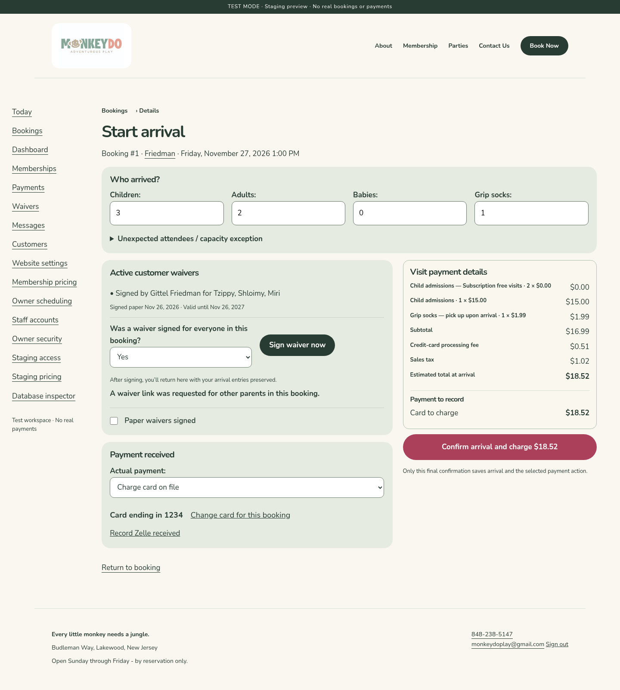
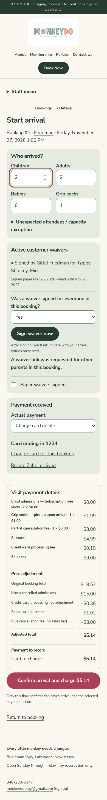
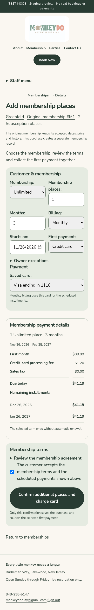
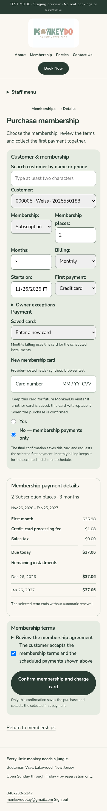
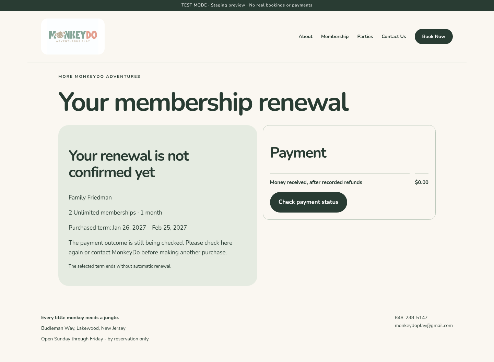

# Active memberships — first functional samples

Draft [PR #37](https://github.com/MonkeyDo-Site/MonkeyDoWebsiteNewCode/pull/37). These are actual application pages with fictional review data, captured at 1440px desktop and 390px phone widths. All names, card references and payment outcomes are synthetic. No card was charged and no customer email was delivered.

These samples cover staff purchase with existing/new cards, the membership overview, member-aware staff booking/edit/arrival, individual-cohort renewals/additions, explicit installment payment resolution and verified private customer renewal. Public new-membership purchase, combined multi-cohort renewal checkout, conversion/credit and scheduled collection are still being implemented. The gallery will grow as those flows become functional; the current samples do not claim those parts are finished. Actual Banquest hosted fields are not verified here; sample 13 visibly labels its provider-field test double.

## 01 — Purchase membership on one page

Customer, membership places, term, payment choice, amount due today, remaining installment dates, accepted agreement and final purchase action stay together. Two Subscription places billed monthly: $35.98 + $1.08 card processing fee = **$37.06 today**. Membership and its fee are not taxable. Changes require reviewing the current terms again. Owner exceptions stay collapsed.

| Desktop | Phone |
| --- | --- |
|  |  |

## 02 — Active membership after confirmed payment

A successful simulated provider outcome records $37.06 received. The overview separates actual money from the next $37.06 installment. Membership dates, current month, saved card, included benefits and available/reserved/used counts are together; installment details and accepted history expand underneath. No automatic renewal beyond the purchased term.

| Desktop | Phone |
| --- | --- |
|  |  |

## 03 — First payment not yet confirmed

One Subscription place: **$18.53 due**. No received funds or active benefits are claimed while the card outcome is pending. The payment record opens from the overview. This sample has not been submitted to Banquest.

| Desktop | Phone |
| --- | --- |
|  |  |

## 04 — Member-aware booking on the existing combined page

Three children, two adults and one pair of socks; two Subscription places cover two children and both adults. One ordinary child admission remains: $15.00 + $1.99 socks + $0.51 card fee + $1.02 tax = **$18.52 at arrival**. Membership information sits above the existing attendee/price, waiver and card controls. Capacity counts, the 30-minute temporary reservation, session blocking, owner pricing and waiver-link choice remain visible. No member benefit is reserved by the unfinished draft itself.

The card setup shown here was simulated. Its configuration warning belongs to the isolated review environment and does not diagnose the deployed Banquest setup. No actual hosted card fields were verified.

| Desktop | Phone |
| --- | --- |
|  |  |

## 05 — Edit member booking

The estimate includes member admissions before saving. A count or timing change recalculates the applicable membership month/day and atomically transfers reservations when saved. Current capacity controls remain in place.

| Desktop | Phone |
| --- | --- |
|  |  |

## 06 — Member arrival

The existing combined arrival page shows two free member admissions, one ordinary admission and socks. Waiver coverage and the selected payment action are reviewed before the single final confirmation. Only confirmation records usage and requests payment.

| Desktop | Phone |
| --- | --- |
|  |  |

## 07 — One fewer child arrives

Two member-covered children attend, along with two adults and one pair of socks. The revised total is **$5.14**: $1.99 socks + $3 cancellation fee + $0.15 card fee. The adjustment explains the original **$18.52**, the **$15 ordinary admission removed**, the fee/tax adjustments and the cancellation fee. No attendance or payment is recorded in these review captures.

| Desktop | Phone |
| --- | --- |
|  |  |

## 08 — Renew existing places

Two Subscription places change to Unlimited after their original term ends. The qualifying one-month renewal starts **February 26**, with **$82.38 due today** including the card fee. The original membership keeps its dates, price and history. The start date is fixed by the original expiry; a partial renewal also leaves the unrenewed places available for a later explicit purchase. Pending card outcomes count toward renewed places so another click cannot sell them twice.

| Desktop | Phone |
| --- | --- |
|  |  |

## 09 — Add places with their own term

One additional Unlimited place costs **$41.19 today**, with the two remaining installments visible. The new place has its own dates and payment schedule; the original two Subscription places keep theirs. The new three-month minimum and the accepted card authorization apply to this purchase. These captures stop before confirmation and do not request payment.

| Desktop | Phone |
| --- | --- |
|  |  |

## 10 — Resolve a declined installment with cash

Two Subscription places have a declined **$37.06** card installment. The same overview shows the actual first **$35.98 received**, the overdue installment and its payment history. Opening the controls keeps the amount and final action together. Choosing cash previews **$35.98**, removing the uncharged **$1.08** card fee for this installment. The owner/staff verifies receipt before recording it. Changing the membership card is alongside this control and requests no charge by itself.

| Desktop | Phone |
| --- | --- |
|  |  |

## 11 — Uncertain outcome blocks another collection

The first **$18.53** card outcome is unknown. Received funds remain **$0.00**, benefits stay pending and the previous payment record remains accessible. The payment controls explain that its outcome must be checked first. Another card charge or manual receipt is blocked even after changing the membership card. The collection button is visibly inactive.

| Desktop | Phone |
| --- | --- |
|  |  |

## 12 — Installment resolved, benefits active again

The cash-only fictional browser scenario was completed once. **$71.96 total money received** represents two actual **$35.98** recorded cash payments. The failed card attempt remains in history and adds no received funds. Benefits are active again with **four free child visits available** this membership month; the next installment remains **$37.06** on its accepted date. The persistent payment notice clears. No successful-installment customer email is queued.

| Desktop | Phone |
| --- | --- |
|  |  |

## 13 — New card on the combined membership purchase

Choose Enter a new card alongside the same membership, term and **$37.06 due today**. Staff records Yes/No for retaining it for unrelated future visits. **Confirm membership and charge card** securely saves the card first, then submits the explicit purchase once. Card storage and membership acceptance have their own evidence; no booking payment/cancellation consent is fabricated. The new source is restricted to this reviewed purchase unless future use was chosen.

**Provider limitation:** the pictured field area is explicitly labelled **synthetic browser test**. It verifies the surrounding page, nonce handoff and controls. It does not show or verify Banquest's real hosted-field rendering or processor behavior. The end-to-end scenario uses fake provider responses, creates one queued payment and leaves funds/benefits pending. A separate uncertain-save scenario reloads the page without another provider POST or membership purchase.

| Desktop | Phone |
| --- | --- |
|  |  |

## 14 — Verify a private renewal link

An owner/staff-created private link asks for phone number and last name before showing membership details. No staff login or public customer search is exposed. The link lasts 30 days; each verified browser session lasts 20 minutes. Link validity does not extend the seven-day renewal grace rule. The pictured details are fictional, and no private link is published in this gallery.

| Desktop | Phone |
| --- | --- |
|  |  |

## 15 — Customer renewal on one page

After verification, the customer reviews membership type, places, term, card, **$82.38 due today** and accepted terms together. Two Unlimited places start after the original Subscription term ends; the original dates and payment history stay intact. The final button explicitly requests the renewal and its card payment. The same form supports new secure-card entry; provider responses in this review are simulated.

| Desktop | Phone |
| --- | --- |
|  |  |

## 16 — Renewal submitted, payment pending

The fictional browser confirmation creates exactly one customer-accepted renewal and one queued initial payment. **$0.00 received** and the pending message accurately describe that state; no active benefit or completed charge is claimed. Checking status reads the existing result. A second verified browser returns this same renewal instead of collecting again. A separate uncertain new-card save survives reload without another provider exchange or purchase.

| Desktop | Phone |
| --- | --- |
|  |  |

## Checked so far

The browser checks confirm no horizontal overflow or JavaScript errors on all sixteen desktop/phone pairs. The complete application suite passes 878 tests. Functional browser scenarios complete a prepaid cash purchase, resolve a declined installment with one cash receipt, perform one new-card purchase and submit one verified customer renewal with simulated provider responses. Changing purchase counts requires accepting the current terms again; unchanged number-field blur no longer discards a completed review. Reloading uncertain card storage repeats no exchange and creates no purchase. Application tests cover immutable purchases/terms, exact-cent non-taxable payments, fixed-term calendar dates, stale quotes, duplicate submissions, uncertain outcomes, owner exceptions, permissions and actual runtime database grants. Two PostgreSQL concurrency tests exercise competing renewal links and repeated submissions from independently verified sessions. The [owner testing guide in progress](../../ACTIVE_MEMBERSHIP_OWNER_TESTING.md) distinguishes current functional checks from the remaining scope.

The first review is about layout and clarity. Implementation and regression testing continue independently while the owner reviews. The final owner testing guide and release package follow completion and explicit release approval.
